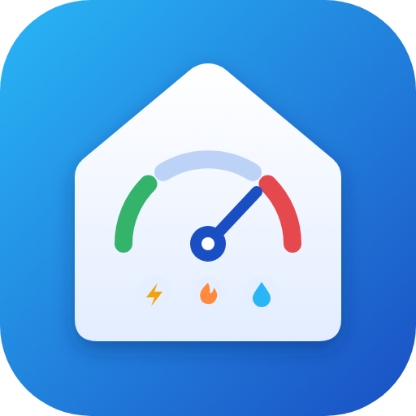
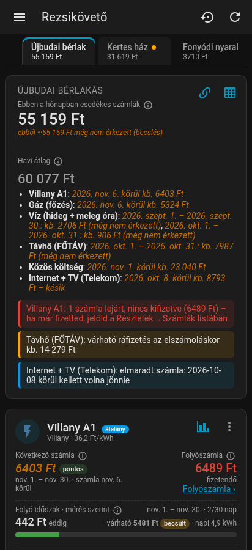
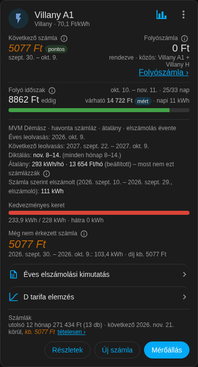
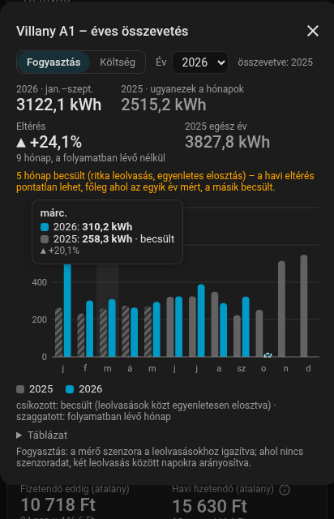

#  Rezsikövető – magyar lakossági rezsi-elszámolás Home Assistanthoz

> [!IMPORTANT]
> **Tájékoztató jellegű számítás, nem helyettesíti a szolgáltatói számlát.** A valódi összeg mindig a szolgáltató számláján szerepel.

A Rezsikövető egy Home Assistant-integráció. A háztartás **villany-, gáz-, víz- és fix díjas** (pl. szemétszállítási) költségeit számolja a magyar lakossági díjszabások szerint, és egy saját oldalon, a **Rezsikövető panelen** mutatja.

A panel négy kérdésre felel: **Mennyibe került? → Mennyi lesz? → Hol tartok a keretben? → Kell-e változtatnom?**

| Összesítő | Fiók kártyája | Éves összevetés |
|---|---|---|
|  |  |  |

## Dokumentáció

| Dokumentum | Kinek | Formátum |
|---|---|---|
| **Telepítési és kezelési kézikönyv** – telepítéstől a hibaelhárításig, mezőnként | aki telepíti és beállítja | [Markdown](docs/KEZIKONYV.md) · [PDF](docs/Rezsikoveto_kezikonyv.pdf) |
| **Képes útmutató** – a mindennapi használat számozott képekkel (A4, nyomtatható) | aki használja | [PDF](docs/Rezsikoveto_kepes_utmutato.pdf) |
| Integráció – műszaki leírás, számlák felvitele | haladó | [Markdown](docs/INTEGRACIO.md) |
| Tervek – adatmodell, díjszabás-formátum, elszámoló motor, ütemterv | fejlesztő | [`docs/terv/`](docs/terv/) |
| Változások | mindenki | [CHANGELOG](CHANGELOG.md) |

## Újdonságok a 2.4.0-ban (2026. november 7.)

- **Értesítés a határidő előtt, hangon is:** a telefonodra szól (Home Assistant mobilalkalmazás), ha egy számla határideje közeleg – alapból 3 nappal előtte, beállítható, ki-be kapcsolható –, és egyszer, ha lejárt és még nincs befizetve. Az Assisttól meg is kérdezheted: *„Van befizetendő számlám?”*, *„Mennyi lesz a következő gázszámla?”*, *„Mennyi a rezsi eddig?”*, *„Hol tartok a keretben?”*, *„Mennyi volt az utolsó villanyszámla?”*. Útmutató: [kézikönyv 7.5.2–7.5.3](docs/KEZIKONYV.md#752-értesítés-a-mobilra-a-fizetési-határidő-előtt-240).
- **Számlakifogás-tervezet az éves kimutatásból:** részletes, szerkeszthető levél mellékletekkel (számlánkénti összevetés, levezetés, folyószámla-egyeztetés, számlajegyzék). Előtte ellenőriz, és ha valami nem jön ki, levél helyett az okot mutatja. Szabály alapú, AI nélkül; tájékoztató, nem jogi tanács.
- **Kedvezményes keret a jogszabály szerinti évre:** áramnál aug. 1. – júl. 31., a H-tarifánál a nyári idény. Az éves kimutatás és az Éves fogyasztás szenzor is ezekre az időszakokra áll, az éves leolvasás csak az átalány elszámolásához tartozik.
- **Év- és idényhatár a mérőállások között (◆):** a számla bontásából számolt állás, innen számol a kedvezményes év.
- **„MVM Áram” egy sorban:** a közös folyószámlás áramfiókok a táblázatokban összevonva. **Diktálás kész jelzése** a Mátrixban és a fiók lapján; a számlanaptárban a diktálási és az éves leolvasási ablak áramnál is.

## Újdonságok a 2.3.0-ban (2026. november 5.)

- **Tablet és mobil: lapozós nézet.** Fiókonként egy lap (Fiókok, a végén a Mátrix), vagy minden fiók témánként egy táblázatban / kártyán (Témák: Számlák, Fogyasztás, Egyenleg, Mérők, Mátrix) – görgetés helyett. Útmutató: [kézikönyv 7.0](docs/KEZIKONYV.md#70-lapozós-nézet-fiókok-és-témák-230).
- **Ismeretlen számla kiolvasása AI-val (kísérleti)** – a személyes adatok kitakarásával, jóváhagyással; az első számlából **saját beolvasó** készül, a szolgáltató következő számláit már AI nélkül olvassa. Útmutató: [AI-os számlaolvasó – részletes leírás](docs/AI_szamlaolvaso.md) és [kézikönyv 9.9](docs/KEZIKONYV.md#99-ismeretlen-számla-kiolvasása-ai-val-saját-beolvasó-230-kísérleti).
- **Mérők:** a saját szenzor szerinti mostani állás; víznél az almérő is; a mérőállások egész számmal; **korrekciós leolvasás** a Mérőállás ablakban (nem diktálás, nem időszakhatár).

## Újdonságok a 2.2.0-ban (2026. november 4.)

- **Számlák e-mailből:** a Rezsikövető maga kiolvassa a postafiókból a szolgáltatók e-mailes számláit (csak olvas, semmit nem töröl), és a számla tartalma – mérő gyári száma, mérési pont, szolgáltató – alapján a jó fiókba sorolja. Beállítás a panelen a **📧 Számlák e-mailből** gombbal, pár kattintással. Útmutató: [kézikönyv 9.8](docs/KEZIKONYV.md#98-számlák-e-mailből--lépésről-lépésre) és [Számlák e-mailből (PDF)](docs/Szamlak_emailbol.pdf).
- **Saját díjak a fiókkártyán:** a víz- és a fix díjas fiókoknál (hulladék, közös költség, internet/TV/telefon) a településenként vagy edényméret szerint eltérő díjak a saját számláról, bruttóban, „érvényes ettől” dátummal – a Fejlesztői eszközök nélkül.
- **A fix díj a számlákból:** ha a havidíjat kézzel nem adtad meg, és a legutóbbi két teljes időszakos számla ugyanannyi, de eltér a beépített díjtól (pl. MOHU), a Rezsikövető a számlák díját veszi át, értesítéssel.
- **A díjeltérés gombjai a kártyán is:** „Ez az új havidíj” / „Egyszeri eltérés – rendben”.
- **Javítások:** MVM-áramszámla 15 jegyű mérőszámmal is (a kimaradt számlák a *Számlák újraolvasása* művelettel olvastathatók be újra); a havi átalány teljes hónapban pontosan jár; a részletező ablakok 10 másodperc tétlenség után maguktól bezárulnak (állítható).

Minden változás: [CHANGELOG](CHANGELOG.md).

## Mit tud

- **Fiókok felületről** (Beállítások → Eszközök és szolgáltatások → Rezsikövető): villany (A1, H-tarifa két regiszterrel), gáz, víz (fő- és locsolási almérővel), fix díjas szolgáltatás. Egy háztartásban tetszőleges számú fiók, több háztartás is.
- **Számlára pontos számítás:** nettó tételsoros díjak ÁFÁ-val, egész kWh-s kedvezményes keret, számlánkénti alapdíj, gáz MJ-ban havi fűtőértékkel. Valódi MVM- és DAKÖV-számlákon forintra ellenőrizve.
- **Villanytarifák az MVM árlapja szerint, mind a négy elosztói területre:** A1, A2 (csúcs/völgy, közös keret), B, B Komfort, B GEO, H (téli/nyári).
- **D (dinamikus) árszabás** az MVM negyedórás rugalmas áraival (automatikus letöltés; a még közzé nem tett napokra a HUPX-árból az MVM képletével számolva), és minden A1 fióknál **D tarifa elemzés**: hónaponként, negyedórás vonalas grafikonon az A1 és a D költsége.
- **Gázmérő nélküli gázátalány** (csak gáztűzhely): havi fix MJ szobaszám és tűzhely szerint (MVM-táblázat), 2,465 Ft/MJ.
- **Dinamikus fiók-varázsló:** csak a választott díjszabáshoz tartozó kérdések.
- **Gáz kedvezményes keret a fizetés módja szerint:** diktálásnál havonta súlyozott (MVM-táblázat, télen több), a kedvezményes évben (aug. 1. – júl. 31.) halmozva; átalánynál éves. Lakossági (20 m³/h alatti és feletti mérő) és fogyasztói közösségi díjszabás az MVM árlapja szerint.
- **MVM sávkorrekció:** a kedvezményes keret (mérőnként 2 523 kWh/év, napi arányosan) az A1, a B (vezérelt) és a H-tarifa nyári (1.82) regiszterén jár, felette lakossági piaci ár. A keret áramnál a kedvezményes évben (aug. 1. – júl. 31.) halmozódik: a korábban ki nem használt keret később jóváíródik, de a következő évre nem vihető át; a H-tarifa nyári regiszterén a nyári idényben jár. Az éves leolvasás a keretet nem nullázza. A H-tarifa téli (1.81) fogyasztására nincs keret, és a keretbe sem számít bele.
- **Átalányos (részszámlás) fiókok:** havi fizetendő, „ha ma lenne az elszámolás”, várható éves/félévi egyenleg, az átalány összevetése a valódi fogyasztással.
- **Többhavi, utólagos számlázás:** kéthavi víz (DAKÖV), negyedéves szemétszállítás (MOHU). Víznél a folyó időszak (fogyasztás, várható díj) is a számlázási időszak.
- **Számlák** automatikusan egy mappából (pl. a Díjnet-integráció letöltései), e-mailből, feltöltéssel a panelről (PDF/XML), bemásolással vagy kézzel. Felismeri: MVM Next áram és gáz, DAKÖV, ALFÖLDVÍZ, HVSZ (távhő), MOHU, Magyar Telekom, One.
- **Éves összevetés grafikon:** a kártya grafikon-ikonjára felugró ablak – havi fogyasztás vagy költség az előző év ugyanazon hónapjaival, összesítéssel és táblázattal. Ritka (pl. éves) gázleolvasásnál a havi bontást egy profil-szenzor (pl. a kazán becsült gázfogyasztása) adja.
- **Automatikus mérő-korrekció:** a szenzor (pl. Shelly) és a valódi óra eltérését a leolvasásokból becsli és kiigazítja; a kézi eltolás-ugrást nem veszi fogyasztásnak.
- **Automatikus kezdőpont:** üresen hagyott kezdőállásnál a szenzor HA-statisztikájából, ennek hiányában a mostani értékéből indul – mesterséges 0 óraállás nélkül.
- **Napelem (kísérleti):** bruttó és szaldó elszámolás – valódi napelemes számlákkal még ellenőrizendő.

## Telepítés feltételei – mit kell előre telepíteni

| # | Mit | Honnan / hogyan | Kötelező? |
|---|---|---|---|
| 1 | **Home Assistant 2025.6** vagy újabb | Beállítások → Rendszer → Frissítések | igen |
| 2 | **Recorder** (adatbázis, statisztikával) | alapból be van kapcsolva | igen |
| 3 | **Mérőállás- vagy fogyasztás-szenzor** közművenként, hosszú távú statisztikával (`state_class: total_increasing`): pl. Shelly EM / Pro EM, P1-olvasó, Zigbee mérő, gázóra-impulzusolvasó | a mérő integrációja | erősen ajánlott – nélküle csak a leolvasásokból számol |
| 4 | **[HACS](https://hacs.xyz/)** | https://hacs.xyz/docs/use/ | ajánlott (telepítés, frissítés) |
| 5 | **Díjnet-integráció** | HACS | nem – a számlák automatikus letöltéséhez |
| 6 | A **legutóbbi számláid** (legalább egy) | a szolgáltatótól / Díjnetről | ajánlott – mérő gyári száma, fizetés módja |

## Telepítés

### HACS-szal

1. HACS → jobb felül ⋮ → **Egyéni tárolók** → tároló: `https://github.com/Gyuszko55/ha-energia-elszamolas-hu`, típus: **Integráció** → Hozzáadás.
2. A Rezsikövető oldalán **Letöltés**, majd **indítsd újra a Home Assistantot**.

### Kézzel

1. GitHub → **Code → Download ZIP**.
2. A `custom_components/hu_rezsi` mappát másold a Home Assistant `config/custom_components/` mappájába (Samba, File editor vagy Studio Code Server). Frissítésnél a régi mappát írd felül.
3. Indítsd újra a Home Assistantot.

### Első beállítás

1. Beállítások → Eszközök és szolgáltatások → **Integráció hozzáadása** → **Rezsikövető** → a háztartás neve.
2. **Fiók hozzáadása** szolgáltatásonként: közmű, szolgáltató, díjszabás, a mérő gyári száma, a mérőállás-szenzor, és ha van, a Díjnet számlamappája. A kezdőnap és a kezdő óraállás üresen hagyható – ilyenkor a szenzorból veszi.
3. Nyisd meg a bal oldali menüben a **Rezsikövető** panelt, és töltsd fel a legutóbbi számláidat.

Részletesen, mezőnként: [kézikönyv, 4–5. fejezet](docs/KEZIKONYV.md#4-első-beállítás-háztartás-és-fiókok).

## Átállás a v1 YAML-csomagról

A korábbi v1 YAML-csomag (villany- és gáz-elszámolás) **ebben a tárolóban már nem szerepel**; a Rezsikövető az utódja, és át tudja venni a v1 adatait (leolvasások, lezárt hónapok). Lépések: [kézikönyv, 14. fejezet](docs/KEZIKONYV.md#14-átállás-a-v1-yaml-csomagról). A v1 utolsó kiadása továbbra is letölthető ennek a tárolónak a kiadásai közül: [`v1.0.0`](https://github.com/Gyuszko55/ha-energia-elszamolas-hu/releases/tag/v1.0.0).

## Készítők

- **Gyuszko55** – ötlet, tervezés, a Rezsikövető integráció
- **Krissz55555** (Krisztián) – társszerző, a Rezsikövető integráció közreműködője

## Licenc

MIT. Használd, alakítsd át szabadon, garancia nélkül. A számítás tájékoztató jellegű, nem helyettesíti a szolgáltatói számlát.
