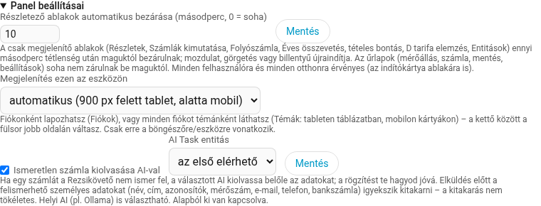
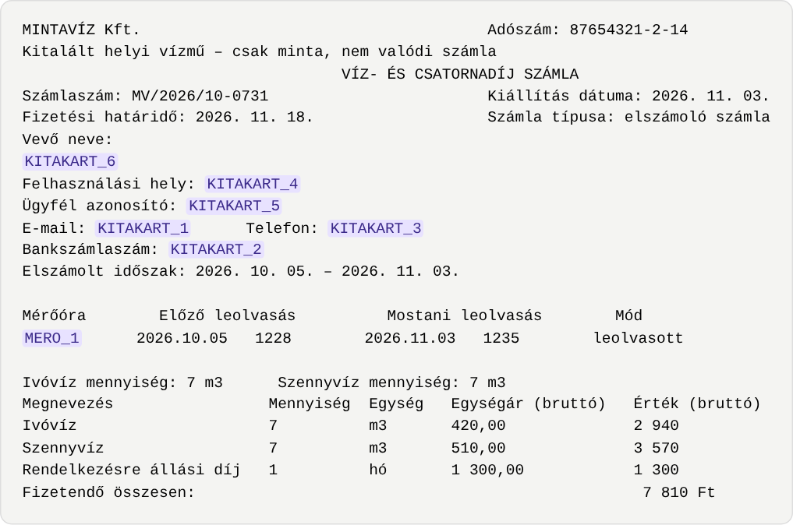
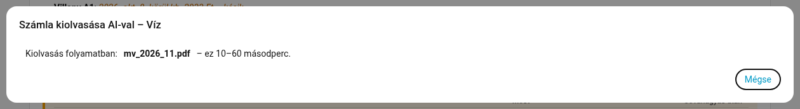
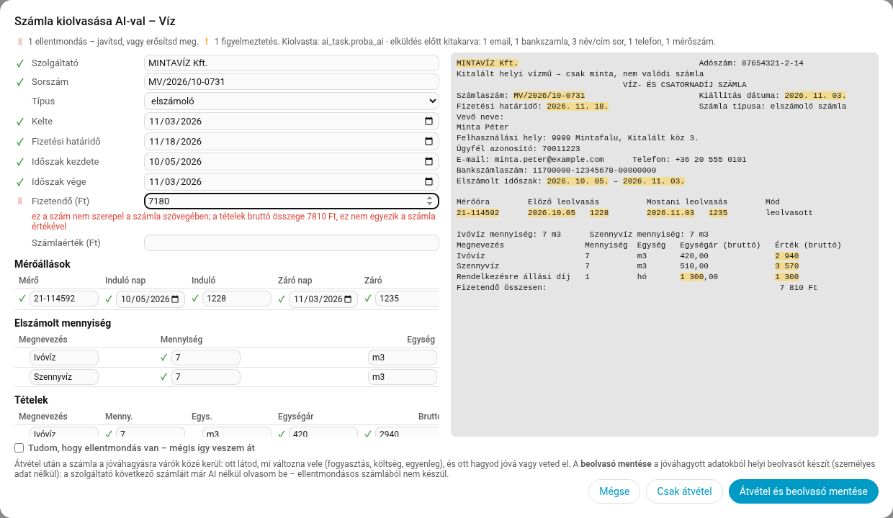
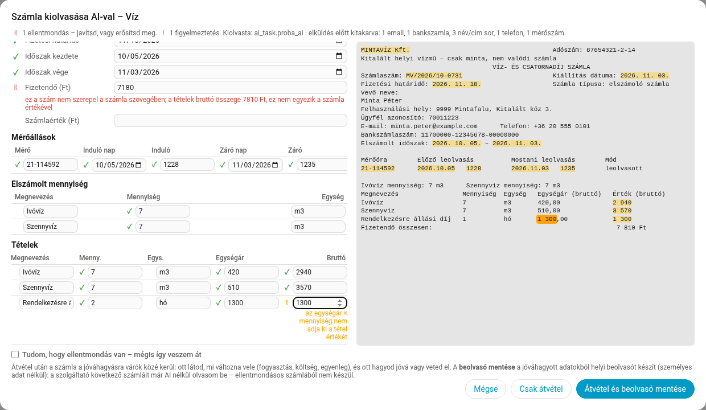
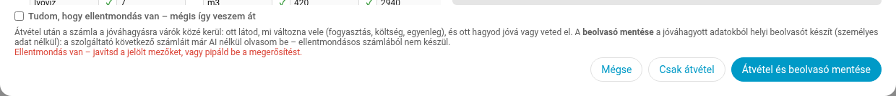
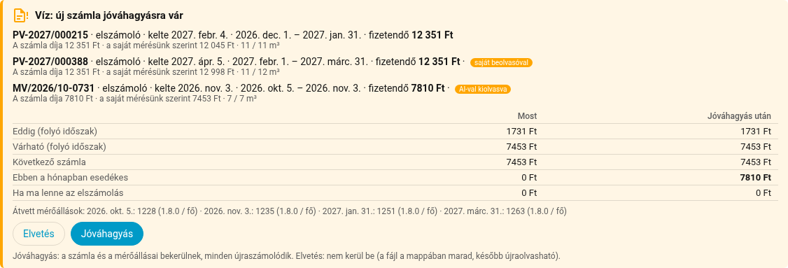
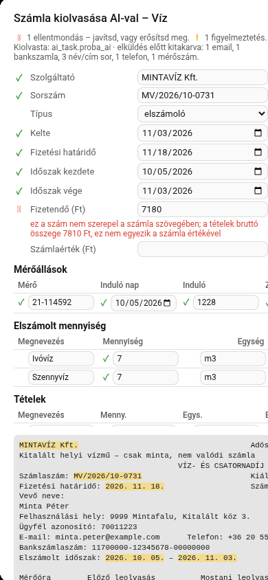

# Rezsikövető – AI-os számlaolvasó

**Változat:** 2.3.0 béta (2.3.0b8, kísérleti funkció) · 2026. november
**Kinek szól:** a Rezsikövető felhasználóinak, programozói tudás nélkül

> [!NOTE]
> A leírás képein minden adat **kitalált**: a „MINTAVÍZ Kft.” nem létező szolgáltató, „Minta Péter” nem létező személy, a mérőszám, a cím, az e-mail cím és a bankszámlaszám is csak minta. A képek a Rezsikövető próbapéldányán készültek.

## Tartalom

1. [Mire jó?](#1-mire-jó)
2. [Mi kell hozzá?](#2-mi-kell-hozzá)
3. [Bekapcsolás](#3-bekapcsolás)
4. [Adatvédelem: mi megy el az AI-hoz?](#4-adatvédelem-mi-megy-el-az-ai-hoz)
5. [Lépésről lépésre](#5-lépésről-lépésre)
6. [Mit ellenőriz a Rezsikövető?](#6-mit-ellenőriz-a-rezsikövető)
7. [A saját beolvasó](#7-a-saját-beolvasó)
8. [Hibaüzenetek és teendők](#8-hibaüzenetek-és-teendők)
9. [Költség, korlátok, gyakori kérdések](#9-költség-korlátok-gyakori-kérdések)

## 1. Mire jó?

A Rezsikövető a nagy szolgáltatók (például az MVM vagy a DAKÖV) PDF-számláit magától beolvassa. Ha viszont olyan szolgáltatótól kapsz számlát, amelyet nem ismer (például a falud helyi vízművétől), eddig csak kézzel tudtad rögzíteni.

Az **AI-os számlaolvasó** ezt könnyíti meg. Egy mesterséges intelligencia (AI) kiolvassa a számlából az adatokat, de **semmi nem kerül be a jóváhagyásod nélkül**.

Röviden így működik:

1. **Az AI kiolvassa** a fel nem ismert számlát. Elküldés előtt a Rezsikövető kitakarja belőle a személyes adataidat.
2. **Te ellenőrzöd.** Egy ablakban látod a kiolvasott adatokat és mellettük a számla szövegét. A Rezsikövető minden mezőt ellenőriz, és megjelöli, amivel gond lehet.
3. **Te hagyod jóvá.** A számla a jóváhagyásra várók közé kerül, ahol azt is látod, mit változtat a fogyasztáson és az egyenlegen.
4. **Saját beolvasó készül.** Ha kéred, a jóváhagyott számlából a Rezsikövető helyi beolvasót készít ehhez a szolgáltatóhoz.
5. **A következő számla már AI nélkül jön.** A szolgáltató következő számláit a saját beolvasó olvassa be, helyben és ingyen.

Az AI-t tehát jó esetben **szolgáltatónként egyszer** kell használnod.

## 2. Mi kell hozzá?

| Mi kell | Miért, és honnan van |
|---|---|
| **AI Task entitás** a Home Assistantban | Ez az az „AI”, amely a számlát kiolvassa. Lásd lent. |
| **Friss Home Assistant** | Az AI Task a Home Assistant 2025.8-as változatától létezik. A listás adatokhoz (mérőállások, tételek) ennél is újabb kell, ezért érdemes a legfrissebbet használni. |
| **Szöveges PDF-számla** | A szolgáltatótól letöltött vagy e-mailben kapott PDF általában szöveges. A beszkennelt vagy lefényképezett papírszámla (kép) még nem olvasható ki. |
| **Számlamappás fiók** | A fiók beállításaiban meg kell adni egy számlamappát (például `Szamlak/viz`). A számlát ebbe a mappába teszed, vagy az **Új számla** gombbal töltöd fel. |
| **Rendszergazdai fiók** | A kiolvasást csak a Home Assistant rendszergazdája indíthatja, mert a számla tartalma kerül el, és fizetős AI-nál pénzbe kerülhet. |

### AI Task entitás hozzáadása

Ha az **AI-tájékoztatóhoz** már beállítottál AI-t, ugyanaz jó, nincs vele további teendőd.

Ha még nincs:

1. A Home Assistantban nyisd meg: **Beállítások → Eszközök és szolgáltatások → Integráció hozzáadása**.
2. Válassz egyet:
   - **Google Generative AI** (Gemini): Google-fiók és egy API-kulcs kell hozzá (Google AI Studio). Kis forgalomnál gyakran ingyenes, de a feltételek változhatnak.
   - **OpenAI** (ChatGPT): OpenAI-fiók és API-kulcs kell hozzá. Fizetős.
   - **Ollama**: helyi AI a saját gépeden. Semmi nem hagyja el az otthonodat, de erős gép kell hozzá.
3. Az integráció létrehoz egy **AI Task** entitást (a neve `ai_task.` kezdetű). Ha nem jön létre magától, az integráció oldalán add hozzá az **AI Task** szolgáltatást.

> [!TIP]
> Ha nem tudod, melyiket válaszd: a legegyszerűbb a Google Generative AI. Ha viszont semmilyen adatot nem szeretnél külső szolgáltatónak küldeni, válaszd a helyi Ollamát.

## 3. Bekapcsolás

Az AI-os számlaolvasó alapból **ki van kapcsolva**. Így kapcsolod be:

1. A Rezsikövető panel fejlécében kattints a **⚙** gombra (Beállítások, mentés és visszaállítás).
2. Nyisd le a **Panel beállításai** részt.
3. Pipáld be: **Ismeretlen számla kiolvasása AI-val**.
4. Az **AI Task entitás** listában válaszd ki az AI-t. Ha az „az első elérhető” marad, a Rezsikövető az első talált AI Task entitást használja.
5. Kattints a mellette lévő **Mentés** gombra.



Az első bekapcsoláskor egy **tájékoztató** jelenik meg, és megkérdezi, engedélyezed-e. Akkor is megjelenik, ha a kapcsolót nem kapcsoltad be, hanem rögtön egy **Kiolvasás AI-val** gombra kattintasz. A tájékoztató szövege:

> **Ismeretlen számla kiolvasása AI-val**
>
> • A számla szövegét elküldöm a választott AI-szolgáltatónak (az AI Task entitás integrációjának, pl. Google Gemini). Helyi AI (pl. Ollama) esetén a gépedet nem hagyja el.
>
> • Elküldés előtt igyekszem kitakarni a felismerhető személyes adatokat: a feliratos név- és címsorokat, a címeket, az ismert neveket és azonosítókat, a mérőszámot, az e-mailt, a telefont, a bankszámlát, az adóazonosítót. A kitakarás nem tökéletes – szokatlan elrendezésű számlán maradhat benne személyes adat. A szolgáltató neve és adószáma marad.
>
> • Az AI válaszát és a számla szövegét nem tárolom; csak az általad jóváhagyott adatok kerülnek be.
>
> • Egy kiolvasás néhány forintba kerülhet (fizetős AI-nál).
>
> Engedélyezed?

Az **OK** gombbal engedélyezed, a **Mégse** gombbal nem változik semmi. A beállítás minden otthonra és minden felhasználóra érvényes. Kikapcsolni ugyanitt tudod: vedd ki a pipát, és kattints a **Mentés** gombra.

## 4. Adatvédelem: mi megy el az AI-hoz?

Az AI a **számla szövegét** kapja meg, a Rezsikövető pedig elküldés előtt **igyekszik kitakarni** belőle a személyes adatokat. A kitakart adat helyére egy helyőrző kerül (`KITAKART_1`, `KITAKART_2` …). A mérőszám helyére `MERO_1` kerül. Az AI ezt a helyőrzőt adja vissza, a Rezsikövető pedig a válaszban visszaírja a valódi mérőszámot, így a mérőállás a jó mérőhöz kerül.

### Mit takar ki?

- **Feliratos név- és címsorokat.** Ilyen felirat például: „Név:”, „Cím:”, „Lakcím:”, „Vevő neve:”, „Felhasználó:”, „Felhasználási hely:”, „Fizető:”, „Számlafizető:”, „Ügyfél …:”, „Szerződő:”, „Tulajdonos:”, „Értesítési / Postázási / Levelezési / Számlázási cím:”, „Születési név / hely / idő:”, „Anyja neve:”. A felirat megmarad, csak a mögötte álló érték tűnik el. Ha a felirat után üres a sor, a **következő sorban álló érték** tűnik el.
- **Felirat nélküli címeket**, például a borítékablakban álló címet: irányítószám, település, közterület (utca, út, tér, köz, körút, sor, sétány, fasor, lakótelep, dűlő …) és házszám.
- **Minden otthonod ismert adatait.** A Rezsikövető az összes otthonod összes számlájáról ismeri a neveket, címeket, ügyfél-azonosítókat és mérési pontokat. Ezeket akkor is kitakarja, ha egy új szolgáltató számláján, felirat nélkül szerepelnek.
- A Home Assistant **személyeinek nevét** (Beállítások → Személyek).
- A fiók **mérőszámait** (`MERO_1`, `MERO_2` … helyőrzővel). A nagyon rövid, 5 jegynél rövidebb mérőszámot nem takarja ki, mert az összegekkel összekeveredne.
- **E-mail címet, telefonszámot, bankszámlaszámot** (IBAN-t is) és **adóazonosító jelet**.

### Mi marad benne?

- A **szolgáltató neve és adószáma**. Ezek nem személyes adatok, és a saját beolvasónak szüksége van rájuk a szolgáltató felismeréséhez.
- Az összegek, dátumok, mérőállások, mennyiségek és díjtételek, hiszen ezeket kell kiolvasni.
- Segítségként az AI megkapja a fiók közművét (például víz), a mértékegységet (m³), a mérők helyőrzőjét (`MERO_1`) és az utolsó ismert mérőállást a dátumával.

Így látta az AI az 5. fejezet példájának kitalált MINTAVÍZ-számláját. A kitakart részeket a képen lila kiemelés jelöli:



A jóváhagyó ablak tetején azt is látod, mit takart ki a Rezsikövető, például: „elküldés előtt kitakarva: 1 email, 1 bankszamla, 3 név/cím sor, 1 telefon, 1 mérőszám”.

> [!WARNING]
> **A kitakarás nem tökéletes.** Szokatlan elrendezésű számlán (például ha a név felirat nélkül, a lap közepén áll) maradhat benne személyes adat. Ha ez nem elfogadható neked, használj **helyi AI-t (Ollama)**: akkor a számla szövege a gépedet sem hagyja el.

### Mit tárol a Rezsikövető?

- Az AI **válaszát** és a számla **szövegét** nem tárolja.
- Csak az általad jóváhagyott adatok kerülnek be, ugyanúgy, mint egy kézzel rögzített számlánál.
- A PDF-fájl a számlamappában marad, ahová tetted.

## 5. Lépésről lépésre

### 5.1 A számla bekerül a számlamappába

Tedd a PDF-et a fiók számlamappájába (például a Samba-megosztáson vagy a Fájlszerkesztővel), vagy töltsd fel a panelen az **Új számla → fájl** gombbal. Ha e-mailes számlákat is beállítottál, a Rezsikövető maga menti oda.

Ha a Rezsikövető nem ismeri fel a számlát, a panel tetején, a figyelmeztetések között szól. Alatta minden fel nem ismert PDF-hez megjelenik egy **Kiolvasás AI-val: <fájlnév> ›** gomb:


Feltöltésnél ugyanez a lehetőség a feltöltő ablakban jelenik meg: „…nem ismertem fel – add meg az adatait lent kézzel, vagy **olvastasd ki AI-val ›**”.

> [!NOTE]
> A gomb csak a rendszergazdának jelenik meg, és csak akkor, ha a Home Assistantban van legalább egy AI Task entitás.

### 5.2 Várakozás

Kattints a gombra. Ha még nem engedélyezted a funkciót, most jelenik meg a 3. fejezetben idézett tájékoztató. Ezután kis türelem kell: a kiolvasás **10–60 másodpercig** tart. A **Mégse** gombbal bármikor megszakíthatod.



### 5.3 A jóváhagyó ablak

Ezután megnyílik a **jóváhagyó ablak**:

- **Balra** a kiolvasott adatok, mind javítható:
  - szolgáltató, sorszám, típus (részszámla, elszámoló, egyéb, sztornó), kelte, fizetési határidő, időszak kezdete és vége, fizetendő összeg, számlaérték;
  - **Mérőállások**: mérő, induló nap és állás, záró nap és állás, mód (leolvasott, diktált, becsült);
  - **Elszámolt mennyiség** (például ivóvíz 7 m³);
  - **Tételek**: megnevezés, mennyiség, egység, egységár, bruttó érték.
- **Jobbra** a számla szövege, a megtalált értékek **sárgával kiemelve**. Ha egy mezőbe kattintasz, a szövegben az értéke **narancssárgán** kiemelődik, és a szöveg odagörget. Így gyorsan összevetheted a kettőt.
- **Fent** egy összegzés: hány ellentmondást és figyelmeztetést talált, melyik AI olvasta ki, és mit takart ki elküldés előtt.



A jobb oldali szöveg a **teljes, eredeti** számlaszöveg. Ezt csak te látod a saját képernyődön. Az AI a 4. fejezetben látható, kitakart változatot kapta.

> [!NOTE]
> A dátummezők a böngésződ beállítása szerint jelennek meg. A képeken amerikai formában (hónap/nap/év) látszanak, magyar beállítású böngészőben „2026. 11. 03.” alakban.

### 5.4 A jelölések jelentése

Minden mező előtt egy jel áll. Ha az egeret a jel fölé viszed, kiírja az okát is:

| Jel | Jelentése | Mit tegyél? |
|---|---|---|
| **✓** (zöld) | Az érték **szó szerint szerepel a számlán**, és megfelel a szabályoknak. | Semmit. |
| **!** (narancs) | **Ellenőrizd**: valami szokatlan. Például a tételek összege nem adja ki a számla értékét, az egységár × mennyiség nem jön ki, szokatlanul nagy a fogyasztás, vagy nem a fiók ismert mérője. | Nézd meg a számlán. Ha az érték jó, nyugodtan átveheted. |
| **✗** (piros) | **Ellentmondás**: az érték nincs a számla szövegében (az AI „kitalálta” vagy elírta), a záró állás kisebb az indulónál, a mérőállás ellentmond a fiók korábbi leolvasásainak, vagy a számla már szerepel. | Javítsd. Ha biztos vagy benne, hogy jó, külön meg kell erősítened (lásd 5.5). |
| (nincs jel) | Az üres vagy nem ellenőrizhető mező (például a megnevezés). | Nézd át szemmel. |

A jel alatt pirossal vagy narancssárgával az ok is olvasható. A képen az AI a fizetendő összeget elírta (7180 Ft a számlán álló 7 810 Ft helyett). Ezért a mező **✗** jelet kapott: „ez a szám nem szerepel a számla szövegében; a tételek bruttó összege 7810 Ft, ez nem egyezik a számla értékével”.

A tételek között az AI az egyik mennyiséget rosszul olvasta ki (2 hó az 1 helyett). A **2** szám szerepel a számlán, ezért **✓**-t kapott, a tétel értéke mellett viszont **!** jelzi: „az egységár × mennyiség nem adja ki a tétel értékét”:



### 5.5 Javítás és átvétel

1. **Javítsd** a hibás mezőket: írd be a helyes értéket. A példában a fizetendő **7810**, a harmadik tétel mennyisége **1**.
2. Válassz a két gomb közül:
   - **Csak átvétel**: a számla a jóváhagyásra várók közé kerül, beolvasó nem készül.
   - **Átvétel és beolvasó mentése** (ajánlott): ugyanez, és a jóváhagyott adatokból saját beolvasó is készül ehhez a szolgáltatóhoz (lásd 7. fejezet).
3. A Rezsikövető az átvételkor a javított adatokkal **újra ellenőriz mindent**. A jelek gépelés közben nem frissülnek, csak az átvétel gombra kattintva.

Ha ellentmondás marad, nem veszi át a számlát, hanem ezt írja: „**Ellentmondás van – javítsd a jelölt mezőket, vagy pipáld be a megerősítést.**” Ekkor két lehetőséged van:

- kijavítod a **✗** jelű mezőket, vagy
- ha biztos vagy benne, hogy az érték jó (például a szolgáltató tényleg így írta), bepipálod: **„Tudom, hogy ellentmondás van – mégis így veszem át”**, és újra az átvétel gombra kattintasz.



Ellentmondással megerősített számlából **nem készül beolvasó**, de maga a számla átvehető.

### 5.6 Jóváhagyás

Az átvett számla a panel tetején, a **jóváhagyásra várók** között jelenik meg, **„AI-val kiolvasva”** címkével. Itt pontosan látod, mi változna vele:

- „**Most**” és „**Jóváhagyás után**”: eddigi és várható költség, következő számla, ebben a hónapban esedékes összeg, „Ha ma lenne az elszámolás”;
- **Átvett mérőállások**: melyik napon milyen állás kerül be.

A **Jóváhagyás** gombbal a számla és a mérőállásai bekerülnek, és minden újraszámolódik. Az **Elvetés** gombbal nem kerül be: a fájl a mappában marad, később újra kiolvasható.



A képen egy másik kitalált szolgáltató (PÉLDAVÍZ) számlája is vár, **„saját beolvasóval”** címkével. Ezt már a korábban mentett saját beolvasó olvasta be, AI nélkül.

### 5.7 Mobilon

Telefonon ugyanez az ablak egy hasábban jelenik meg: felül a mezők, alattuk a számla szövege. A széles táblázatok (mérőállások, tételek) oldalra görgethetők.



## 6. Mit ellenőriz a Rezsikövető?

Az AI tévedhet, ezért a Rezsikövető minden kiolvasott értéket összevet a számla szövegével és a fiók meglévő adataival. A szabályok:

| Ellenőrzés | Mit néz? | Ha nem teljesül |
|---|---|---|
| **Kötelező adatok** | Van-e sorszám, kelte és fizetendő összeg. | ✗ „hiányzik a(z) sorszám” (kelte, fizetendő összeg) |
| **Szó szerinti egyezés: szöveg** | A szolgáltató neve, a sorszám és a mérő gyári száma szerepel-e a számlán (a szóközök nem számítanak). | ✗ „nem szerepel a számla szövegében” |
| **Szó szerinti egyezés: szám** | Az összegek, mérőállások, mennyiségek, egységárak szerepelnek-e a számlán, bármilyen magyar írásmóddal (12 345, 12.345, 12345,00). | ✗ „ez a szám nem szerepel a számla szövegében” |
| **Szó szerinti egyezés: dátum** | A kelte, a határidő, az időszak és a mérőállások dátuma szerepel-e (2026.10.05, 2026-10-05, 05.10.2026, „2026. október 5.”, „2026. okt. 5.”). | ✗ „ez a dátum nem szerepel a számla szövegében” vagy „nem értelmezhető dátum” |
| **Már szerepel** | Van-e már ilyen sorszámú számla a fiókban. | ✗ „ez a számla már szerepel a fiókban” |
| **Tételek összege** | Két vagy több tételnél a bruttó értékek összege kiadja-e a számla értékét (tételenként 1 Ft kerekítés belefér). | ! „a tételek bruttó összege … Ft, ez nem egyezik a számla értékével” |
| **Egységár × mennyiség** | Kiadja-e a tétel értékét, akár ÁFÁ-val szorozva (27%, 18%, 5%), fél százalék eltéréssel. | ! „az egységár × mennyiség nem adja ki a tétel értékét” |
| **Fizetendő és számlaérték** | Részszámlánál és egyéb számlánál eltér-e a kettő. | ! „a fizetendő eltér a számla értékétől (levont tétel vagy túlfizetés?)” |
| **Időszak** | A vége nincs-e a kezdete előtt, nem hosszabb-e egy évnél, nem ér-e véget jóval (2 hónappal) a kelte után. | ✗ „az időszak vége a kezdete előtt van”; ! „szokatlanul hosszú időszak (több mint egy év)”; ! „az időszak jóval a számla kelte után ér véget” |
| **Határidő és kelte** | A határidő nincs-e a kelte előtt; a kelte nem 2000 előtti és nem egy hónapnál távolabbi jövőbeli dátum-e. | ! „a határidő a kelte előtt van”; ✗ „valószínűtlen kelte” |
| **Mérőállások: sorrend** | A záró állás nem kisebb-e az indulónál, és a záró dátum nincs-e az induló előtt. | ✗ „a záró állás kisebb az indulónál”; ✗ „a záró dátum az induló előtt van” |
| **Mérőállások: illeszkedés** | Beillik-e az állás a fiók korábbi leolvasásai közé (a mérő nem menne visszafelé). | ✗ „ellentmond a fiók meglévő mérőállásainak (visszafelé menne)” |
| **Ismeretlen mérő** | A számlán álló mérő a fiók ismert mérője-e. | ! „nem a fiók ismert mérője (mérőcsere vagy más fiók számlája?)” |
| **Nagyságrend** | Nem szokatlanul nagy-e a havi fogyasztás (havonta kb. villany 3000 kWh, víz 60 m³, távhő 30, gáz 1500 a fiók mértékegységében). | ! „szokatlanul nagy fogyasztás (kb. … / hó)” |
| **Közmű** | A számla közműve (például víz) egyezik-e a fiókéval. | ! „a számla szerint viz, a fiók villany” |

**Röviden:** ✗ esetén a számla csak javítás vagy kifejezett megerősítés után vehető át, ! esetén nézd meg, de átveheted.

## 7. A saját beolvasó

### Mi ez?

A **saját beolvasó** (más néven sablon) egy kis leírás arról, hogy egy adott szolgáltató számláján hol, milyen felirat mellett áll a sorszám, a kelte, a fizetendő összeg, a mérőállás és a díjtételek. Az **Átvétel és beolvasó mentése** gomb készíti el a jóváhagyott számlából. Ezután a szolgáltató **következő számláit már AI nélkül**, helyben és ingyen olvassa be a Rezsikövető.

### Mikor készül el?

- Csak az **Átvétel és beolvasó mentése** gombra.
- Csak **önpróba** után: a Rezsikövető a kész beolvasóval újra beolvassa ugyanazt a számlát. A beolvasót csak akkor menti el, ha **pontosan azt** kapja vissza, amit jóváhagytál.
- **Ellentmondásos** (megerősítéssel átvett) számlából nem készül.
- Csak ha a beolvasóban **nincs személyes adat**. Ezt egy szűrő ellenőrzi a fiók ismert adatai és mérőszámai alapján.

Siker esetén ezt írja ki: „**Beolvasó mentve (MINTAVÍZ Kft. – viz): a szolgáltató következő számláit AI nélkül olvasom be.**” A Home Assistant értesítései között is megjelenik egy „Rezsikövető – új számlabeolvasó” üzenet a fájl helyével.

Ha nem sikerül, megmondja az okát:

- „A beolvasó nem készült el: a számlán nem ugyanazt olvasná ki (…). A következő számlát újra AI-val olvashatod ki.”
- „A beolvasó nem készült el: személyes adat maradt volna benne.”
- „Ellentmondásos számlából nem készül beolvasó.”

A számla ilyenkor is átkerül a jóváhagyásra várók közé, csak beolvasó nem készül.

### Mi van benne, és mi nincs?

**Benne van:** a szolgáltató neve és adószáma (ebből ismeri fel a számlát), a mezők feliratai (például „Számlaszám:”, „Fizetendő összesen:”), a díjtételek megnevezése és általános minták (itt dátum, itt szám áll).

**Nincs benne:** a neved, a címed, az ügyfél-azonosítód, a mérőszámod, és egyetlen összeg vagy dátum sem a számládról. A sorminták csak az első és az utolsó kiolvasott érték közötti részt tartalmazzák, így a sor elején vagy végén álló név, cím nem kerül bele.

### Hol van?

A Home Assistant konfigurációs mappájában: `config/hu_rezsi_sablonok/<szolgáltató>.yaml`, például `hu_rezsi_sablonok/mintaviz_kft_viz.yaml`. Szöveges fájl, bármikor elolvashatod, és a Home Assistant mentésébe is bekerül.

Egy rövidített, **kitalált** példa:

```yaml
# Rezsikövető számlasablon – a jóváhagyott első számlából készült (személyes adat nélkül).
# Megosztható; a minták: DATUM = dátum, SZAM = szám, (...) = a kiolvasott érték.
azonosito: mintaviz_kft_viz
nev: MINTAVÍZ Kft. – viz
kozmu: viz
felismeres:
  szovegek:
  - MINTAVÍZ Kft.
  - 87654321-2-14
mezok:
  sorszam:
    minta: Számlaszám:[ \t]*([A-Za-z\d\-/]{12,18})
  kelte:
    minta: Kiállítás[ \t]+dátuma:[ \t]*({DATUM})
  fizetendo:
    minta: Fizetendő[ \t]+összesen:[ \t]*({SZAM})
tetelek:
- sor: Ivóvíz[ \t]+(?P<mennyiseg>{SZAM})[ \t]*m3[ \t]*(?P<egysegar>{SZAM})[ \t]+(?P<brutto>{SZAM})
  megnevezes: Ivóvíz
  egyseg: m3
```

Nem kell értened vagy szerkesztened. A lényeg, hogy jól látszik: csak feliratok és minták vannak benne, személyes adat nincs.

### Mi történik a következő számlával?

- Ha a szolgáltató új számlája bekerül a számlamappába, a saját beolvasó felismeri és beolvassa. A számla ugyanúgy a **jóváhagyásra várók** közé kerül, **„saját beolvasóval”** címkével (lásd a képet az 5.6 pontban). Ott hagyod jóvá vagy veted el, ahogy bármely más számlát.
- A mappában már ott lévő, **korábban fel nem ismert** számlái is magától előkerülnek, minden otthonodban.
- A számla típusát (rész, elszámoló, sztornó) a beolvasó minden számlánál a szövegből határozza meg.

### Ha a szolgáltató más formájú számlát küld

Előfordul, hogy a szolgáltató megváltoztatja a számlája külalakját, vagy egy másik fajta számla (például elszámoló a részszámla után) másképp néz ki. Ha a beolvasó egy kötelező adatot (sorszám, kelte, fizetendő) nem talál, a fájl **fel nem ismert** marad, és újra megjelenik mellette a **Kiolvasás AI-val** gomb.

Ilyenkor olvastasd ki újra AI-val, és mentsd a beolvasót. Az új forma **külön beolvasót** kap (`mintaviz_kft_viz_2.yaml`), a régi is megmarad, és mindkettő működik.

Ha egy beolvasót törölni szeretnél, töröld a fájlját a `hu_rezsi_sablonok` mappából, és indítsd újra a Home Assistantot.

### Megosztás

A beolvasó fájlja **megosztható**. Ha elküldöd a fejlesztőnek egy hibajegyben (GitHub Issues: <https://github.com/Gyuszko55/ha-energia-elszamolas-hu/issues>), a szolgáltató **beépített beolvasót** kaphat, és akkor mindenki más is AI nélkül használhatja. Küldés előtt nézd át a fájlt, és ha mégis látnál benne bármi személyeset, azt töröld ki belőle.

## 8. Hibaüzenetek és teendők

| Üzenet | Mit jelent? | Mit tegyél? |
|---|---|---|
| **Nincs „Kiolvasás AI-val” gomb** | Nem rendszergazdaként vagy bejelentkezve, vagy nincs AI Task entitás. | Lépj be rendszergazdaként; adj hozzá AI-t (2. fejezet). |
| „Az AI-beolvasás nincs engedélyezve (Panel beállításai).” | A funkciót közben kikapcsolták. | Kapcsold be (3. fejezet). |
| „Nincs AI Task entitás (Beállítások → Eszközök és szolgáltatások: pl. Google Gemini, OpenAI, Ollama).” | A kiválasztott AI nem érhető el, vagy nincs egy sem. | Add hozzá vagy javítsd az AI integrációt; a Panel beállításaiban válaszd ki újra. |
| „Ennek a fióknak nincs számlamappája – a számlát az Új számla gombbal töltsd fel vagy rögzítsd.” | A fióknak nincs beállított számlamappája. | Állíts be számlamappát a fiók beállításaiban, vagy rögzítsd a számlát kézzel. |
| „AI-val egyelőre csak PDF-számla olvasható ki.” | A fájl nem PDF (például XML vagy kép). | Kérd a számlát PDF-ben, vagy rögzítsd kézzel. |
| „A PDF-ben nincs kinyerhető szöveg (szkennelt, képes számla) – ezt egy későbbi változat tudja majd kiolvasni. Addig rögzítsd az Új számla gombbal.” | Beszkennelt vagy lefényképezett számla. | Töltsd le a számlát a szolgáltató ügyfélkapujáról PDF-ben, vagy rögzítsd kézzel. |
| „A fájl (…) nincs a fiók számlamappájában.” | A fájlt közben áthelyezték vagy törölték. | Frissítsd a panelt; tedd vissza a fájlt. |
| „Az AI 90 másodpercen belül nem válaszolt – próbáld újra később.” | Az AI-szolgáltató lassú vagy túlterhelt, helyi AI-nál lassú a gép. | Próbáld újra néhány perc múlva. |
| „Az AI nem adott értékelhető választ.” | Az AI üres vagy hibás választ adott. | Próbáld újra; ha ismétlődik, válassz másik AI-t. |
| „Az AI-hívás nem sikerült: …” | Az AI-szolgáltató hibát jelzett: elfogyott a keret (kvóta), hibás vagy lejárt az API-kulcs, nincs internet. A pontos ok a kettőspont után áll. | Javítsd az AI integrációt (kulcs, keret), majd próbáld újra. |
| „Ellentmondás van – javítsd a jelölt mezőket, vagy pipáld be a megerősítést.” | Átvételkor maradt ✗ jelű mező. | Javítsd, vagy pipáld be a megerősítést (5.5). |
| „A(z) … számla már szerepel.” | Ez a sorszám már a fiókban van, vagy már jóváhagyásra vár. | Nincs teendő, a számla már bent van. |
| „A számla kelte hiányzik vagy hibás.” / „A számla sorszáma hiányzik.” | Átvételkor üres maradt a kelte vagy a sorszám. | Töltsd ki a mezőt a számla alapján. |
| „A beolvasó nem készült el: …” | A saját beolvasó nem ment át az önpróbán vagy a személyesadat-szűrőn. | A számla ettől átkerült; a következőt olvastasd ki újra AI-val (7. fejezet). |

## 9. Költség, korlátok, gyakori kérdések

### Költség

- **Fizetős AI-nál** (például OpenAI, vagy a Gemini ingyenes keretén felül) egy kiolvasás jellemzően **néhány forint**. Mindig csak akkor fut, ha te kattintasz a gombra, magától soha.
- Ha **mented a beolvasót**, a szolgáltató következő számlái **ingyen**, AI nélkül jönnek.
- **Helyi AI-nál** (Ollama) nincs díj, csak a géped dolgozik.

### Korlátok (2.3.0 béta)

- Csak **szöveges PDF**. A szkennelt, képes számla egy későbbi változatban jön.
- A **regiszterenkénti** mérőállás-sorokat (például H-tarifás 1.8.1 / 1.8.2) még nem veszi át, csak a fő mérőállást.
- A funkció **kísérleti**: minden kiolvasott adatot nézz át jóváhagyás előtt.
- Friss Home Assistant kell (AI Task, 2025.8 vagy újabb; a listás adatokhoz még újabb).

### Gyakori kérdések

**Bekerülhet valami a jóváhagyásom nélkül?**
Nem. Az AI-val kiolvasott és a saját beolvasóval beolvasott számla is a jóváhagyásra várók közé kerül, és csak a **Jóváhagyás** gombbal jut be.

**Mi van, ha az AI téved?**
A Rezsikövető minden értéket összevet a számla szövegével. Amit az AI „kitalált” vagy elírt, az piros ✗ jelet kap, és csak javítás vagy megerősítés után vehető át. A mezőket te javíthatod.

**Látja az AI a nevemet és a címemet?**
A Rezsikövető igyekszik kitakarni (4. fejezet), de a kitakarás nem tökéletes. Ha teljes biztonságot szeretnél, használj helyi AI-t (Ollama).

**Mit jelent a „MERO_1” vagy a „KITAKART_3”?**
Helyőrzők a kitakart adat helyén. A mérőszámot a Rezsikövető a válaszban visszaírja, a jóváhagyó ablakban már a valódi mérőszámot látod.

**Kell minden számlánál AI?**
Nem. Ha az első számla után mented a beolvasót, a többi AI nélkül jön. AI csak akkor kell újra, ha a szolgáltató más formájú számlát küld.

**Elrontottam: rossz adattal hagytam jóvá a számlát. Mi a teendő?**
A számlát a fiókkártya **Részletek → Számlák** listájában javíthatod vagy törölheted, ugyanúgy, mint bármely más számlát.

**Elvetettem a számlát. Elveszett?**
Nem. A fájl a mappában marad, és később újra kiolvasható.

**Hova jelezzem, ha hibát találok?**
A GitHub Issues oldalon: <https://github.com/Gyuszko55/ha-energia-elszamolas-hu/issues>. A számlát csak kitakarva küldd el, vagy inkább csak a saját beolvasó fájlját.
