# Rezsikövető – telepítési és kezelési kézikönyv

**Változat:** 2.4.0b3 – béta · 2026. november 6.
**Készítők:** Gyuszko55, Krissz55555

> [!IMPORTANT]
> A Rezsikövető **tájékoztató jellegű** számítás. Nem helyettesíti a szolgáltató számláját; a valódi összeg mindig a számlán szerepel.

> [!NOTE]
> **Újdonságok a 2.4.0-ban (béta):** értesítés a mobilra a fizetési határidő előtt ([7.5.2](#752-értesítés-a-mobilra-a-fizetési-határidő-előtt-240)) és hangutasítások – „Van befizetendő számlám?”, következő számla, rezsi eddig, keret, utolsó számla ([7.5.3](#753-hangutasítások-van-befizetendő-számlám-és-társai-240)).
>
> **Újdonságok a 2.3.0-ban:** lapozós tablet- és mobilnézet – Fiókok, Témák és Mátrix ([7.0](#70-lapozós-nézet-fiókok-és-témák-230)), ismeretlen számla kiolvasása AI-val és saját beolvasó ([9.9](#99-ismeretlen-számla-kiolvasása-ai-val-saját-beolvasó-230-kísérleti)), korrekciós leolvasás és a saját szenzor szerinti állás a Mérőknél ([8.](#8-mérőállás-rögzítése-mérőcsere)).
>
> **Újdonságok a 2.2.0-ban:** számlák e-mailből ([9.8](#98-számlák-e-mailből--lépésről-lépésre)), **Saját díjak** a kártyán ([13.1](#131-saját-díjak-a-panelről)), a fix díj a számlákból ([13.2](#132-a-fix-díj-a-számlákból)), a díjeltérés gombjai a kártyán ([13.3](#133-ha-a-számla-eltér-a-havidíjtól)), MVM-számla 15 jegyű mérőszámmal ([15.](#15-gyakori-kérdések-és-hibaelhárítás)).

---

## Tartalom

1. [Mi a Rezsikövető?](#1-mi-a-rezsikövető)
2. [Mielőtt telepíted – előfeltételek](#2-mielőtt-telepíted--előfeltételek)
3. [Telepítés](#3-telepítés)
4. [Első beállítás: háztartás és fiókok](#4-első-beállítás-háztartás-és-fiókok)
5. [A fiók beállításai mezőnként](#5-a-fiók-beállításai-mezőnként)
6. [Közművenként: villany, H-tarifa, B, B Komfort, B GEO, A2, D, gáz, víz, távhő, szemétszállítás](#6-közművenként)
7. [A Rezsikövető panel](#7-a-rezsikövető-panel)
8. [Mérőállás rögzítése, mérőcsere](#8-mérőállás-rögzítése-mérőcsere)
9. [Számlák felvitele (Díjnet, feltöltés, kézi, e-mail)](#9-számlák-felvitele)
10. [Hogyan számol?](#10-hogyan-számol)
11. [Entitások – irányítópulthoz, automatizáláshoz](#11-entitások)
12. [Szolgáltatások (haladó)](#12-szolgáltatások-haladó)
13. [Díjak, díjszabások, felülírás](#13-díjak-díjszabások-felülírás)
14. [Átállás a v1 YAML-csomagról](#14-átállás-a-v1-yaml-csomagról)
15. [Gyakori kérdések és hibaelhárítás](#15-gyakori-kérdések-és-hibaelhárítás)
16. [Adatok, mentés, frissítés, eltávolítás](#16-adatok-mentés-frissítés-eltávolítás)

---

## 1. Mi a Rezsikövető?

A Rezsikövető egy Home Assistant-integráció, amely a háztartás **villany-, gáz-, víz- és fix díjas** (pl. szemétszállítási) költségeit, valamint a **távhőt** (fűtés és melegvíz) számolja a magyar lakossági díjszabások szerint, és egy saját oldalon, a **Rezsikövető panelen** mutatja.

A panel négy kérdésre felel, ebben a sorrendben:

| Kérdés | Mit látsz |
|---|---|
| **Mennyibe került?** | eddigi költség, ebben a hónapban esedékes számlák |
| **Mennyi lesz?** | várható havi költség, várható fogyasztás |
| **Hol tartok a keretben?** | a rezsicsökkentett (kedvezményes) keret felhasznált és hátralévő része, a várható keretátlépés napja |
| **Kell-e valamin változtatnom?** | „ha ma lenne az elszámolás”, várható éves/félévi egyenleg, elmaradt számla, figyelmeztetések |

Fő tudása:

- **Számlára pontos számítás:** nettó tételsoros díjak ÁFÁ-val, egész kWh-s kedvezményes keret, számlánkénti alapdíj, gáz MJ-ban havi fűtőértékkel. Valódi MVM-, DAKÖV-, ALFÖLDVÍZ- és HVSZ-számlákon ellenőrizve.
- **Átalányos (részszámlás) fiókok:** havi fizetendő, várható éves egyenleg, az átalány összevetése a valódi fogyasztással.
- **Többhavi, utólagos számlázás:** kéthavi és négyhavi víz, negyedéves szemétszállítás. Víznél a folyó időszak – a kártyán és a Fogyasztás táblázatban a fogyasztás eddig, a várható mennyiség és díj, az átalány – a számlázási időszakra szól (a legutóbbi számla vége utántól az ütem szerint), alatta a havi rész; az előzmények havonta zárulnak.
- **Távhő:** mért melegvíz, légtérfogat szerinti alapdíjak, havi hődíj-átalány, a fűtési idény utáni korrekció.
- **H-tarifa** két regiszterrel (téli 1.81 és nyári 1.82).
- **Víz** fő- és locsolási almérővel (az almérő vize a csatornadíjból levonódik).
- **Számlák** automatikusan egy mappából (pl. a Díjnet letöltései), feltöltéssel a panelről, vagy kézzel.
- **Napelem (kísérleti):** bruttó és szaldó elszámolás.
- **Fix díjas fiókok:** szemétszállítás, társasházi közös költség (havi előírás), internet/TV/telefon előfizetés.

> [!TIP]
> **Kipróbálható demó:** https://gyuszko55.github.io/rezsikoveto-demo/ – a valódi panel, három kitalált otthon generált adataival: egy **kertes ház** (napelemes A1 szaldóval, hőszivattyú H tarifán, villanybojler B tarifán, gáz, víz locsolási almérővel, internet + TV a One-nál, szigetüzem), egy **fonyódi nyaraló** (idényes használat, üdülő szemétdíj; a demón a **Távmérő** kártyájával: a nyaraló emulált távoli érzékelői a vásárlás napjától) és egy **bérbe adott újbudai lakás** (távhő, közös költség, internet + TV). Minden megnézhető, de módosítani nem lehet.

Amit **nem** csinál: nem fizet, nem kommunikál a szolgáltatóval, és nem olvas ki adatot a mérőóráról – a mérőállást egy szenzorból vagy a kézi leolvasásodból veszi.

---

## 2. Mielőtt telepíted – előfeltételek

| # | Mi kell | Kötelező? | Megjegyzés |
|---|---|---|---|
| 1 | **Home Assistant 2025.6** vagy újabb | igen | |
| 2 | **HACS** | ajánlott | a telepítéshez és frissítéshez; nélküle kézzel is telepíthető |
| 3 | **Recorder** (adatbázis, statisztikával) | igen | alapból be van kapcsolva; a mérőállás-szenzor napi statisztikáját használja |
| 4 | **Mérőállás- vagy fogyasztás-szenzor** közművenként | erősen ajánlott | lásd lent; nélküle csak a kézi leolvasásokból számol |
| 5 | **Díjnet-integráció** (HACS) | nem | a számlák automatikus letöltéséhez és a befizetésekhez |
| 6 | A **legutóbbi számláid** (vagy legalább egy) | ajánlott | a mérő gyári száma, egy induló mérőállás, a fizetés módja (átalány?) |

### A mérőállás-szenzor

A Rezsikövető abból számolja a fogyasztást, hogyan nő egy szenzor értéke. Kétféle szenzort fogad el:

- **Mérőóra-állás** (ajánlott): a szenzor értéke maga az óraállás, pl. `sensor.meroora_allas` = 20 631 kWh. Ilyet pl. egy sablonszenzorral csinálhatsz egy fogyasztásmérőből (Shelly EM, Zigbee mérő) + a leolvasott óraállás eltolásával.
- **Csak növekvő számláló**: pl. egy Shelly „összes energia” szenzora. Ilyenkor a Rezsikövető csak a változását veszi át, és a kézi leolvasásaidhoz igazítja.

Feltétel: a szenzornak legyen **hosszú távú statisztikája** (`state_class: total_increasing` vagy `total`), mert a napi értékeket a statisztikából olvassa.

Ha nincs szenzorod (pl. víznél gyakran nincs): a Rezsikövető a **kézi és a számlákon szereplő leolvasásokból** számol, a köztes napokat arányosítva. Minél gyakrabban olvasol le, annál pontosabb.

---

## 3. Telepítés

### 3.1 HACS-szal (ajánlott)

1. HACS → jobb felül **⋮** → **Egyéni tárolók**.
2. Tároló: `https://github.com/Gyuszko55/ha-energia-elszamolas-hu`, típus: **Integráció** → **Hozzáadás**.
3. A tároló oldalán **Letöltés**, majd **indítsd újra a Home Assistantot** (Beállítások → Rendszer → jobb felül ⏻ → Home Assistant újraindítása).

> [!NOTE]
> A Rezsikövető egyéni tárolóként kerül a HACS-ba (a tároló nyilvános, GitHub-fiók nem kell hozzá). Ha nem jelenik meg, telepíts kézzel (3.2).

### 3.2 Kézzel

1. Töltsd le a tárolót (GitHub → **Code → Download ZIP**).
2. Másold a `custom_components/hu_rezsi` mappát a Home Assistant `config/custom_components/` mappájába (Samba, File editor vagy Studio Code Server bővítménnyel). Az eredmény: `config/custom_components/hu_rezsi/manifest.json`.
3. Indítsd újra a Home Assistantot.

### 3.3 Ellenőrzés

Újraindítás után: Beállítások → Eszközök és szolgáltatások → **+ Integráció hozzáadása** → keresd: **Rezsikövető**. Ha megtalálod, a telepítés sikerült.

---

## 4. Első beállítás: háztartás és fiókok

A Rezsikövetőben két szint van:

- **Háztartás** – egy lakás/ház (pl. „Otthon”). Ennek a szintjén látszik az összesített rezsi.
- **Fiók** – egy szerződés egy mérővel: pl. „Villany A1”, „Villany H”, „Gáz”, „Víz”, „Távhő”, „Szemétszállítás”. A háztartáson belül tetszőleges számú lehet.

### 4.1 Háztartás létrehozása

1. Beállítások → Eszközök és szolgáltatások → **+ Integráció hozzáadása** → **Rezsikövető**.
2. Add meg a háztartás **nevét** (pl. a település vagy „Otthon”) → **Mehet**.

A bal oldali menüben megjelenik a **Rezsikövető** menüpont (a panel). Amíg nincs fiók, ezt írja: *„Ennek a háztartásnak még nincs fiókja.”*

### 4.2 Fiók hozzáadása

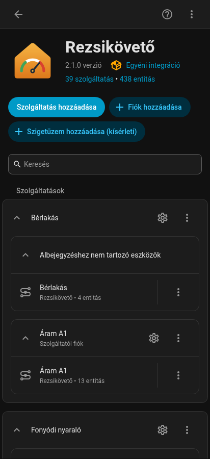

1. Beállítások → Eszközök és szolgáltatások → **Rezsikövető** → **Fiók hozzáadása**. A varázsló legfeljebb öt lépésből áll, és **csak az adott díjszabáshoz tartozó kérdéseket** teszi fel: H-tarifánál nincs napelem, A1-nél nincsenek H-regiszterek, víznél nincs kedvezményes keret, diktálásnál nincsenek átalány-mezők, gázmérő nélküli átalánynál pedig a szobaszám és a tűzhely után már csak a számlák (mappa, számlázási ütem) jönnek. Ha később díjszabást váltasz, a már nem érvényes beállítások mentéskor törlődnek.
2. **Név és közmű:** a fiók **neve** (pl. „Áram A1”) és a **közmű** (Villany / Gáz / Víz / Távhő (fűtés és melegvíz) / Hulladékszállítás).

   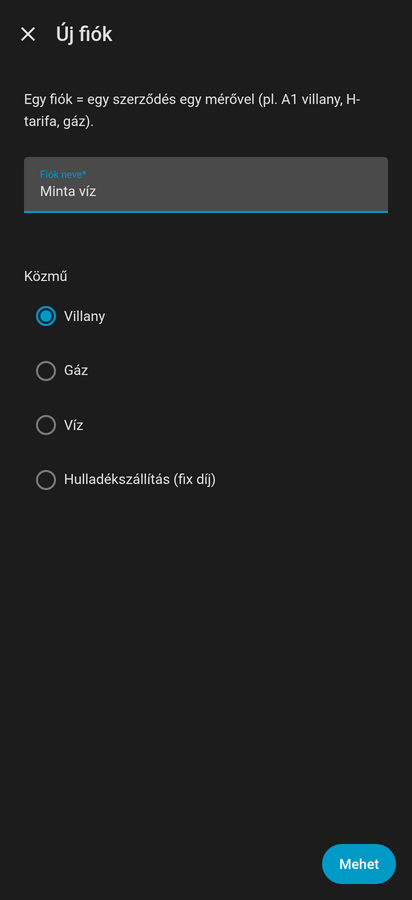

3. **Szolgáltatás:** szolgáltató és díjszabás (a számlán az „Árszabás” sor). A területhez kötött díjszabásnál (B Komfort: MVM Démász; B GEO: ELMŰ, MVM Émász) a varázsló szól, ha nem illik a szolgáltatóhoz.
4. **Elszámolás:** csak ami a díjszabáshoz tartozik – villanynál az **elszámolás módja** (diktálás / átalány / távleolvasás), gáznál és víznél a **fizetés módja** és az elszámolási időszak, a „kedvezményes keret jár” kapcsoló csak kerettel rendelkező díjszabásnál. **Gázmérő nélküli átalánynál** csak a **szobaszám** és a **gáztűzhely**; mérő nem kell, a következő lépésben a számlamappa és a számlázási ütem (pl. negyedéves) adható meg. **Távhőnél** a lakás **légtérfogata** (lm³, a számlán az alapdíj mennyisége) és a **havi hődíj-átalány** (GJ, a számlán a „Hődíj” mennyisége egy fűtési hónapban). Hulladékszállításnál ez a lépés kimarad.
5. **Mérő:** a mérő **gyári száma**, a **kezdőnap** és az **óraállás a kezdőnapon**, és ha van, a mérőállás-szenzor. A kezdőnapnak a legrégebbi feltöltendő számla induló állásának napját add meg (pl. „2026.08.04–2026.09.04  13 058 → 13 119” → 2026-08-04 és 13 058) – a kezdőnap előtti állásokat a program nem veszi át. H-tarifánál itt adhatók meg a téli/nyári regiszter szenzorai, víznél a locsolási almérő, A2-nél a csúcs/völgy regiszter, gáz B1-nél a mérő teljesítménye, fogyasztói közösségnél a lakásszám. A „havi elosztás szenzora” csak gáznál és víznél. Hulladékszállításnál ez a lépés kimarad.
6. **Számlák és fizetés:** **számlamappa**, **számla-mérők** (előre kitöltve a mérő gyári számával; távhőnél nincs, mert a távhőszámlán nincs mérőszám), a számlázási ütem; átalányos/részszámlás fióknál az átalány mennyisége és a részszámlák.
7. **Mehet.** A fiók elkészül, és pár másodperc múlva megjelenik a panelen; ha van számlamappa, a számlákat magától beolvassa.

**Később módosítás:** a fiók sorában a ⚙ (fogaskerék) – ugyanazok a lépések, a mostani értékekkel. Minden mező utólag is átírható, a mérő kezdőnapja és kezdőállása is (egymérős fióknál a tárolt mérőre is átvezetődik). Az utólag beírt (vagy átírt) kezdő óraállás is az elszámolások origója lesz; ha kiüríted, a bejegyzés eltűnik. Ha a kezdőnapot vagy a kezdőállást módosítod, a lezárt időszakok a korábbi naptól magától újraszámolódnak (pl. korábbra tett kezdőnapnál a hiányzó hónapok is lezárulnak); kézzel: `hu_rezsi.lezartak_ujraszamolasa`. Ha a számlamappa, a számla-mérők, a díjszabás vagy a mérő kezdő adatai megváltoznak, a mappát magától újraolvassa (a kézzel rögzített számlák maradnak).

**Fiók törlése:** a fiók sorában ⋮ → **Törlés**. A fiók tárolt adatai (leolvasások, számlák, lezárt időszakok) is törlődnek.

### 4.3 Ajánlott sorrend az első napon

1. Hozd létre a háztartást, majd fiókonként a fiókokat.
2. Minden fióknál add meg **a legutóbbi elszámoló számlán szereplő leolvasást** kezdőállásként (vagy egy friss saját leolvasást).
3. Állítsd be a **számlamappát** (ha van Díjnet), vagy töltsd fel a legutóbbi néhány számlát a panelről (lásd [9. fejezet](#9-számlák-felvitele)).
4. Nézd meg a panelt: ha valahol „nincs adat” vagy furcsa érték van, a [15. fejezet](#15-gyakori-kérdések-és-hibaelhárítás) segít.

---

## 5. A fiók beállításai mezőnként

Nem minden mező jelenik meg minden közműnél (pl. almérő csak víznél, H-regiszter csak H-tarifánál).

### 5.1 Alapadatok

| Mező | Mit írj be | Példa |
|---|---|---|
| **Szolgáltató** | akitől a számla jön; a díjak a szolgáltató hivatalos díjaival indulnak | MVM Démász, E.ON, OPUS TITÁSZ, ELMŰ, MVM Émász, MVM Next (gáz), DAKÖV (víz), Helyi vízmű, MOHU, Egyedi |
| **Díjszabás (tarifa)** | a szerződésed tarifája (a számlán az „Árszabás” sor) | A1 – általános lakossági; A2 – kétzónás; H – hőszivattyús; B – vezérelt (éjszakai); B Komfort; B GEO; Lakossági földgáz (20 m³/h alatti / feletti mérő); Fogyasztói közösség (gáz); DAKÖV; Víz (egyedi); MOHU |
| **Díjszabás érvényes ettől** | mikortól számoljon ezzel a tarifával | 2024-01-01 |
| **Elszámolás módja** (csak villany) | hogyan számláz a szolgáltató – ez dönti el az időszakot és a fizetés módját (lásd lent) | *Diktálás*, *Átalány*, *Távleolvasás* |
| **Elszámolási időszak** (gáz, víz, hulladék) | a havi számítás határa | *Naptári hónap*, *Egyedi kezdőnap* (pl. gáz: a számla 14-étől 13-áig → 14), *Naptári negyedév* (szemétszállítás) |
| **Időszak kezdőnapja** | csak „egyedi kezdőnap”-nál | 14 |
| **Kedvezményes (rezsicsökkentett) keret jár** | ki/be | villany, gáz: be |

#### Az elszámolás módja (villany)

| Mód | Időszak | Kedvezményes keret | Mikor válaszd |
|---|---|---|---|
| **Diktálás** | **két egymást követő leolvasás között**: az előző leolvasástól (diktálástól) az utolsóig – a fogyasztás a két állás különbsége. Minden rögzített mérőállás (a kezdő óraállás is) határ; a számlák időszaka nem. A lezárt időszak ezért **a számlától eltérhet** (pl. Városi lakás 08.03–09.04: 61 kWh, 2 372 Ft; a számla 2 374 Ft). Az utolsó leolvasás után az időszak a következő leolvasásig nyitva marad (nincs havi „becsült” lezárás) | napi rész (6,91 kWh) × az időszak napjai, egész kWh-ra kerekítve | havonta te diktálod be az óraállást, és a számla ebből készül |
| **Átalány** | mint a diktálásnál: a diktálási időszakok; ha nem diktálsz, a számlán szereplő **diktálási ablak utolsó napjáig** (pl. „minden hónap 08–14 között” → 14-éig, így egy időszak 33 napos is lehet). A fizetendő **teljes naptári hónapban** – és a 14-étől 14-éig tartó időszakban is – hónaponként pontosan a **havi átalány-mennyiség** (pl. 293 kWh), azaz havi × a hónapok száma, a 30 és a 31 napos hónapban ugyanannyi; a nem teljes hónapos időszak (pl. az éves leolvasás utáni 46 nap) napra arányos. Ha diktálsz, a szolgáltató a diktált adattal számol. | napi rész × az időszak napjai | fix részszámlát kapsz, évente elszámolóval |
| **Távleolvasás** | **naptári hónap**, 1-jétől a hónap végéig (az első időszak a számlán szereplő kezdőnaptól) | napi rész × a hónap tényleges napjai | okosmérőd van, a szolgáltató távolról olvassa le – **mérőállás-jelentéssel nincs dolgod**: a kártyán nincs diktálási sor és figyelmeztetés |

- **Átalánynál** az időszak **a diktálás napjával zárul** (ez a nap még benne van), a következő másnap indul. Időszakhatár a számlákon szereplő leolvasás és elszámolt időszak, valamint az a saját leolvasás, amelynél a Mérőállás ablakban bepipálod: **Diktáltam a szolgáltatónak**. Egy ellenőrzésre rögzített saját leolvasás nem zárja le az időszakot. Ha egy diktálás elmarad, a várható határ havonta tovább tolódik.
- **Átalánynál** a számla az átalány szerint jön; a kártya fejlécében a *Következő számla* a számlázási ütemre számolt átalány („pontos”; kéthavonta 2 × havi; a havi összeg akkor is egy hónapé, ha a folyó időszak hosszabb), a *Folyó időszak* pedig tájékoztatásul a mért fogyasztás díja. **Ha a szolgáltató valójában diktálás szerint számláz** (az utolsó két számla elszámoló, vagy 120 napon belül diktáltál), a kártya a **mért diktálásos fiókéra vált**: az időszak a legutóbbi számla utolsó napja utántól a várható diktálásig (a diktálási ablak közepéig) tart; a fejléc *Következő számla* blokkja a következő diktálásig mért (vagy becsült) fogyasztás díja, a kedvezményes keret is erre az időszakra. Az átalány csak a felső tájékoztató sorban marad („– most nem ezt számlázzák” ⓘ); *Ha ma lenne az elszámolás* és *éves egyenleg* nincs – havonta elszámoló számla jön, minden hónap ki van egyenlítve, éves ráfizetés nem gyűlik (az összesítő sem figyelmeztet rá). Ha diktáltál, a diktált, még nem számlázott időszak „Még nem érkezett számla”, a folyó időszak a diktálás utántól a következőig. Ha egyszer nem diktálsz és átalányszámla jön, a kártya magától visszavált az átalányos nézetre. Minden átalányszámla után a Részletek → Mérőállások között „számla alapján” bejegyzés mutatja, milyen állást feltételez a szolgáltató (az utolsó valódi állás + az azóta számlázott átalány); ez tájékoztató, a fogyasztás számítását nem befolyásolja.
- **Átalánynál** a havi mennyiség a fiók *Átalány mennyisége havonta* mezőjéből jön; ha üres, a **legutóbbi számlán** szereplő „A következő részszámla becsült mennyisége” értékből (MVM). A kártyán az ⓘ megmutatja, melyikből.
- **Teljes hónapban pontosan a havi átalány jár** (2.2.0 óta): ha az időszak teljes naptári hónapokból áll (pl. nov. 1. – dec. 1.), vagy azonos napon kezdődik és végződik (14-étől 14-éig), az átalány mennyisége pontosan havi × hónapok száma – a 30 és a 31 napos hónapban és februárban is ugyanannyi. A nem teljes hónapos időszak (pl. az éves leolvasás utáni 46 nap) napra arányos (havi × 12 / 365 naponta). Korábban mindig napra osztott, így egész m³-es víznél a 30 napos hónap 1 m³-e 0,986 m³ lett, és 0-ra kerekedett.
- A mód nélküli, régebbi villanyfiók a korábbi *Elszámolási időszak* és *Fizetés módja* beállítással működik tovább; a fiók szerkesztésekor a mód előre kitöltődik (részszámlásnál *Átalány*, különben *Távleolvasás*).

### 5.2 Mérő

| Mező | Mit írj be |
|---|---|
| **Mérő gyári száma** | a számlán szereplő gyári szám (a számlák ez alapján kerülnek a jó fiókhoz) |
| **Kezdőnap** (opcionális) | innen indul a számítás (a mérő beszerelése, vagy egy leolvasás napja). Üresen hagyva: a folyó elszámolási időszak eleje, ha a szenzornak van rá HA-statisztikája, különben a mai nap |
| **Óraállás a kezdőnapon** (opcionális) | az óraállás azon a napon. Üresen hagyva a szenzorból veszi: a kezdőnapi HA-statisztikából, ha nincs, a szenzor mostani értékéből – ilyenkor a kártya kiírja, hogy a költségkövetés ma indult. A kézzel beírt érték mindig erősebb. **A beírt kezdő óraállás az elszámolások origója:** innen indul az elszámolási év és a „Ha ma lenne az elszámolás” (amíg egy későbbi éves leolvasás át nem veszi), és a Részletek → Mérőállások között „kezdő óraállás” forrással, ★-gal látszik |

### 5.3 Automatikus mérőállás-szenzor (opcionális)

| Mező | Mit írj be |
|---|---|
| **Automatikus mérőállás-szenzor** | a szenzor, amelynek értéke a mérővel együtt nő (lásd [2. fejezet](#a-mérőállás-szenzor)) |
| **A szenzor értéke** | *Mérőóra-állás* vagy *Csak növekvő számláló* |
| **Szenzor-szorzó** | fix szorzó, ha nem kéred az automatikus korrekciót (pl. 1,0412). Általában hagyd 1-en |
| **Automatikus mérő-korrekció** | a valódi leolvasásokból (számla, diktálás, saját leolvasás) kiszámolja, hány százalékkal mér kevesebbet vagy többet a szenzor az óránál, és ezzel korrigál. Legalább 3 leolvasás kell 45 napon át. Alapból be van kapcsolva |
| **Havi elosztás szenzora** | ritka (pl. évi egy) leolvasásnál az éves összevetés ennek a szenzornak a napi alakja szerint osztja el a fogyasztást a hónapokra – pl. a kazán működési idejéből becsült gáz. A szenzor által nem látott részt (melegvíz, főzés) egyenletesen. A számlaszámítást nem érinti |
| **A szenzor érvényes ettől** | ha a szenzor korábbi adatai hibásak (pl. képletjavítás előtt), az ez előtti értékeit figyelmen kívül hagyja |

A **kézi leolvasás mindig erősebb** a szenzornál: a Rezsikövető a szenzor értékeit a leolvasásokhoz igazítja.

> [!TIP]
> **Automatikus korrekcióhoz a nyers szenzort add meg** (pl. a Shelly *összes energia* szenzorát, *Csak növekvő számláló* típussal), ne egy olyan sablon-szenzort, amely már szoroz és amelyet kézi eltolással az órához igazítasz. Az ilyen szenzornál a korrekció ~1 lesz (a kézi igazítás már elvégezte), és a kézi eltolás-ugrások a leolvasások között torzíthatják a fogyasztást.

### 5.4 Fizetés, számlázás

| Mező | Mit írj be |
|---|---|
| **Fizetés módja** (gáz, víz) | *Fogyasztás szerint* (minden számla a valódi fogyasztásról szól) vagy *Részszámlás (átalány)*: havi fix részszámla, időszak végén elszámoló számla ráfizetéssel vagy visszatérítéssel. Villanynál az *Elszámolás módja* dönti el. **Gáznál a kedvezményes keretet is ez dönti el:** fogyasztás szerint havonta súlyozott, átalánynál éves (lásd [6.4](#64-gáz)). |
| **Gázmérő névleges teljesítménye** (gáz B1) | m³/h – a B1 díjszabás alapdíja m³/h-nként jár (a mérő adattábláján vagy a számlán) |
| **Fogyasztói közösség típusa, lakások száma** (gáz A3) | társasház / lakásszövetkezet: keret (lakásszám + 1) × 63 645 MJ; családi fogyasztói közösség: lakásszám × 63 645 MJ |
| **Részszámlák száma évente** | az elszámoló számlán kívül (MVM gáz: 11; DAKÖV: 5 kéthavi részszámla az éves elszámolás mellett). Ha a számla közli a következő leolvasást, a ciklust és a részszámlák számát a program abból veszi |
| **Részszámla összege** | Ft; ha üres, a legutóbbi részszámla összegét veszi |
| **Átalány mennyisége havonta** | ha a szolgáltató mennyiséget számláz átalányként (pl. 293 kWh/hó, 11 m³/hó); elsőbbséget élvez az összeggel szemben. Villanynál üresen a legutóbbi számla „következő részszámla becsült mennyisége” érvényes. Teljes hónapban (és 14-étől 14-éig) hónaponként pontosan ennyi jár, a 30 napos hónapban is; csak a nem teljes hónapos időszak napra arányos. |
| **Számlázási ütem** | milyen gyakran jön számla: havonta / kéthavonta / negyedévente / négyhavonta / félévente / évente; üresen a számlákból becsli |
| **Elszámolási ciklus** | milyen gyakran jön elszámoló számla: félévente (pl. DAKÖV) / évente |
| **A szolgáltató következő éves leolvasása** (opcionális, tört évnél) | beköltözésnél, új szolgáltatásnál: a szolgáltató éves leolvasásának várható napja (pl. az otthon többi mérőjéé). Az első év **tört év**: a kezdőnaptól eddig tart – ehhez igazodik a „Következő elszámolás”, az átalányos éves egyenleg és a részszámlák száma; a kedvezményes keret a kezdőnaptól napra arányosan jár. Ha a számlán szerepel a következő leolvasás, az erősebb. Legfeljebb 12 hónap + 1 hónap lehet a kezdőnaptól. Ha ennek környékén (±31 nap) rögzítesz egy éves (elszámoló) leolvasást, a megadott dátum teljesültnek számít: a következő éves leolvasás onnan egy év |
| **Diktálási ablak** (opcionális, pl. `8-14`) | a hónap mely napjain lehet diktálni. Új fióknál, amíg nincs számla: ebből tudja a Rezsikövető, meddig tart a folyó időszak (az ablak végéig; a 20 napon belüli ablak kimarad – pl. az éves leolvasás után az első) és mikor jön a következő számla. Ha a számlán szerepel a diktálási időszak, az erősebb. **Több havonta számlázó szolgáltatónál** a díjszabás mondja meg, melyik hónapban lehet diktálni: ALFÖLDVÍZ – az elszámolási időszak vége utáni hónap 10–15-én; DAKÖV (kéthavi) – a záró hónapban, a számla zárása előtt, 20–25-én. A kártyán a következő ilyen ablak látszik (pl. „Diktálás: 2027. jan. 10. – jan. 15.”) |
| **Előző évi fogyasztás** | ha nincs két elszámoló leolvasásod; az éves egyenleg előrejelzéséhez (pl. víznél 2 havonta 22 m³ → 132) |
| **Használat** | *Állandó* (lakás, ház – alapértelmezés) vagy *Nyaraló (idényes)*: az éves egyenleg előrejelzése nyaralónál havi profillal számol (jún.–aug. a fogyasztás ~¾-e, télen szinte semmi), nem a nyári napi átlaggal – így a nyári ráfizetés mellett is látszik, hogy a téli átalányok év végére kiegyenlítik |
| **Díjnet-szolgáltató** | ha a Díjnet-integráció kifizetett számláiból vegye a befizetéseket |
| **Számlázás szünetel ettől / Szünetelés vége** (opcionális) | ha a szolgáltatás szünetel – pl. haláleset vagy katasztrófa miatt lakatlan az ingatlan, a mérő plombálva –: ettől a naptól a Rezsikövető **semmit nem számol** (se fogyasztást, se alapdíjat, se havi tételt, se számlánkénti minimumot), és számlát, részszámlát sem vár (nincs „elmaradt számla” jelzés). A kártyán „A számlázás szünetel …” sáv látszik. Ha a szolgáltatás újraindult, add meg a szünetelés utolsó napját: így a szünet ideje a múltban is nulla marad. |
| **A lakás légtérfogata** (távhő) | lm³ – a számlán az alapdíj mennyisége (pl. „Alapdíj 118,30 lm3”); a fűtési és a melegvíz-alapdíj ezzel szorzódik |
| **Havi hődíj-átalány** (távhő) | GJ/hó – a számlán a „Hődíj” mennyisége egy fűtési hónapban (pl. 2,0939 GJ); október–március számlázzák előre |

### 5.5 Számlák

| Mező | Mit írj be |
|---|---|
| **Számlamappa** | a config mappán belüli mappa, ahova a számlák kerülnek (pl. a Díjnet letöltési mappája: `Dijnet /mvm_next_aram`). A felület felajánlja a számlát tartalmazó mappákat. |
| **Számla-mérők** | vesszővel elválasztott gyári számok – ha egy mappában több fiók számlája van (pl. A1 és H egy szerződésen), ezzel választható szét. Üresen villanynál a számla árszabása (A1/H) és a fiók díjszabása dönt; más közműnél a mappa minden számlája ehhez a fiókhoz tartozik. A mérőszám nélküli számlákat (távhő, MOHU) a szűrő nem zárja ki. A gyári számot úgy írd be, ahogy a számlán áll (az MVM-számlán 15–18 jegyű is lehet). |

### 5.6 Közműfüggő mezők

| Mező | Közmű | Mit írj be |
|---|---|---|
| **H-tarifa: téli regiszter (1.81) szenzora** | villany, H | a téli regiszter szenzora |
| **H-tarifa: nyári regiszter (1.82) szenzora** | villany, H | a nyári regiszter szenzora (a télivel együtt) |
| **Locsolási almérő a főmérő mögött** | víz | be, ha van locsolási almérőd |
| **Almérő-szenzor / kezdőnap / állás** | víz | mint a főmérőnél |
| **Csatornadíj** | víz | be (az almérőé automatikusan levonódik) |
| **Napelem (kísérleti)** | villany | *Nincs* / *Bruttó* / *Szaldó* |
| **Betáplálás-szenzor (2.8.0)** | villany, napelem | a hálózatba visszatáplált energia szenzora |

---

## 6. Közművenként

### 6.1 Villany – A1 (általános)

- **Kedvezményes keret:** évi 2 523 kWh mérőnként, napra leosztva 6,91 kWh × a számlázott napok, **egész kWh-ra kerekítve** (pl. 26 napra 180 kWh). A keret fölötti rész lakossági piaci áron (bruttó 70,104 Ft/kWh rendszerhasználati díjjal együtt).
- **Elszámolási év és sávkorrekció:** a keret az éves elszámoló leolvasástól a következő éves elszámoló leolvasásig tart. Ezen belül halmozódik: ha egy hónapban nem használod ki, a maradék a későbbi számlákon piaci helyett kedvezményes áron jár (a számlán „sávkorrekció” sor), és fordítva. A következő elszámolási évre **nem vihető át** – az éves elszámoló leolvasással újraindul.
- **Díjak:** energia + rendszerhasználati díj, nettó tételenként, +27% ÁFA; havi alapdíj (számlánként egy hónap).
- **Elszámolás módja:** diktálás, átalány vagy távleolvasás – a különbség az [5.1 fejezetben](#az-elszámolás-módja-villany). Az MVM átalányos számláin szerepel a következő havi mennyiség (pl. „24 órás 293 kWh”); a Rezsikövető ezt magától átveszi, ha a fiókban nem adsz meg mást.

- **Éves leolvasás egy otthonban egyszerre:** az elosztó az otthon összes villanymérőjét (A1, H, B…) ugyanakkor olvassa le évente. A számla alján álló „Következő leolvasás várható időpontja” (pl. 2026.09.22–10.09) magától bekerül; ha az otthon bármelyik villanymérőjén van ebbe az időszakba eső mérőállás (pl. a saját szeptember 29-i leolvasásod), az lesz **minden villanyfiók** elszámolási évének kezdete – a kedvezményes keret halmozása, az éves egyenleg és a „következő elszámolás” (egy évvel később) ebből indul.
- **A kártya fejlécében** külön sorban: az éves leolvasás, a következő elszámolás, a diktálási időszak; átalánynál az **átalány**, amiből a havi fizetendőt számolja (kWh/hó és Ft/hó, beállított vagy számla szerinti), alatta a legutóbbi számla szerint **elszámolt mennyiség** (részszámla vagy elszámoló, időszakkal).
- **Tiszta lap az éves leolvasástól:** a „Ha ma lenne az elszámolás” és az éves egyenleg az éves leolvasás napjától számol; az előző év (akár zavaros, sztornós, mínuszos) számlái nem számítanak bele.
- **Diktálás vagy átalány:** ha havonta diktálsz, minden számla elszámoló számla a diktált állásról – ilyenkor a kártya fejléce a folyó időszak díját mutatja (eddig és várhatóan), éves egyenleg nincs. Átalánynál (havi fix részszámla) a fejlécben az átalány a következő számla, lent az éves egyenleg látszik. Az elszámolás módja a fiók beállításában választható, a számláidhoz igazítsd. Átalánynál a saját havi leolvasásokat **ne jelöld diktáltnak** – a diktált állásból a Rezsikövető arra következtet, hogy diktálás szerint számláznak, és az éves egyenleg eltűnik.
- **Napelem, szaldó (kísérleti):** az éves elszámolás a vételezés (1.8.0) és a betáplálás (2.8.0) **különbözetén** megy. Ha a különbözet pozitív, arra jár a kedvezményes keret (évi 2 523 kWh, a nettóra) és a díj; ha negatív, csak az alapdíj, és a többletet a szolgáltató jóváírja. Ebből számol a *Ha ma lenne az elszámolás*, az *Éves egyenleg* (a hátralévő betáplálást a tavalyi, ennek híján egy tipikus napelemes havi profil szerint jelzi előre) és az előző év visszamérése. A keret-csík éves, a nettó vételezést mutatja; havi keret és „elfogy” dátum nincs. Átalányos szaldós fióknál a kártya a folyó időszak *vételezését* és várható *betáplálását* (a tavalyi ugyanazon napokból, ennek híján napelemes profillal) is mutatja, és a **nettót** veti össze az átalánnyal. A kártya fejlécében az éves leolvasás és az **utolsó állás** mindkét regiszterrel (1.8.0 vételezés, 2.8.0 betáplálás) látszik; a *Mérőállások* listája a legutóbbi 15 nap állásait mutatja regiszterenként. A betáplálás kezdőállása a legkorábbi rögzített 2.8.0-s állás (a varázslóban nem kell megadni). Példa (Minta otthon): 2 790 kWh vételezés, 2 440 kWh betáplálás → 350 kWh nettó, az éves díj 14 580 Ft (betáplálás nélkül 112 470 Ft lenne).

### 6.2 Villany – H-tarifa (hőszivattyú)

> [!TIP]
> Ha a téli (1.81) vagy a nyári (1.82) regiszternek két leolvasás között nincs szenzoradata, a Rezsikövető a regiszter növekményét **csak a saját idénye napjaira** osztja el (a nyári regiszter télen nem nő, és fordítva) – különben a nyári fogyasztás egy része télre, keret nélküli piaci árra kerülne.

- **Téli időszak (okt. 15. – ápr. 15., mindkét napot beleértve; a nyári ápr. 16-án indul):** kedvezményes H-ár, keret nélkül (1.81-es regiszter). Ez a fogyasztás a keretbe sem számít bele.
- **Nyári időszak (1.82-es regiszter):** az A1 árai, **saját, 2 523 kWh/év kedvezményes kerettel** (a hagyományos mérőtől külön), amely csak az idényen kívüli napokra jár; felette piaci ár. A keret az elszámolási évben ugyanúgy halmozódik (sávkorrekció), mint az A1-nél – csak a nyári napok és a nyári fogyasztás számít bele.
- **Mérőállás rögzítése H-nál:** a „Mérőállás” ablak – mint az MVM alkalmazása – csak az **1.81 (téli)** és az **1.82 (nyári)** állást kéri, a legutóbbi értékekkel előtöltve; az 1.8.0 (összes) a kettő összege, a Rezsikövető számolja és tárolja (ebből számol). A Részletek → Mérőállások listában az állás mellett a regiszter neve áll, és egy napon csak az idényhez tartozó regiszter látszik (mindkettő, ha mindkettő nőtt).
- **Regiszterek a számlákból:** az MVM H-tarifás számláján a mérőnek két sora van ugyanarra az időszakra – **az első (jelölés nélkül) a nyári 1.82, a második a téli 1.81**; látszik is: télen csak a második, nyáron csak az első nő. A Rezsikövető a számlák valódi (diktált, leolvasott) regiszterállásait is rögzíti (Részletek → Mérőállások), a már tárolt számlákból egyszeri pótlással. Ha a szolgáltató felcserélt regiszterekkel számlázott (pl. telefonos diktálásnál), a hibás állás a Mérőállás ablakban az adott napra felülírható.
- Ha mindkét regiszter szenzorát megadod, a kettő külön mérődik és számolódik; októberben és áprilisban a kártyán mindkét tarifa külön sorban látszik.
- Ha nincs külön regiszter-szenzorod, a fiók a teljes fogyasztásból, naptár szerint bontva számol.

### 6.3 Villany – B (vezérelt, éjszakai)

- **Kedvezményes keret:** a vezérelt mérő külön felhasználási hely, **saját 2 523 kWh/év kerettel**; felette lakossági piaci ár (bruttó 60,935 Ft/kWh rendszerhasználati díjjal együtt). A keret az elszámolási évben ugyanúgy halmozódik (sávkorrekció), mint az A1-nél.

### 6.3.1 Villany – B Komfort, B GEO, A2

- **B Komfort** (vezérelt, napi 12 óra felfűtés; az árlapon csak MVM Démász területen): mint a B – saját 2 523 kWh/év keret, felette piaci ár (bruttó 23,330 / 60,935 Ft/kWh).
- **B GEO** (hőszivattyús vezérelt, csak meglévő szerződés, ELMŰ és MVM Émász terület): **nincs keret és nincs piaci ár** – a teljes fogyasztás bruttó 23,368 Ft/kWh.
- **A2 – kétzónás:** csúcs- és völgyidőszak külön kedvezményes áron, a keret felett mindkettő piaci áron. **Völgyidőszak:** munkanapokon 22–06 óra, nyári időszámítás idején 23–07 óra, nem munkanapokon (hétvége, ünnepnap, áthelyezett pihenőnap) egész nap; a ledolgozós szombat munkanap. A 2 523 kWh/év keret a **mérési pontra közös**; a Rezsikövető a zónák között a fogyasztásuk arányában osztja meg, és az elszámolási évben halmozza (sávkorrekció).

    - Ha megadod a **csúcs (1.8.1)** és a **völgy (1.8.2)** regiszter szenzorát, a kettő külön mérődik (a mérőállás-rögzítőben regiszterenként is rögzíthetsz).
    - Nélkülük a fiók **mérőállás-szenzorának órás adataiból** bontja csúcsra és völgyre, a fenti időszabály szerint. Ahol nincs órás adat (pl. csak kézi leolvasás), az órák arányából becsül (egy munkanap 1/3-a, egy nem munkanap egésze völgy) – „becsült” jelöléssel.

### 6.3.2 Villany – D (dinamikus)

- **Kinek:** csak A1-es mérőre kérhető, ha a mérő **távlehívható** és **havi idősoros** elszámolású (okosmérőt az elosztó jelenleg 5 000 kWh/év felett szerel, díjköteles lehet). Előre fizetős mérő, szaldós napelem, lejárt tartozás vagy ideiglenes bekapcsolás mellett nem választható. **Legkorábban 2027. január 1-jétől** kezdődhet; visszalépés után 12 hónapig nem kérhető újra.
- **Ár:** a kedvezményes keretig (2 523 kWh/év, napi 6,91 kWh) az **A1 kedvezményes ára**. Felette a **rugalmas egységár**: negyedóránként a HUPX tőzsdei ár × az MNB napi euróárfolyama + **13,70 Ft/kWh kereskedői díj** (nettó). A hónap egységára a negyedórás fogyasztásoddal súlyozott átlag – mindenkinek más. A rendszerhasználati díj és az alapdíj mint az A1-nél.
- **Árforrás:** az MVM havonta közzéteszi az utolsó 12 hónap negyedórás rugalmas egységárait. A Rezsikövető ezt **magától letölti** (naponta egyszer ellenőrzi), és a te fogyasztásoddal súlyoz. A még közzé nem tett napokra (az előző és a folyó hónap, holnap éjfélig) az árat az MVM képletével **maga számolja**: a HUPX negyedórás másnapi ára (energy-charts.info) × az MNB napi euróárfolyama (munkaszüneti napon az előző banki napé) + 13,70 Ft/kWh. Ez a közzétett MVM-listával fillérre egyezik; a lista megjelenésekor az lép a helyébe. Csak ha egyik sem érhető el, akkor becsül a legutóbbi hónap súlyozott árával.
- **D fiók:** válaszd a „D – dinamikus” díjszabást; az elszámolás mindig naptári havi (távleolvasás), ezt a varázsló nem kérdezi.
- **D tarifa elemzés** – az A1 fiók kártyáján egy „D tarifa elemzés” sor (csak ha az elmúlt 12 hónapban volt kereten felüli fogyasztás – a D tarifa csak azt árazza másképp); rákoppintva ablak nyílik:
    - **Hónap** választó (a folyó hónappal kezdve, visszafelé 13 hónapig) és **Nap** választó (egész hónap vagy egy nap).
    - **Vonalas grafikon negyedórás bontásban**, kék: A1, narancs: D. Három nézet: **Költség** (negyedóránként, bruttó Ft), **Halmozott** (a tartomány elejétől összeadva – itt látszik legjobban, melyik a drágább), **Egységár** (a keret feletti energiadíj bruttó Ft/kWh-ban, mögötte halványan a fogyasztásod – látszik, mikor olcsó a D). A grafikonra mutatva/koppintva a negyedóra adatai.
    - Fölötte az összesítés: A1-gyel, D-vel, az eltérés (narancs: a D többe kerülne, zöld: olcsóbb lenne), a fogyasztás (ebből a keret feletti rész és rajta a D-ár), valamint a hónap **kedvezményes kerete** és hogy **mikor léptük át** (vagy mennyi van még hátra).
    - **Hogyan számol (naptári hónap):** a hónap kedvezményes kerete napi 6,91 kWh × a hónap napjai (pl. 31 napra 214 kWh), és a hónap elejétől, negyedóráról negyedórára fogy. Amíg tart, mindkét árszabáson a kedvezményes ár jár – a grafikonon a halványzöld „kedvezményes keretben” szakasz, ahol a két vonal együtt fut. Az **átlépés** negyedórájától (narancs függőleges vonal; azon a negyedórán belül arányosan) az A1-nél a piaci ár (31,80 Ft/kWh nettó), a D-nél az adott negyedóra ára. Mindegyikhez a rendszerhasználati díj, bruttó; az alapdíj azonos, kimarad.
    - **Két számítás, választható** (kapcsoló az ablak tetején, a választás megmarad):
        - **MVM szerint** (alapértelmezett, ahogy a D-számla számol): a keret feletti mennyiséget a hónap *összes* negyedórás fogyasztásával súlyozott átlagáron számlázzák. A grafikonon ezért a hónap keret feletti aránya (pl. 26%) minden negyedórára egyformán jut – a két vonal már a hónap elejétől szétválik.
        - **Átlépés szerint:** az átlépés negyedórájától az adott negyedórák D-árával – a két vonal az átlépésig együtt fut. Megmutatja, mennyit számít, *mikor* fogyasztasz a keret elfogyása után.
        - A kettő havonta általában néhány száz forinttal tér el (télen több), egyik sem mindig a kedvezőbb.
    - **Havi kimutatás** (táblázat a grafikon alatt): a folyó és az előző 12 naptári hónap – fogyasztás, keret feletti rész, az átlépés napja és ideje, A1, D (a választott számítással) és az eltérés; alul a 12 lezárt hónap összesen. Sorra koppintva az a hónap nyílik meg. Mobilon a keret feletti és az átlépés oszlop rejtve.
    - **Negyedórás fogyasztás:** a mérő szenzorának 5 perces statisztikájából. A HA ezt csak néhány napig őrzi, ezért a Rezsikövető óránként a saját tárába menti (`.storage/hu_rezsi_negyedek.*`), így ez a funkció bekapcsolásától gyűlik. A korábbi hónapokra az órás statisztika negyedét veszi (egyenletesen elosztva, az ablak jelzi). A mennyiség a mérőleolvasásokhoz igazított havi elszámolásé (a szenzor alakja szerint elosztva). **Szenzor nélküli fióknál** (csak mérőállás-rögzítés) a havi fogyasztás a mérőállásokból jön (két leolvasás között napokra arányosítva), és a hónapon belül egyenletesen oszlik el – a napszaki alak ismeretlen, a D-ár így a hónap egyszerű átlaga (közelítés, a táblázatban „≈”). Az utolsó mérőállás utáni napok nem ismertek: az ilyen hónap „‡” jelet kap, és nem számít a 12 havi összegbe – rögzíts új mérőállást. Ha a havi fogyasztás a kereten belül marad (pl. 60–80 kWh a havi ~210 kWh-s keretben), a D és az A1 költsége azonos.
    - A **„D árszabással – különbség (12 hónap)”** szenzor a 12 lezárt naptári hónap összege MVM szerint (attribútumként az átlépés szerinti is); 6 óránként frissül. Szaldós napelemnél az ablak figyelmeztet.

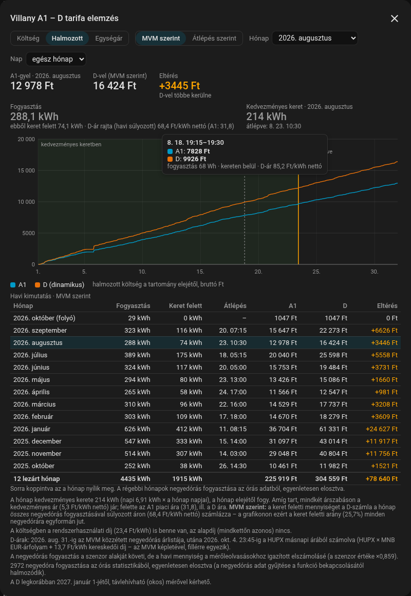

### 6.3.3 Munkarend (A2), díjszabások ellenőrzöttsége, számla-összevetés

- **Munkarend:** az A2 völgyidőszakához a munkaszüneti napokat a Munka törvénykönyve szerint (húsvét, pünkösd is) a Rezsikövető maga számolja, az **áthelyezett munka- és pihenőnapokat** pedig évente a rendelet szerint tárolja (2024: 15/2023. GFM, 2025: 11/2024. NGM, 2026: 10/2025. NGM – pl. 2026.01.02. pihenőnap, 01.10. munkanap). Nem a `holidays` csomagra hagyatkozik (régebbi változatában a friss év hiányzik). Új év rendeletét a `motor/munkarend.py` táblájába kell felvenni; addig a `holidays` csomag adata számít („nem ellenőrzött”).
- **Díjszabások ellenőrzöttsége:** minden díjszabás-verziónak van forrása, érvényessége és ellenőrzési állapota: *valódi számlával forintra összevetve*, *számláról, összevetés nélkül*, *hivatalos árlapról*, *ellenőrizendő* (pl. a HMKE átvételi árai) vagy *sablon*. A fiók **Részletek → Díjszabás** részében látszik (dátummal és hogy mivel ellenőriztük).
- **Számla-összevetés:** a `hu_rezsi.szamla_osszevetes` szolgáltatás (Fejlesztői eszközök → Műveletek, a fiók eszközével) a fiók valódi számláit számlánként összeveti a Rezsikövető számításával az elszámolt időszakra. A számla díja a bruttó számlaérték + a benne levont korábbi részszámlák (a fizetendő ettől eltérhet); jelzi, hol van az időszak mindkét végén valódi mérőállás. Eredmény 2026-10-04: Városi lakás A1 17 számlából 14 forintra (mind ±2 Ft), Városi lakás H 10 forintra (mind ±24 Ft); a részletek és a nyitott pontok: `docs/ellenorzes/szamla_osszevetes_2026-10-04.md`.
- **Gáz korrekciós tényező:** az MVM éves elszámolója a mérő korrekciós tényezőjével (hőmérséklet, nyomás; pl. 1,018) és az év fűtőértékével számol, a részszámlák 1,0-val és havi fűtőértékkel. A Rezsikövető az elszámoló számla értékeit a lefedett hónapokra átveszi (felülírják a részszámlák becsült értékét), a többi – pl. a folyó év – hónapjaira a legutóbbi elszámoló korrekciós tényezőjével számol, mert a következő elszámoló várhatóan azzal számláz. Kertes ház: a két éves elszámoló +8 és +5 Ft-tal tér el.
- **Keret kerekítése (MVM):** a kedvezményes keret számlánként (tételenként) kerekítve jár – kerek(6,9123 × a számla napjai), pl. 29 nap → 200 kWh; augusztus 1-jén a számla két tételre bomlik, a két rész külön kerekítve (23 nap → 159, 10 → 69). Az elszámolási évre halmozott keret ezeknek a kerekített részeknek az összege. Diktálásnál a számlázási időszakok a diktálások, naptári havi elszámolásnál a hónapok.
- **Az elszámolási év hossza:** legalább ~10 hónap (egy évközi végszámla, sztornó nem évkezdet – kivéve az „MVM-év kezdete” jelölésűt és a kezdő óraállást), és legfeljebb 12 hónap + 1 hónap tűrés (a leolvasás napja évről évre csúszhat, pl. okt. 1. → szept. 29.). Ha egy éves leolvasás kimarad, az évfordulón virtuális évhatár keletkezik, így a kedvezményes keret nem csúszik át a következő évbe.
- **Évkezdet kézzel:** a `hu_rezsi.leolvasas_rogzites` „MVM-év kezdete” (`evkezdet`) kapcsolójával egy leolvasás (pl. végszámla és új szerződés után) a 10 hónapos szabálytól függetlenül évkezdet lesz (Kertes ház A1: 2026.02.02.). A fiókban megadott kezdő óraállás (a mérő felszerelése) is mindig évkezdet – előtte nincs mérés (Kertes ház H: 2026.02.03.).
- **Alapdíj (MVM):** annyi havi alapdíj, ahány hónap 1-je esik az elszámolt időszakba (egyhavi számlán egy, töredék hónapon nulla, éves gázelszámolón tizenkettő); H-tarifánál télen a H saját, nyáron az A1 alapdíja – valódi számlákból megállapítva.

### 6.4 Gáz

- **MJ-ban számol**, mint a számla: m³ × korrekció × **havi fűtőérték** (MJ/m³). A fűtőérték a gázszámlán szerepel; számlamappából vagy feltöltéssel magától bekerül, kézzel a `hu_rezsi.futoertek_rogzites` szolgáltatással adható meg.
- **Díjszabások** (MVM, „Földgázdíjak az egyetemes szolgáltatásban”, nettó, +27% ÁFA; az árak 2023. október 1. óta változatlanok):

| Díjszabás | Kinek | Kedvezményes gázdíj | Piaci ár (keret felett) | Alapdíj |
|---|---|---|---|---|
| **Lakossági, 20 m³/h alatti mérő (A1)** | a legtöbb háztartás | 2,256 Ft/MJ (bruttó 2,9) | 17,324 Ft/MJ (bruttó 22,002) | 9 192 Ft/év (766 Ft/hó) |
| **Lakossági, 20 m³/h és afeletti mérő (B1)** | nagy teljesítményű mérő | 1,943 Ft/MJ (bruttó 2,5) | 17,324 Ft/MJ | 14 633 Ft/év **m³/h-nként** – add meg a mérő teljesítményét |
| **Fogyasztói közösség (A3)** | közös gázmérős lakóépület | 2,373 Ft/MJ (bruttó 3,0) | 17,324 Ft/MJ | 9 192 Ft/év |

- **Kedvezményes keret:** 63 645 MJ/év felhasználási helyenként (kb. 1 729 m³). Fogyasztói közösségnél társasháznál / lakásszövetkezetnél (lakásszám + 1)-szer, családi közösségnél lakásszám-szor ennyi – a fiókban add meg a **lakások számát** és a **közösség típusát**. A keret felett a versenypiaci költségeket tükröző ár.
- **A keret a fizetés módjától függ** (MVM lakossági rezsi GYIK – földgáz), lásd lent.

**Fogyasztás szerint (diktálás, leolvasás):** a keret **havonta súlyozott** – télen több, nyáron kevesebb. Egy számlára a benne lévő napok része jár (pl. a 14-től 13-ig tartó számlánál az előző hónap 18 és a következő hónap 13 napjáé). A ki nem használt keret a **kedvezményes évben (augusztus 1. – július 31.)** nem vész el, később jár (sávkorrekció); az évfordulón viszont nem vihető át. A korábbi túllépést a későbbi keret **nem** írja jóvá visszamenőleg (gáznál a keret csak előre vihető át). A panel csíkja **az adott havi számla** keretét mutatja.

| Hónap | MJ/hó | Hónap | MJ/hó |
|---|---|---|---|
| január | 12 365 | július | 512 |
| február | 10 421 | augusztus | 565 |
| március | 8 915 | szeptember | 1 109 |
| április | 5 145 | október | 3 724 |
| május | 1 827 | november | 7 490 |
| június | 635 | december | 10 937 |

Összesen 63 645 MJ; a hónapon belül naponta egyenletesen (szökőév februárjában is 10 421 MJ).

**Részszámlás (átalány, egyenletes részszámla):** a keret **éves** (az elszámolási évre).

**A panel keretcsíkja gáznál mindig az éves keretet mutatja** (63 645 MJ), az év elejétől **ténylegesen felhasznált** mennyiséggel – a mérőállás-szenzorból, ennek híján a rögzített mérőállásokból. Az év eleje átalánynál az éves elszámoló leolvasás, diktálásnál a kedvezményes év kezdete (augusztus 1.); diktálásnál alatta az adott számla havonta súlyozott kerete is látszik.

**Gázmérő nélküli átalány számlái:** az MVM gáz-PDF-eket XML nélkül is beolvassa (pl. „Földgáz elszámoló számla”, „Árszabás: Mérő nélküli”). Az MVM ezt jellemzően negyedévente számlázza, a negyedév 2. hónapjának végén, az adott negyedévről (pl. máj. 27-én ápr. 1. – jún. 30.); a Rezsikövető az időszakot a számlák szerint igazítja (a többhavi számla elszámolt időszakának eltolását a legutóbbi számlából veszi – a MOHU-nál utólagos, itt a negyedév közepén). A háztartás havi összegében csak a számla hónapjában szerepel.

**Gázmérő nélküli átalánynál** a kártya egyszerű: havi (negyedéves számlázásnál negyedéves – az időszakkal és a számla napjával) és éves díj, alatta a számlázás alapja táblázatban (elszámolás módja, szobaszám, tűzhely, havi MJ, egységár nettó/bruttó, havi díj = MJ × egységár + ÁFA) – keret, mérés, előrejelzés nincs.

**Gázmérő nélkül (átalánydíj):** ahol nincs gázóra, csak gáztűzhely, az MVM havi fix mennyiséget számláz a szobaszám és a tűzhely szerint, országosan egységes 2,465 Ft/MJ nettó (3,131 bruttó) áron, kedvezményes keret nélkül. Válaszd a „Földgáz – gázmérő nélkül” díjszabást; a varázsló csak a szobaszámot és a tűzhelyet kérdezi.

| Szobaszám | 2 lángú | 3–4 lángú | 4 lángú, elektromos sütővel | 5+ lángú | Garzon |
|---|---|---|---|---|---|
| 1 | 210 MJ · 657 Ft | 300 · 939 | 240 · 751 | 315 · 986 | 250 · 783 |
| 1,5 | 300 · 939 | 370 · 1 158 | 310 · 970 | 390 · 1 221 | 310 · 970 |
| 2 | 350 · 1 096 | 450 · 1 408 | 390 · 1 221 | 475 · 1 487 | 390 · 1 221 |
| 2,5 | 410 · 1 284 | 520 · 1 628 | 460 · 1 440 | 545 · 1 706 | 450 · 1 409 |
| 3 | 470 · 1 471 | 600 · 1 878 | 540 · 1 690 | 630 · 1 972 | 520 · 1 628 |
| 3,5 | 530 · 1 659 | 690 · 2 160 | 630 · 1 972 | 725 · 2 270 | 600 · 1 878 |
| 4 | 610 · 1 910 | 750 · 2 348 | 690 · 2 160 | 790 · 2 473 | 660 · 2 066 |

(MJ/hó · bruttó Ft/hó, MVM „Földgázdíjak mérő nélküli (átalánydíjas) ügyfeleknek 2023. október 1-jétől”.)

- **A kártya fejlécében:** az éves leolvasás, a számlán közölt következő leolvasás (pl. 2027.07.13–19), átalánynál a számla szerinti részszámla-mennyiség és összeg („Átalány: 103 m³/hó · 11 185 Ft/hó”), alatta a legutóbbi számla szerint elszámolt mennyiség (m³ és MJ). Ha a várt havi számla elmaradt, a kártya alján „esedékes volt … – még nem érkezett meg” áll.
- **Hónap végi diktálás:** naptári havi elszámolásnál (gáz, víz; villany távleolvasással) a hónap **utolsó napjára** rögzített saját állás a hónap zárása (a nap végét jelenti) – pl. a 07.31-i diktálás pontosan a július fogyasztását zárja; a számla erről a következő hónapban jön (utólag). Ha a fiók hónap közben indul (pl. 07.15-i mérőkezdés), az első, töredék hónap is számolódik.
- **Elszámolási időszak:** az MVM a hónap közepétől a következő hónap közepéig számláz (pl. 14-től 13-ig) – állítsd **Egyedi kezdőnapra** a számla szerint.
- Tipikusan **részszámlás**: 11 részszámla + éves elszámoló.

### 6.5 Víz

- **Vízdíj** a főmérő teljes mennyisége után; **csatornadíj** a főmérő **mínusz a locsolási almérő** mennyisége után; **alapdíj** (ivóvíz + szennyvíz) havonta; +27% ÁFA.
- **Almérő egész évben (DAKÖV):** a DAKÖV-számlák a locsolási almérő fogyasztását **idényen kívül is** levonják a csatornadíjból (pl. 2023 ősz 2 m³, 2025 tavasz 3 m³), ezért a Rezsikövető is egész évben levonja, és az almérőre egész évben rögzíthető mérőállás. Más szolgáltatónál, ha csak a locsolási idényben (máj. 1. – szept. 30., 58/2013. Korm. rendelet) jár a levonás, a díjszabás `almero_idoszak` szabálya korlátozza (az egyedi víz-sablonban ez az alap) – ilyenkor idényen kívül az almérőre állás sem rögzíthető.
- **Egész m³:** a szolgáltató az óraállásokat egész m³-re (lefelé) kerekítve olvassa, és ezek különbségét számlázza (pl. 741,6 → 749,3 = 749 − 741 = **8 m³**, bár a mért 7,7). A Rezsikövető is így számol, a díjbontásban a számlázott mennyiség mellett zárójelben a mért is látszik. Ezért egy-egy időszakban a díj nem pontosan a mért mennyiséggel arányos – a különbség a következő időszakban kiegyenlítődik.
- **Számlánként legalább 1 m³:** ha egy teljes számlázási időszakban (havi számlázásnál egy hónap, négyhavinál négy) az egész m³-es különbség 0, a szolgáltató akkor is 1 m³ vizet és csatornát számláz – a becsült (még nem érkezett) számla és a várható díj is így számol. Nem jár: a folyó hónap „eddig” értékében, a hónapokra bontott részekben (pl. négyhavi számlázásnál havonta), és **üdülőnél** (a fiók *Használat* mezője: nyaraló) – ott sajátos a számlázás.
- **Kéthavonta, utólag** számláznak (a számla a megelőző két hónapot számolja el), átalány-részszámlával; az elszámolás **évente**, a szolgáltató júliusi leolvasása után. A számla alján álló „Következő leolvasás várható időpontja” (pl. 2027.07.01–07.25) és „Következő diktálás várható időpontja” (pl. 2026.11.25–11.30) magától bekerül: a kártya fejlécében látszik, a diktálási időszak előtt egy héttel figyelmeztetés jelenik meg, és az elszámolási ciklus (éves) is ebből adódik.
- A kártya fejlécében a legutóbbi számla tetején álló **elszámolt mennyiség** is látszik („Számla szerint elszámolt: ivóvíz 28 m³, csatorna 22 m³”, időszakkal; átalánynál „átalány” jelöléssel). Víznél az átalány napi forintja és mennyisége nem jelenik meg – a számla szerinti elszámolt mennyiség a mérvadó; a kiállított számla fizetendője mellett, egy sorban a számlázott időszak mért fogyasztása áll.
- A fenti ütem a **DAKÖV**-é; 2026 márciusától kéthavonta számláz, diktálni a záró hónap 20–25-én lehet, különben átalányt számláz.
- Beépített vízművek: **DAKÖV**, **ALFÖLDVÍZ** (lásd 6.5.1), **DRV** (6.5.2) és **Fővárosi Vízművek** (6.5.3); más vízműnél válaszd az **Egyedi** díjszabást, és add meg a díjakat a kártya **Saját díjak** gombjával ([13.1](#131-saját-díjak-a-panelről)) vagy felülírással ([13. fejezet](#13-díjak-díjszabások-felülírás)).
- **Mezőföldvíz:** a részszámláit (2.3.0 óta) beépített saját beolvasó olvassa ([9.9](#99-ismeretlen-számla-kiolvasása-ai-val-saját-beolvasó-230-kísérleti)); a díjakat a Saját díjak adja meg.
- **Településenként más díj:** sok vízműnél (pl. Mezőföldvíz, vagy az önkormányzati tulajdonú településeken) a víz- és csatornadíj, az alapdíj településenként eltér. Ilyenkor is az **Egyedi** díjszabás a jó, a saját számlád díjaival: **Saját díjak** → ivóvíz (Ft/m³), csatorna (Ft/m³), alapdíj (Ft/hó), bruttóban, „érvényes ettől” dátummal. Ha a beépített vízmű díja nálad más, a beépített díjszabás mellett is ugyanígy felülírhatod.

#### 6.5.1 ALFÖLDVÍZ (Dél-Alföld)

- **Díjak** (nettó, +27% ÁFA): ivóvíz 234,00 Ft/m³, szennyvíz 240,30 Ft/m³, alapdíj nincs. Az **áthárított vízterhelési díj** a szennyvíz mennyiségére jár, a csatornadíjba vonva: 2025. március végéig 11,70, 2025. áprilistól 2,00, 2026. májustól 6,90 Ft/m³.
- **Részszámlák:** diktálás nélkül havi **1 m³ átalányt** számláz („Fogyasztás megállapításának módja: kalkulált”). Az ilyen mérőállás nem valódi leolvasás, a Rezsikövető nem veszi át. A Rezsikövető a teljes hónapra pontosan 1 m³-rel számol (a 30 napos hónapban is – a 2.2.0 előtt ez 0,986 m³ lett, és egész m³-re 0-ra kerekedett, így novemberben és februárban eltűnt a várható víz- és csatornadíj). A részszámlákat **összevonja**, amíg el nem érik a bruttó 3 810 Ft-ot, ezért 2026-tól 2–4 havonta jön számla. Aki diktál, annak havonta számláz.
- **Diktálás:** minden hónap 10–15-én lehet; a Rezsikövető a következő elszámolási időszak vége utáni hónap ablakát mutatja.
- **Éves elszámolás:** a leolvasó évente egyszer (februárban) olvas le; az elszámoló számla a teljes éves fogyasztást számolja, és levonja a részszámlákon kiszámlázott mennyiséget. A számla alján a következő leolvasás és diktálás időpontja magától bekerül.
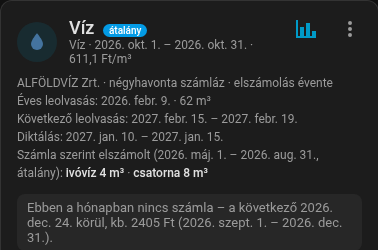

- **Számlák:** a PDF-et magától olvassa (rész- és elszámoló számla; a portálról letöltött, más formátumú PDF-et nem – azt kézzel kell rögzíteni).
- **Melegvíz szennyvize:** ha a melegvíz távhőről jön, 2026 májusától annak szennyvizét is az ALFÖLDVÍZ számlázza, ezért a vízszámlán **több szennyvíz** állhat, mint ivóvíz. Ha a háztartásban van Távhő fiók, a számla-ellenőrzés ezt levonja, és nem jelez hibát. A becslés is számol vele **„Meleg szennyvíz”** néven: havonta a távhőszámla melegvíz-mennyisége (amíg nincs számla, a távhőfiók átalánya), **legalább 1 m³**, a csatornadíj árán. Benne van a várható (átalány)számlában (pl. 4 havi: 4 m³ ivóvíz + 4 m³ csatorna + 4 m³ meleg szennyvíz), a folyó időszak várhatójában, és az „eddig”-ben hónapról hónapra nő, amíg a vízszámla el nem készül; a tételes díjtáblában külön sor. Csak ott, ahol a vízmű külön számlázza (díjszabás: `meleg_szennyviz`) – ahol a vízfiók a melegvízórát is méri (pl. budapesti társasház), ott nem.
- **Egész m³ és minimum a folyó időszakban:** a számla egész m³-rel és számlánként legalább 1 m³-rel számol; az „eddig” ezért legalább a várható díj időarányos része (a 0,3 m³ egész m³-re kerekítve még 0 lenne, de a minimum arányos része már jár).

#### 6.5.2 DRV (Dunántúli Regionális Vízmű, Balaton-part)

- **Díjak** (az állami tulajdonú közművek 2026-os lakossági díja, nettó, +27% ÁFA): ivóvíz 357,30 Ft/m³, csatorna 390,60 Ft/m³, alapdíj havonta 234 (ivóvíz) + 378 (csatorna) = 612 Ft, mérőmérettől függetlenül. 2026. június 1-től a csatorna mellé 3,00 Ft/m³ vízterhelési díj jár. Önkormányzati tulajdonú településen a díj eltérhet – a DRV díjkalkulátorával ellenőrizd.
- **Idényes (üdülő) felhasználási hely:** negyedévente jön számla. Az 1. negyedéves csak alapdíj, a 2. és 4. becsült fogyasztással (az előző 12 hónap átlagából), a **3. negyedéves az elszámoló** a szolgáltató évi egyszeri leolvasása szerint. Év közben bejelenthető mérőállás (pl. a szezon előtt és után). Állítsd: *Számlázási ütem* = negyedévente, *Fizetés módja* = fogyasztás szerint; a becsült negyedéves számla részszámlaként, a 3. negyedéves elszámolóként kerül be.
- A díjszabás a DRV nyilvános díjtáblázatából készült, valódi számlával még nincs összevetve.

#### 6.5.3 Fővárosi Vízművek + FCSM (Budapest)

- **Díjak** (lakossági, 2013 óta változatlan, bruttó): ivóvíz 218,90 Ft/m³, csatorna 375,49 + vízterhelési díj 5,80 = 381,29 Ft/m³, alapdíj 179,95 Ft/hó, és a lakás-mellékvízmérő ügyviteli díja 251 Ft/számla (a díjszabás kéthavi számlánál havi 125,50 Ft-ként az alapdíjba vonja).
- **Számla:** a lakás-mellékvízmérők számláját a **Díjbeszedő** állítja ki, kéthavonta; a mérőt évente egyszer olvassák le, közben diktálni lehet. A **melegvízmérőn** mért víz víz- és csatornadíja is ide tartozik (a felmelegítés a távhőé) – ha a lakásban hideg- és melegvízóra is van, a víz fiókban a két óra összegét rögzítsd.
- A díjszabás a nyilvános díjtáblázatból készült, valódi számlával még nincs összevetve.

### 6.6 Távhő (fűtés és melegvíz)

A lakásba a fűtés és a használati melegvíz a távhőszolgáltatótól jön. Beépítve: **HVSZ Zrt.** és a **FŐTÁV** (6.6.1).

- **Mért mennyiség:** a **melegvíz** (m³) a lakás melegvízórájáról – ezt diktálod; a szolgáltató áprilisban és októberben olvassa le (elszámolási ciklus: félévente). A fiók mérője a melegvízóra.
- **A fűtés a lakásban nem mért:** havi tételként jár
    - a **fűtési alapdíj**: légtérfogat × 22,75 Ft/lm³ (+5% ÁFA), szeptembertől májusig;
    - a **hődíj-átalány**: havi GJ × 2 891 Ft/GJ (+5% ÁFA), októbertől márciusig.
- **Melegvíz:** egész m³-ben, számlánként legalább 1 m³ (mint a víznél, 6.5); 389 Ft/m³ és **melegvíz-alapdíj** légtérfogat × 4,92 Ft/lm³ (szeptembertől májusig), +27% ÁFA. 2025. novemberig a melegvíz csatornahasználata is itt volt (240 Ft/m³), azóta a vízszámlán (6.5.1).
- **2026. január:** a hődíj és a melegvíz díja 30%-kal kevesebb (2 024 Ft/GJ, 272 Ft/m³) – a díjszabásban külön időszak.

- **Fűtési idény utáni korrekció:** a hő valós elosztását a ház költségmegosztói (pl. Techem) mérik. Az idény után a szolgáltató „hődíj korrekció” számlán írja jóvá vagy terheli a különbözetet (pl. nem fűtött lakásnál a 2025/26-os idényre 22 631 Ft jóváírás). A Rezsikövető ezt elszámoló számlaként veszi fel; a számla-ellenőrzés nem veti össze a saját méréssel.
- **Számlák:** a HVSZ XML-számláit magától olvassa; a mellette lévő PDF-ből a melegvízóra havi állásait (nyitó/záró), a számlán közölt folyószámla-egyenleget (a folyószámla ezzel egyeztet) és az elszámoló teljes időszakát is (az XML-ben a hődíj-korrekció sorai dátum nélküliek). Az XML-ben nincs mérőszám, ezért a „számla-mérők” mező távhőnél nem jelenik meg.
- **Kezdés a régebbi számlákkal:** ha a fiók kezdőnapja az első számla időszakának eleje (pl. 2025. szeptember 1., az akkori óraállással), a számlák óraállásaiból egy teljes év történet áll össze, és a még meg nem érkezett számlát is becsli (pl. októberben a szeptemberit).
- **Fizetés:** a csoportos beszedési megbízással (vagy beszámítással) fizetett számlát a határidő napján kifizetettnek veszi („B”, illetve „beszedés” címke) – kézzel felülírható.
- **Állandó átutalás:** ha a bankod ütemezett (állandó) átutalással fizeti a számlát a hónap egy adott napján, a fiók beállításában (Számlák lépés) add meg az **Állandó átutalás napja** mezőben (pl. 16). A számlát a kelte utáni első ilyen napon fizetettnek veszi („Á”, illetve „állandó átutalás” címke). A banki szabály szerint, ha ez a nap munkaszüneti napra esik (hétvége, ünnep, áthelyezett pihenőnap), az utána következő első munkanapon (pl. 2026. augusztus 16. vasárnap → 17., hétfő); rövidebb hónapban a hónap utolsó napja. Az átutalás napjáig a számla nem lejárt, és a kártya a „következő határidőnél” ezt a napot mutatja. A kézi és a Díjnet szerinti befizetés erősebb.
- **A kártyán** a havi várható díj a melegvízből és a havi tételekből áll (pl. októberben fűtési és melegvíz-alapdíj + hődíj-átalány: kb. 9 900 Ft melegvíz nélkül).

#### 6.6.1 FŐTÁV (Budapest)

- **Díjak** (lakossági, 5% ÁFA): fűtési alapdíj nettó 360,36 Ft/lm³/év és vízfelmelegítési alapdíj 27,60 Ft/lm³/év (12 egyenlő havi részletben, a légtérfogatra), hődíj nettó 2 472 Ft/GJ (hőközponti mérés). A **2026. januári** fogyasztás hődíja 30%-kal kevesebb (januári rezsistop, 1 730 Ft/GJ) – a díjszabásban külön időszak.
- **Részszámlázás:** 11 hónapig az előző 12 hónap hőfogyasztásának 1/12-e – a fiókban a *havi GJ* mezőben add meg (pl. 45 GJ/év → 3,75). Az elszámolási év máj. 1. – ápr. 30., az **elszámoló májusban** jön; ennek különbözetét (jóváírás/pótdíj) a Rezsikövető nem veti össze a saját számításával (a ház hőközpontjától és a költségmegosztástól függ), a jóváírást pedig a következő számlába beszámítja.
- **Melegvíz:** a felmelegítés díja a hőközpontban mért GJ/m³ × a melegvízóra m³ – a díjszabás 0,32 GJ/m³-rel számol (becslés, házanként eltér). A fiók mérője a melegvízóra.

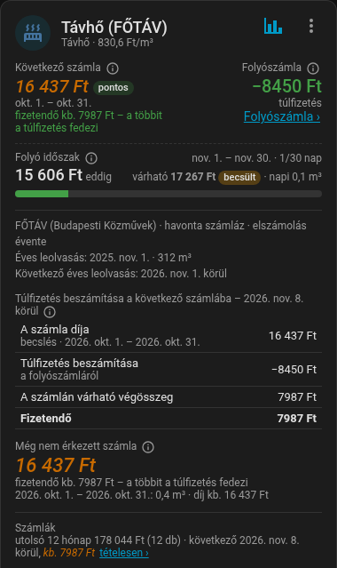

### 6.7 Szemétszállítás (fix díj)

- Mérő nélkül: csak a havi díj és a számlák. A MOHU negyedévente, **utólag** számláz (a negyedév után).
- Állítsd: *Elszámolási időszak* = Naptári negyedév, *Számlázási ütem* = negyedévente.
- **A díj helyenként más:** a MOHU díja a településtől, az edény méretétől és az ürítési gyakoriságtól függ. A beépített díjszabás (negyedévente 5 772 Ft) csak kiindulás:
    - a Rezsikövető **a számláidból átveszi** a díjat, ha a legutóbbi két teljes negyedéves számla ugyanannyi, de eltér a beépítettől – értesítést küld róla ([13.2](#132-a-fix-díj-a-számlákból));
    - vagy add meg magad a kártya **Saját díjak** gombjával: havidíj bruttóban, „érvényes ettől” dátummal ([13.1](#131-saját-díjak-a-panelről)).
- **A kártyán** csak a számla hónapjában áll „Ebben a hónapban fizetendő” (pl. október: 5 772 Ft a III. negyedévről). A többi hónapban „Esedékes: 2027. január”, az összeg szürkén, dőlt betűvel – havi részösszeg nincs.
- **A háztartás havi összegeiben** (Havi átlag, eddig/várható szenzorok) a szemétszállítás is csak az esedékesség hónapjában szerepel, a teljes számlaösszeggel; a többi hónapban 0.
- **Üdülőingatlan (MOHU, idényes):** üdülőn a közszolgáltatás idényes – pl. a PELSO-KOM területén (Fonyód és környéke) ápr. 1. – szept. 30., 80 literes edénnyel 189,50 Ft/ürítés, júliusban és augusztusban heti két ürítéssel (évi ~35 ürítés ≈ 6 633 Ft). A *MOHU – üdülőingatlan (idényes)* díjszabás a díjat az idény hat hónapjára osztja; az idényen kívüli negyedévre nincs díj és nem jön számla – a kártyán „Idényen kívül: 0 Ft … a következő 2027. ápr. körül”. Üdülődíj csak akkor jár, ha az ingatlan üdülőövezetben fekszik **és** a tulajdoni lapon üdülő/hétvégi ház; különben egész évre a lakóingatlan díja.

---

### 6.7.1 Társasházi közös költség

- **Közmű: Társasházi közös költség (fix havi díj).** Társasházi lakásnál a szemétszállítás (Budapesten 2026. júliustól a MOHU főszabályként a társasháznak számláz), a közös víz-különbözet, a takarítás, a felújítási alap a közös költségben van – ilyenkor ne vegyél fel külön szemétszállítás fiókot.
- **Díj:** a *Társasház (közös képviselő)* szolgáltató *Társasházi közös költség* díjszabása sablon: a havi összeget a kártya **Saját díjak** gombjával ([13.1](#131-saját-díjak-a-panelről)) vagy felülírással add meg (`hu_rezsi.feluliras`, `dijak.alapdij_ho`, bruttó Ft), közgyűlési emelésnél új *érvényes ettől* nappal – pl. 64 m² × 330 Ft = 21 120 Ft, júniustól 360 Ft/m² = 23 040 Ft.
- **Számla nincs:** a közös képviselő kimutatása szerinti havi befizetendőt **előírásként** rögzítsd (a kártyán *Új előírás*; típus: *Közös költség előírás*). A kártyán „Ebben a hónapban fizetendő … előírva …”, a folyószámlán „Közös költség előírás” sorok és a befizetések.

### 6.7.2 Internet, TV, telefon

- **Közmű: Internet, TV, telefon (havi előfizetés).** Fix havidíj, havi számlával. Szolgáltató: Magyar Telekom, One, DIGI, Yettel (vagy Egyedi).
- **Havidíj:** a díjcsomagok és a kedvezmények összege (pl. Net 250/70 + IPTV M, „Speciális kedvezmény”, e-Pack) – a kártya **Saját díjak** gombjával ([13.1](#131-saját-díjak-a-panelről)) vagy felülírással add meg (`dijak.alapdij_ho`, bruttó Ft), díjváltozásnál új *érvényes ettől* nappal.
- **Telekom-számla:** a Díjnetről letöltött XML-t (összevont számla) magától olvassa: sorszám, kelte, fizetendő, határidő, a számlázott hónap és a fizetési mód. Ha csak a PDF van meg (pl. a Telekom-fiókból töltötted le, vagy a Díjnet-letöltés elmaradt), ugyanezeket a PDF-ből olvassa. A számlán szereplő előfizetői (levelezési) cím nem számít: a fiókhoz a mappa köti. Az egyszeri tételek (kiszállási díj, munkadíj, készülék) a számla összegében vannak. A kártya a legutóbbi számlát a **beállított havidíjhoz** méri (nem az előző számlához), és ha eltér, figyelmeztet: „a legutóbbi számla 18 439 Ft – 8 750 Ft-tal több, mint a díj (9 689 Ft): egyszeri tétel vagy díjváltozás”. A teendő alatt – az összesítő Teendői között és a fiók kártyáján, a figyelmeztetés alatt is – két gomb: **Ez az új havidíj** (a számla összege lesz a havidíj a számla hónapjától – felülírásként a fiókban, ugyanaz, mintha kézzel adnád meg) és **Egyszeri eltérés – rendben** (egyszeri tétel vagy kedvezmény: ennél a számlánál nem jelez tovább, a következő eltérő számlánál újra). Ugyanígy mér a szemétszállítás és a közös költség is (idényes üdülő-díjnál nem). A számla az előző hónapot számlázza (pl. a júliusi számla a júniust).
- **One-számla (volt DIGI):** a One Magyarország PDF-számláját (EcoSoftWare, „…_INVOICE.pdf”) is magától olvassa: sorszám (pl. 2026/15890872), kelte, fizetési határidő, fizetendő, a tételsorok időszaka (a One a folyó hónapot számlázza) és a fizetési mód. A díjváltozást (pl. a 2026. augusztus 1-jei díjcsomag-egységesítés: NET MAX 6 490 Ft + vezetékes telefon 1 000 Ft) felülírással add meg a változás hónapjától. A mappában lévő tájékoztató levelet (nem számla) „ismeretlen fájlként” mutatja, ez nem hiba.
- **Fizetés:** ha a fiókban beállítod a Díjnet-szolgáltatót (pl. „Telekom otthoni, Telekom-összevont”), a befizetés a Díjnetből jön.

### 6.8 Szigetüzem (kísérleti)

Szigetüzemi – vagy hálózati tartalékos, generátoros – energiarendszer követése **csak kWh-ban**: nincs Ft, és a rezsiösszegbe nem számít. Nem a napelemes villanyfiók (HMKE) része, hanem külön rendszer az otthon alatt (Krissz55555 specifikációja, `docs/terv/06_SZIGETUZEM.md`).

- **Felvétel:** Beállítások → Eszközök és szolgáltatások → Rezsikövető → az otthon → **Szigetüzem hozzáadása**. A fogyasztás mindig kell; pipáld be, mit mér még a rendszer (PV, akku töltés és kisütés, hálózat, hálózatról akkuba, export, generátor, egyéb termelés), majd szerepkörönként válaszd ki a kumulatív energiaszámláló-szenzor(oka)t (`total_increasing`, kWh/Wh/MWh – több PV-mező vagy akku összeadódik). W, A, V, SOC nem használható.
- **Szenzor nélkül:** `hu_rezsi.sziget_leolvasas` (időpont, szerepkör, állás) – kézi leolvasásokból számol.
- **Számlálóhibák:** az ismeretlen értéket kihagyja, a kis visszaugrást zajként kezeli, az inverter-nullázódás és a túlcsordulás nem ad negatív vagy dupla fogyasztást.
- **A kártya:** időszak (ma, tegnap, hónap, előző hónap, év, előző év, összesen); fogyasztás és **önellátottság** (1 − (hálózat + generátor) / fogyasztás – *időszakhatár-érzékeny*: az akku az egyik időszakban felvett energiát egy másikban adhatja vissza, ezért napi bontásban jelentősen eltérhet, havi/éves szinten egyre kevésbé); energiaforrások és *saját rendszerből*; akku töltés / kisütés / nettó (hatásfok nincs); hálózati és generátor-részarány; mért útvonalak (csak ami levezethető); **energiamérleg** és mérleg-eltérés; **adatminőség** (teljes / részben becsült / hiányos / nincs elég adat); havi bontás.
- **Az otthon összesítőjében** egy Ft nélküli sor: a rendszer folyó havi fogyasztása, PV-termelése és önellátottsága (a rezsiösszegbe nem számít).
- **Szenzorok:** a folyó hónap fogyasztása, PV, akku töltés/kisütés, hálózat, generátor (kWh), önellátottság, hálózati részarány (%), adatminőség.
- **Amit nem csinál:** PV → ház és PV → akku megosztását akkus rendszerben nem becsüli; Ft-megtakarítás, amortizáció, elveszett (visszaszabályozott) PV-termelés nincs.

## 7. A Rezsikövető panel

> [!TIP]
> Képes összefoglaló a panel értékeiről – az összesítő és a fiókkártyák számozva, melyik érték miből számolódik: [A panel értékei (PDF)](rendszer/Panel_ertekei.pdf).

A bal oldali menüben: **Rezsikövető**. (Mobilon a bal felső ☰ gombbal nyílik a menü.) A panel percenként frissül; a jobb felső ⟳ gombbal azonnal. A gomb a már kiszámolt adatokat tölti újra (a számolás és a számlamappa ellenőrzése 10 percenként, magától fut). Ha közben a Rezsikövető új változata került fel, a gomb – és az alkalmazás háttérből való visszatérése – az oldalt is újratölti, így mobilon sem kell kézzel gyorsítótárat üríteni.

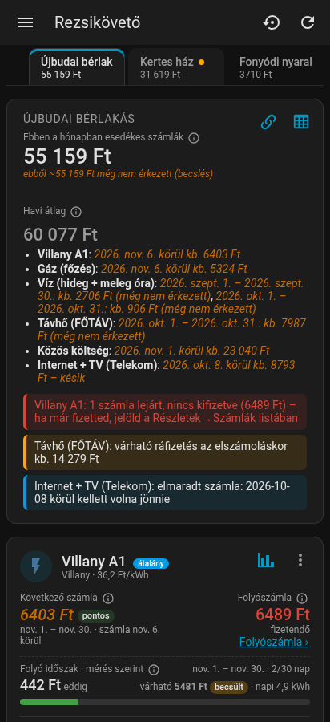

**Több otthon:** ha több háztartást is felvettél (pl. a saját otthonod és egy szülőé), a fejléc alatt **fülsor** jelenik meg, mint a böngészőben: minden otthonnak egy fül, rajta a neve és az e havi esedékes összeg; narancs pötty jelzi, ha ott teendő van. Mindig csak a kiválasztott otthon kártyái látszanak; a panel böngészőnként megjegyzi az utoljára nyitott fület. (Billentyűzettel: ← →.)

### 7.0 Lapozós nézet: Fiókok és Témák (2.3.0)

Szélesebb kijelzőn (900 px felett: tablet fekvő helyzetben, notebook, asztali gép) a panel nem egymás alá rakja a kártyákat, hanem **lapokra** bontja az otthont. Az otthonok fülei alatt egy második fülsor van, jobbra a nézetváltó: **Fiókok** · **Témák**.

**Fiókok nézet**

- **Áttekintés:** az otthon összesítője (7.1) és fiókonként egy **csempe** – következő számla és várható kelte, éves egyenleg, folyószámla; narancs csík: teendő van. A csempére koppintva a fiók lapja nyílik.
- **Fiókonként egy lap:** a fiók kártyája (7.2) a teljes szélességben, három (keskenyebb kijelzőn két) hasábban – fent a következő számla, a folyószámla és a folyó időszak, alatta az ütem, a keret, a számlák, jobbra lent a gombok. Egy fiók egy képernyőn, görgetés nélkül.
- **Mátrix:** a fiókfülek után – ugyanaz, mint a Témák nézet Mátrix lapja (lent): elszámolási mátrix és számlanaptár az otthon összes fiókjáról.
- **Lapozás:** a fülekre koppintva, a lap alatti **‹ ›** nyilakkal vagy pöttyökkel, ujjal **vízszintesen húzva**, billentyűzeten a fülsoron **← →**.

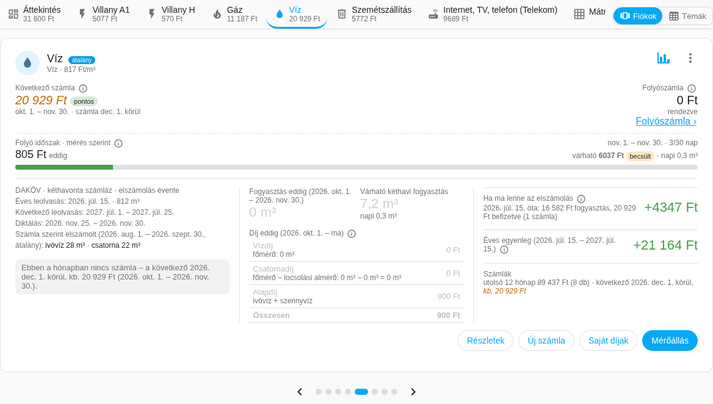

**Témák nézet** – minden fiók egy táblázatban, egymás mellett összevethetően, alul összesítő sorral:

| Lap | Oszlopok |
|---|---|
| Áttekintés | mint a Fiókok nézetben |
| Számlák | következő számla és várható kelte (késik / elmaradt jelzéssel), ebben a hónapban, utolsó számla, utolsó 12 hónap, folyószámla |
| Fogyasztás | folyó időszak és eltelt rész, fogyasztás (több regiszteres mérőnél – H-tarifa, A2 – regiszterenként is) és díj eddig, várható fogyasztás és díj (átalánynál az átalány, alatta összehasonlításként a mért fogyasztás szerinti díj – gáznál évszak szerint súlyozva; diktálás után a következő számláig a diktált állás szerinti díj), napi átlag, kedvezményes keret. Mérő nélküli (fix díjas) fióknál csak az időszak és a várható díj – havi, negyedéves díjnál nincs időarányos rész |
| Egyenleg | „ha ma lenne az elszámolás”, éves egyenleg, elszámolási év, várható éves költség, befizetve, folyószámla. A közös folyószámlás fiókok (MVM: egy ügyfél áramfiókjai, pl. A1 + H) **egy sorban**: az összegek összeadva, a folyószámla egyszer (az összesen-sorban is) |
| Mérők | utolsó rögzített állás és napja (alatta a mérő; víznél az **almérő** állása és mérője is), **saját szenzor szerint most** (a szenzoros csatornák kalibrált mostani állása – H-tarifánál téli/nyári, A2-nél csúcs/völgy, almérő; élőben frissül), következő leolvasás és diktálás, **Mérőállás** gomb. Minden mérőállás egész szám, ahogy az óra számlálója mutatja (a tört rész elhagyva). A korrekciós szorzó a Mérőállás ablakban, korrekciós leolvasás után látszik |
| Mátrix | két nézet. **Elszámolás:** soronként egy fiók, oszloponként a kártya szakaszai sorban – mérés (szenzor / leolvasás / nincs mérő), elszámolás módja (átalány / diktálás szerint / mért / fix díj), ütem, folyó időszak eltelt-csíkkal, várható díj, következő számla, diktálás, éves elszámolás („ha ma lenne”), folyószámla. **Számlanaptár:** fiók × hónap (az elmúlt 8 és a következő 3 hónap) – a beérkezett számlák típusjellel (E elszámoló, R részszámla, Sz számla, Ő előírás, S sztornó áthúzva), a várhatók szaggatott kerettel az ütem szerint, a még nem érkezett számla narancs „?”-lel, a következő diktálási ablak (D, pl. „D 8–14.”; áramnál a számlán közölt havi ablakból – a mostani hónapé, ha még nem múlt el, különben a következőé; közös MVM-számlázásnál az A1 és a H ugyanazt kapja) és az éves leolvasás ablaka (É, pl. „É 14.–dec. 1.”; ha nincs ablak, az éves elszámolás napja). A cella színe az állapot: zöld pontos / mért, sárga becsült, kék átalány, narancs figyelj rá, szürke nem vonatkozik. Felül a narancs cellák listája („amire figyelj”); egy cellára vagy számlára koppintva felül a magyarázat (miből jön az érték), onnan a fiók lapja is nyitható. A számlanaptárban egy beérkezett számlára koppintva: sorszám (ha nincs: „kézzel rögzítve”), honnan jött (számlafájlból beolvasva – PDF / XML, Díjnet –, AI-val kiolvasva, kézzel rögzítve), megjegyzés, fizetési határidő és a fizetés (mikor, hogyan) |

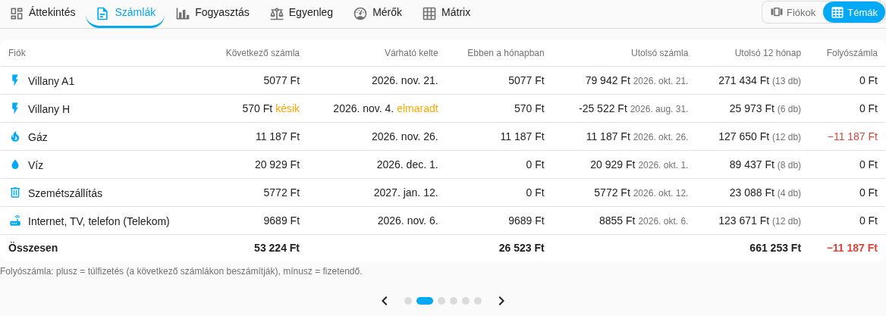

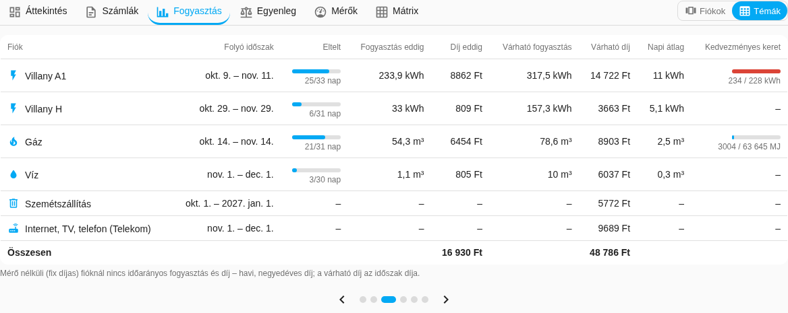

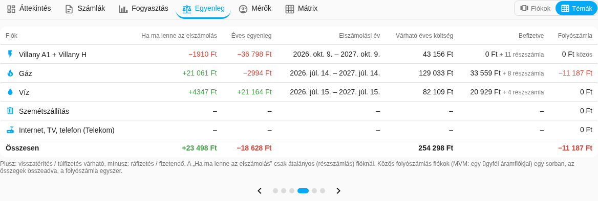

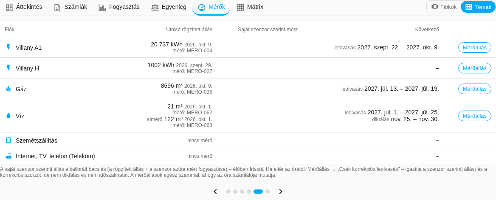

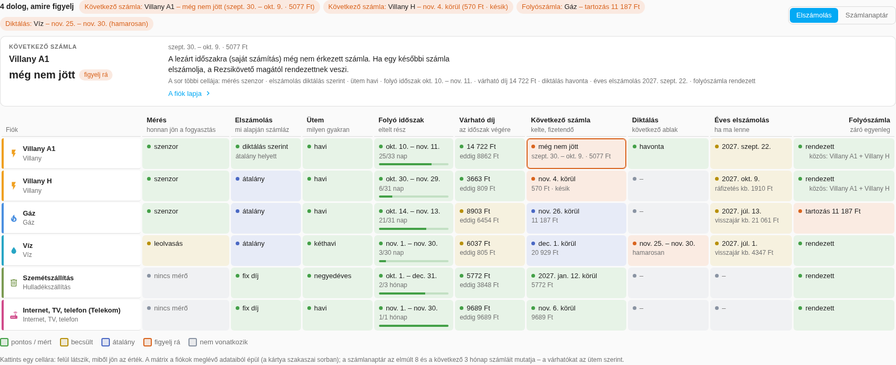

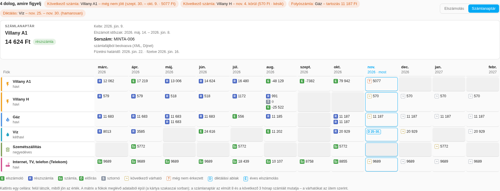

Ha a saját szenzor szerinti állás eltér az órától, a **Mérőállás** ablakban rögzíts **korrekciós leolvasást** (8.).

Egy sorra koppintva a fiók lapja nyílik a Fiókok nézetben. Előjel: **plusz** = visszatérítés / túlfizetés, **mínusz** = ráfizetés / fizetendő.

**Mobilon (900 px alatt)** ugyanez, keskenyre szabva: a fülsor tömör (ikon + név), görgetéskor a fejléc alatt marad; egy fiók egy lapon (a megszokott kártya), ujjal lapozható; az Áttekintésen a két nagy szám egymás mellett, az e-mailes blokk összecsukva, a csempék két oszlopban; a **Témák** lapjai táblázat helyett **fiókonként egy kis kártyán** (címke – érték), alul összesítő kártyával.

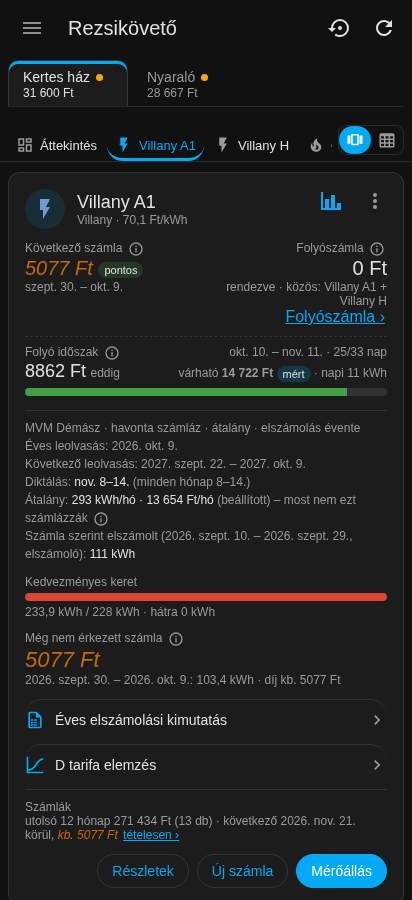

**Melyik nézet?** Alapból automatikus: 900 px felett tablet, alatta mobil – elforgatáskor magától vált. Eszközönként rögzíthető: ⚙ → **Panel beállításai** → „Megjelenítés ezen az eszközön”: automatikus / tablet / mobil / **minden egymás alatt** (a korábbi nézet: összesítő és alatta az összes kártya). A választott nézetet (Fiókok/Témák) és lapot a böngésző megjegyzi.

### 7.1 A háztartás összesítője

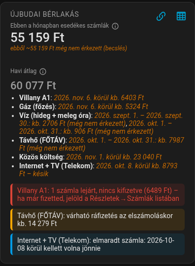

- **Ebben a hónapban esedékes számlák** – a számlázási ütem szerint ebben a hónapban **kiállított és még várható** számlák összege. Alatta fiókonként: melyik, mikor, mennyi; „késik”, ha egy várt számla elmaradt.
- **Havi átlag** – az átalány havi része (teljes hónapos időszakban pontosan a havi átalány, a 30 és a 31 napos hónapban ugyanannyi; egyébként napra leosztva, egy átlagos hónapra), illetve a több hónapra számlázott díjak havi része. Ez a „mennyibe kerül egy hónap” átlagosan. Ha a folyó időszak a hónapnál lényegesen rövidebb vagy hosszabb (pl. az éves leolvasás után a diktálásig tartó 15 nap), a díja egy átlagos hónapra arányosítva (az alapdíj egyszer); a kártyán a Várható alatt „havi átlagban kb. …”.
- **MVM folyószámla** – ha a legutóbbi MVM-villanyszámlán a fizetendő más tételeket is tartalmaz (lásd 7.1.1), a folyószámla egyenlege a számla kibocsátásakor (mínusz: túlfizetés, neked jár), és ha van talált számlahiba, hogy kijavításuk után várhatóan mennyi lesz (pótszámla: +, reklamáció: −).
- **Figyelmeztetések** (sárga/kék sávok; piros: lejárt, még nem fizetett számla – ha már fizetted, jelöld a Részletek → Számlák listában): várható keretátlépés, várható ráfizetés az elszámoláskor, elmaradt számla, fel nem ismert számlafájl, **talált számlahibák** (7.1.1), fix díjas fióknál az eltérés a havidíjtól (gombokkal: *Ez az új havidíj* / *Egyszeri eltérés – rendben*, lásd [13.3](#133-ha-a-számla-eltér-a-havidíjtól); ugyanezek a gombok a fiók kártyáján, a figyelmeztetés alatt is), **késő várt számla** (átalány, fix díj, diktálás: „a … közötti várt számla (570 Ft) … óta késik”) – ha a szolgáltató erről soha nem állít ki számlát (pl. sztornózta, és másképp számolta el), a **Nem jön számla – törlés…** gomb megerősítés után törli a becslést: eltűnik a kártyáról, a fejlécből, a folyószámla várható soraiból és az e havi esedékességből; a számlák, befizetések és egyenlegek nem változnak. A következő ütem szerinti számlát továbbra is várja (ha az is elmarad, az is törölhető); ha a törölt időszakról mégis jön számla, ugyanúgy beolvassa, és a következő valódi számla után a törlés hatástalan. **Automatikus rendezés:** ha egy várt számla nem jön meg, de egy későbbi számla valószínűleg elszámolta, a Rezsikövető magától rendezettnek veszi – csak a becslés tűnik el (kártya, fejléc, folyószámla várható sorai), a számlák, befizetések és egyenlegek nem változnak; az Áttekintés 30 napig kék tájékoztatóban mutatja („… nem jött meg – egy későbbi számla (sorszám) elszámolta, automatikusan rendezve”). Úton lévő (lezárt, saját számítású) számlánál elég, ha azóta későbbi kelte számla jött a fióknak vagy egy társfióknak; késő várt számlánál (átalány, fix díj, diktálás), ha a várt kelte után jött egy társfiók számlája. Társfiók: a közös folyószámla fiókjai – az MVM-nél a fizetendő a folyószámla szerint, az összes áramfiók összevonva, így egy másik áramfiók számlája is elszámolhatja. Ugyanezért közös a számlázási időszak is: ha az egyik áramfiók diktálás szerint számláz (pl. A1), az átalányos társfiók (pl. H-tarifa) folyó időszaka is a diktálások között tart, és a következő számlája a mért fogyasztás díja. **Egy teendőre koppintva** a panel a fiók kártyájára ugrik, és egy pillanatra kiemeli. A rendezettnek jelölt számlahibák rejtve vannak; a lista alatti *Rendezett számlahibák mutatása* előhozza őket. Ha nincs teendő: „Nincs teendő.”

A címkék melletti **ⓘ** gomb buborékban elmagyarázza az adott sort; máshova koppintva bezárul. A fiókkártyán a két sornál hosszabb magyarázó sor (pl. az éves egyenleg részletezése keskeny kijelzőn) nem jelenik meg teljes hosszában: a megnevezése mögötti ⓘ buborékjában olvasható, a meglévő magyarázat fölött. Hogy mi számít hosszúnak, a kijelző szélességétől függ; elforgatáskor újra eldől.

#### 7.1.1 Számla-ellenőrzés és a közös MVM-folyószámla

**Közös folyószámla:** az MVM-nél egy ügyfél minden villany-fiókja (pl. A1 és H) **egy folyószámlán** van. Az egyik fiók jóváírását a másik számláján vonják le – ilyenkor a számlán a bruttó számlaérték és a fizetendő között *Egyéb fizetendőt csökkentő tétel*, *Túlfizetés* sor áll, és a „fizetendő” akár mínusz is lehet, holott a fiók maga fogyasztott (pl. H-számla: számlaérték 22 607 Ft, fizetendő −25 522 Ft – az A1 jóváírásából). Ezért a Rezsikövető a **költségben** (kártya „Számlák” sora: utolsó 12 hónap, befizetések, egyenleg) a **számla saját értékével** számol, a kimutatásban a fizetendő mellett a cellára koppintva látszik, mely tételek nem a fiók díjai. A legutóbbi számla szerinti **folyószámla-egyenleg** az összesítőben áll (az azóta történt befizetések nélkül).

**Számla-ellenőrzés:** minden elszámoló számlát (az utolsó ~14 hónapból) a Rezsikövető összevet a saját mérésével és a számla saját adataival. A talált hibák az összesítő figyelmeztetései között, forint-hatással:

| Hiba | Mit jelent | Forint-hatás |
|---|---|---|
| **Nem kiszámlázott fogyasztás** | A számla mérősorai szerint több fogyott, mint amennyit kiszámláztak („Fogyasztás összesen”) – az MVM saját dokumentuma szerint ellentmondás | + : pótszámla várható |
| **Felcserélt regiszterek** (H) | A kiszámlázott téli és nyári mennyiség épp a mért fordítottja – a drágább nyári árat a téli fogyasztásra számolták (vagy fordítva) | − : túlszámlázás, reklamálható |
| **Több szennyvíz, mint ivóvíz** (víz) | A számla több szennyvizet (csatornadíjat) számláz, mint a mért ivóvíz – pl. kétszer szereplő szennyvízdíj-sor. Bármely számlánál (részszámlánál is) vizsgálja; ha a háztartásban Távhő fiók van, a távhős melegvíz mennyiségét levonja (6.5.1) | − : túlszámlázás, reklamálható |
| **Eltérés a saját számítástól** | Más ok nélkül legalább 1 000 Ft és 5% eltérés ugyanarra a mennyiségre – ellenőrizendő (kék, tájékoztató; napelemes fióknál és a távhő hődíj-korrekciós számlájánál nincs) | ± |

A hatás = a helyes díj (a mérés és a díjszabás szerint) − a kiszámlázott díj. Minden hiba mellett:
- **Reklamáció-tervezet ›** – kész levél a szolgáltatónak (felhasználó azonosító, felhasználási hely, mérési pont a számláról; a hiba leírása számokkal; a kért teendő). Ⓒ másolás, 🖨 nyomtatás / PDF. Küldés előtt nézd át, és csatold a számlát.
- **Rendezve** – ha reklamáltál, vagy megjött a helyesbítő számla: a hiba eltűnik a figyelmeztetésekből és a folyószámla-becslésből (a *Rendezett számlahibák mutatása* gombbal visszahozható, **Újranyitás**).

> [!NOTE]
> Példa (Kertes ház, 2026): az A1 aug. 17-i elszámolója a mérősorai szerinti 1 234 kWh-ból csak 33 kWh-t számlázott ki, és jóváírta a részszámlákat (−48 129 Ft) – kb. 63 000 Ft pótszámla várható; a H aug. 31-i elszámolója felcserélte a regisztereket – 1 674 Ft túlszámlázás. A folyószámla −7 382 Ft (túlfizetés), de a hibák kijavítása után kb. 54 100 Ft lesz fizetendő.

**Számlák kimutatása** – az összesítő jobb felső sarkában a ▦ (táblázat) gomb. Ablakban táblázat az otthon összes fiókjának számláiról: **sorok a hónapok** (a számla kelte szerint, az újabb felül), **oszlopok a fiókok** (ikon, név, szolgáltató), soronként és oszloponként összesen. Felül választható az időszak (*Utolsó 12 hónap* vagy egy naptári év). Az összeg mindig a **fizetendő**: amit a számla szerint fizetni kellett – elszámolónál a korábbi számlák és a túlfizetés levonása után (a mínusz zöld: visszajár). Így az összesen a ténylegesen kifizetett összeg; a számlaérték nem adható össze, mert az elszámoló számlaértéke a korábbi havi számlákat is magában foglalja. Az **E** jel elszámoló számlát, a „2×” egy hónapon belüli több számlát jelöl; egy cellára koppintva alatta a számla(ák) sorszáma, típusa, kelte, elszámolt időszaka, fizetendője és – tájékoztatásként – számlaértéke. **Tételesen:** a fiókkártya „Számlák” sorában és a narancs cellák részleteiben a **tételesen ›** gomb számlaszerű tájékoztató bontást nyit a még nem érkezett számláról: tételenként (energiadíj kedvezményes / keret feletti, H-nál téli vagy nyári, rendszerhasználati díj, víznél csatornadíj, alapdíj) a fogyasztási időszak, a mennyiség, a nettó egységár, a nettó érték, az ÁFA és a bruttó, alul a nettó összesen, az ÁFA és a bruttó számlaérték (várható fizetendő). Jövőbe nyúló időszaknál a mai napig mért fogyasztás napi átlaggal kivetítve.

**Várható, még nem érkezett számlák:** ahol a fogyasztásról még nincs számla, a hónap sora alatt narancs, dőlt **„várható – még nem érkezett”** sor áll „~” jellel (jövő hónapnál pl. „2026. november – várható”), a számla várható keltének hónapjában. Forrása: mért fióknál a folyó vagy lezárt időszak díja a **saját mérésből** (a végéig előrevetítve), átalánynál a következő **részszámla** (ha a legutóbbi számla után diktáltál, a **diktált állás** szerinti díj), fix díjnál a **díj** az ütem szerint, és a 2 hónapon belüli **éves elszámoló** várható fizetendője (mínusz: visszajár). Alul külön sor: *Összesen (beérkezett)*, *Várható (még nem érkezett)* és *Összesen várhatóval*; a narancs cellára koppintva a becslés forrása, időszaka és várható kelte. A számla megérkezésekor helyette a valódi fizetendő áll. Ugyanez a narancs, dőlt jelölés a fiókkártyákon minden becsült fizetendőn (mért fiók *Várható*, következő átalány- vagy diktált számla, „Még nem érkezett számla”, „következő … kb.”), az összesítőben pedig az „Ebben a hónapban esedékes” alatt: *ebből ~… még nem érkezett (becslés)*. Ha a számla több hónapot számol el (pl. a H-tarifa egész téli szezonját), alatta az is olvasható, hogy a számlaérték hány hónap és mekkora fogyasztás (kWh, m³) díja, és mennyit vontak le belőle (korábbi részszámlák, túlfizetés) – így nem tűnik egyetlen hónap költségének. A stornó számla 0-val számít. A fejléc gombjai: 🖨 **Nyomtatás** – számítógépen világos, fekvő A4-es lap a táblázattal, a kiválasztott időszakkal (a nyomtatási ablakban *Mentés PDF-ként* is választható); **telefonon és tableten PDF-fájl** töltődik le (a mobilok nyomtatása eszközönként eltér – a PDF bármelyikről kinyomtatható vagy továbbküldhető); ⤓ **CSV** – ugyanez a táblázat pontosvesszővel tagolt, ékezethelyes CSV-fájlban, egész forintokkal (Excelben közvetlenül megnyitható; üres cella = abban a hónapban nem volt számla). A fájlnév az otthon neve, pl. `Kertes ház_számlák.pdf`, `Kertes ház_számlák.csv`.

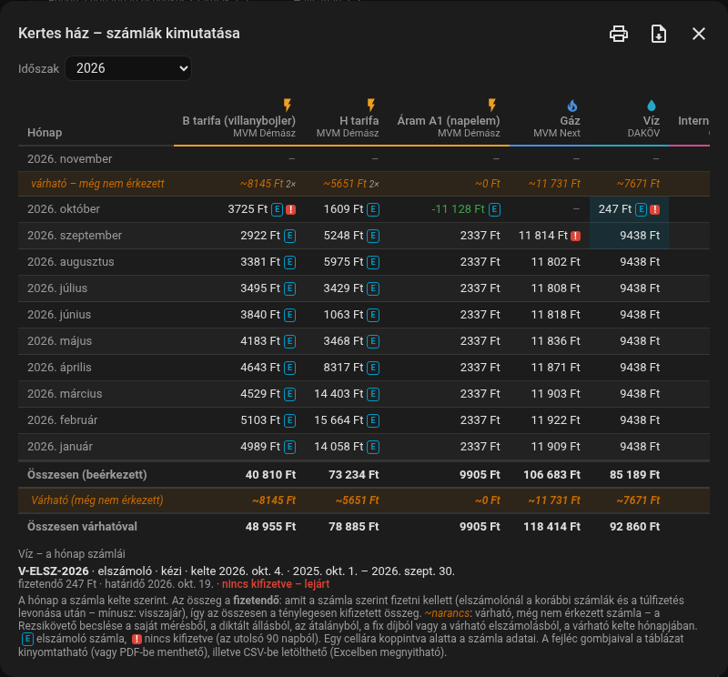

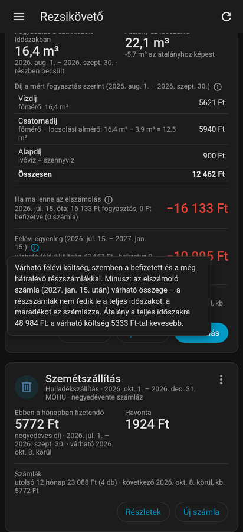

### 7.2 A fiók kártyája

A kártya teteje: név, „átalány” jelzés (ha részszámlás), a közmű és az aktuális egységár. Alatta a **fejléc** három blokkja:

- **Következő számla** (balra): a következőként érkező számla díja, alatta kisbetűvel az elszámolt időszak és a számla várható napja (vagy narancs „késik”, ha már meg kellett volna jönnie). Ha a folyószámlán lévő túlfizetés fedezi, a díj szürke, alatta zölden „fizetendő 0 Ft – a túlfizetés fedezi” (vagy a csökkentett fizetendő). Az összeg a számlázási mód szerint:
  - **lezárt, még nem számlázott időszak** (a záró mérőállás megvan – diktáltál, vagy leolvasták): a Rezsikövető számítása a díjszabásból;
  - **átalány / fix díj**: a szerződött összeg, a mérőtől függetlenül; ha a legutóbbi számla után diktáltál, a diktált fogyasztás díja;
  - **mért fiók** (diktálás, leolvasás, távleolvasás, vagy diktálás szerint számlázott átalány): a folyó időszak díja a mérésből, a várható zárónapig (diktálásnál a diktálási ablak közepéig) előrevetítve.
  Az éves (féléves) **zárószámla nem itt** szerepel, hanem lent a kártyán (*Ha ma lenne az elszámolás*, *Éves egyenleg*).
- **Folyószámla** (jobbra): a fiók folyószámlájának záró egyenlege ([7.5](#75-folyószámla--a-számlák-pénzügyi-teljesítése)) – zöld mínusz: túlfizetés, piros: fizetendő (kifizetetlen számla), „rendezve”: 0 Ft. MVM közös folyószámlánál (pl. A1 + H) a közös egyenleg, mindkét kártyán ugyanaz. A **Folyószámla ›** link megnyitja a kivonatot.
- **Folyó időszak** (alul, teljes szélességben): az időszak eddigi díja, a végére várható díj, a napi átlag, az időszak napjai és egy haladás-csík (eltelt / összes nap). Átalánynál „· mérés szerint”: tájékoztató, mennyibe kerül a valódi fogyasztás (a számla az átalány szerint jön, a különbség az elszámoláskor rendeződik); **szaldós napelemnél** forint helyett a nettó (vételezés − betáplálás) kWh, mert a szolgáltató ezt veti össze az átalánnyal. **Fix díjnál** (szemétszállítás, internet/TV, közös költség, mérő nélküli gáz) a hónap az egység: a megkezdett hónap díja egészében számít, a csík hónapokat mutat (pl. negyedéves szemétszállításnál október 8-án „1/3 hónap”, eddig a havi díj).

Minden várható összeg mellett **megbízhatósági címke**:

| Címke | Mikor |
|---|---|
| **pontos** (zöld) | átalány, fix díj, vagy ismert a záró mérőállás – csak a számla nem jött még meg |
| **mért** (kék) | saját mérő (szenzor) szerint; a hátralévő napokra napi átlaggal előrevetítve |
| **becsült** (narancs) | nincs friss mért adat (nincs szenzor, vagy kiesett): az utolsó mérőállás óta napi átlaggal (H-tarifánál a másik idényre a tavalyi azonos napokból). Diktálás vagy a következő számla pontosítja |

A címkére állva (vagy a ⓘ-re koppintva) a forrás magyarázata látszik.

A fejléc alatt: a szolgáltató, a számlázási ütem, az **éves leolvasás** (napja és óraállása), a **következő éves leolvasás** és a **diktálás** (a következő ablak, pl. „okt. 8–14.”). Új fióknál, az első számla előtt a **kezdőállás** is (birtokba vétel / új mérő napja és állása); ha még nincs éves leolvasás rögzítve, „Éves leolvasás: még nincs rögzítve” ⓘ. Jobb felül a kék **📊** ikon megnyitja az **éves összevetést** ([7.4](#74-éves-összevetés)); a **⋮** menüben: **Éves összevetés**, **Előzmények** (HA előzmény-nézet), **Beállítások** (a fiók entitásai; koppintásra az entitás beállításai, „Eszköz oldala”), **Kapcsolódó**.

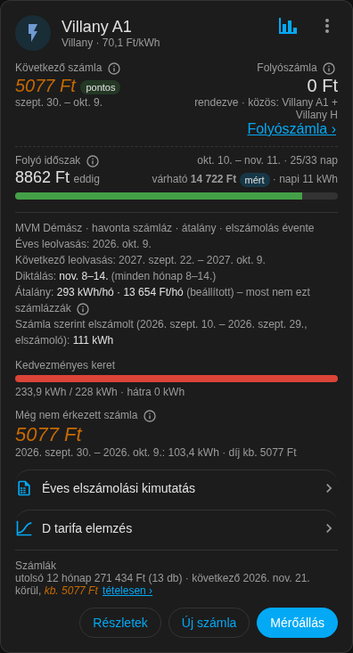

Sorról sorra (a fiók típusától függően nem mindegyik jelenik meg):

| Sor | Jelentés |
|---|---|
| **Ebben a hónapban fizetendő (átalány)** | átalánynál, ha az e havi részszámla már megjött: a kiállított összeg (a következő, még nem érkezett részszámla a fejlécben áll). Diktálás után a diktált állás **egyszer** felülírja az átalányt (a fejléc *Következő számla* blokkja „pontos” címkével mutatja); az azutáni számla újra az átalány szerint jön, amíg nem diktálsz újra |
| **Eddig / Várható** (forintban) | csak lezárt fióknál (*Utolsó időszak*); különben a fejléc *Folyó időszak* blokkja. *Eddig* = az időszak eleje óta mért fogyasztás díja, a már elmúlt hónapfordulók alapdíjával; *Várható* = az időszak végére (az utolsó 7 nap átlagából; H-tarifánál a másik idényre eső napokra a tavalyi ugyanazon napok fogyasztásából) |
| **Fogyasztás eddig / Várható fogyasztás** | a hónapban mért és a hónap végére várható mennyiség, napi átlaggal |
| **Átalány ebben a hónapban … az átalányhoz képest** | átalánynál: a várható fogyasztás eltérése az átalánytól (narancs: több) |
| **Még nem érkezett számla** | fogyasztás szerinti fióknál: lezárt időszak (az elmúlt 45 napból), amelyre még nem jött számla – pl. új fióknál a számla „úton van”. Becsült összeg a mért fogyasztásból; az otthon „ebben a hónapban esedékes” összegében is szerepel, a számla beérkezésekor eltűnik |
| **Az éves leolvasás külön számlát zár** | az MVM a legutóbbi számla után az éves leolvasás napjáig külön számlát küld (a leolvasás napjával együtt), az új elszámolási év másnap indul; az utána következő számla a leolvasás után legalább 20 nappal lévő diktálásig tart (Kertes ház A1 2024 és 2025: leolvasás okt. 1., számla szept. 10. – okt. 1., majd okt. 2. – nov. 10/11.; Városi lakás H 2025: okt. 14., majd okt. 15. – nov. 15.). A kártyán az éves leolvasásig tartó rész „Még nem érkezett számla”, a folyó időszak a leolvasás másnapjától tart |
| **Az első számla** (keretes magyarázat) | új fióknál, amíg nincs számla: mi kerül az első számlá(k)ra – pl. *szept. 9. – 28.: a birtokba vételtől az éves leolvasásig* (ezt a szolgáltató a leolvasott állással számolja el), és *Új elszámolási év (szept. 30. –)*: a következő számla a diktálás (pl. okt. 8–14.) után, a diktált állás szerint, a várható összeggel. A szolgáltató a kettőt küldheti külön vagy egy számlán (ⓘ) |
| **Számlák – Fizetve** (Részletek) | számlánként pipa és a fizetés napja: koppintásra „fizetve” a mai nappal, a dátum átírható; a pipát kivéve „nincs fizetve”. A pipa azonnal érvényes; a kártya egyenlege és a túlfizetés-beszámítás a háttérben számolódik újra, és pár másodperc múlva frissül (gépelés vagy nyitott ablak alatt a panel nem rajzolódik újra). **Javítás:** a számla sorára koppintva a részletek alján *Javítás (fizetés, határidő, megjegyzés)* – ablak a kifizetéssel, a fizetés napjával, a fizetési határidővel és egy szabad szöveges **megjegyzéssel** (pl. „kedvezmény miatt kevesebb”, „reklamálva szept. 3-án”). Csak ezek javíthatók; az összeg, az időszak és a mérőállás a számlából jön (hibánál: reklamáció, stornó vagy újraolvasás). A javítás külön tárolódik, a számla újraolvasása nem írja felül; a javított számla sorában ceruza jel, a megjegyzés a részletekben és a folyószámla tételénél is látszik. *Kézi jelölés törlése*: vissza a Díjnet / csoportos beszedés szerinti állapotra. A Díjnet szerint kifizetett számlák magától kipipálódnak („Díjnet” címke); a csoportos beszedési megbízással fizetett számlák (pl. távhő) a határidő napján („beszedés” címke). A kézi bejegyzés mindkettőnél erősebb. Mellette a fizetési határidő, lejárt és ki nem fizetett számlánál piros „lejárt”; **kézi számlánál** a határidő itt adható meg vagy írható át (dátummező a ki nem fizetett számla sorában), mert a számláról nincs honnan kiolvasni. Nulla vagy mínusz fizetendőnél (visszatérítés, a közös folyószámláról rendezett részszámla, sztornó) „nincs fizetendő”. Az otthon összesítőjében figyelmeztetés, ha az utolsó 90 napban lejárt számla nincs kifizetve; a számlakimutatásban „!” jelzi, és az éves kimutatás „Befizetések” része összesíti (fizetendő, fizetve, nyitott) |
| **Éves elszámolási kimutatás** | A1 és H villanyfióknál, ha van elszámoló számla: rákoppintva ablak – a két éves leolvasás (új fióknál a kezdőállás és az éves leolvasás) közötti év a **mérőállások** és a díjszabás szerint, számlánként szembeállítva a szolgáltató elszámoló számláival: mérőállások, összesítő (mért / kiszámlázott kWh, kedvezményes, piaci, H-nál téli, alapdíj-hónapok, díj), a helyes díj összetevői, számlánkénti tábla (narancs: eltérés), **megállapítások** (kiszámlázatlan fogyasztás, felcserélt H-regiszterek, téves sávkorrekció, le nem vont részszámla), a még nem számlázott rész, és a teljes év helyes díja. Fent évválasztó, **Nyomtatás / PDF** (A4 fekvő) és **Reklamáció-tervezet** (levél a megállapításokkal – másolható, nyomtatható). A „Számla díja” a számla saját díja a levont részszámlák és a folyószámla-tételek nélkül |
| **D tarifa elemzés** | A1 fióknál, ha volt kereten felüli fogyasztás: rákoppintva ablak a hónaponkénti, negyedórás A1–D összevetéssel (vonalas grafikon, Költség / Halmozott / Egységár nézet; lásd 6.3.2) |
| **Kedvezményes keret** (csík) | felhasznált / összes, hátralévő, és a várható elfogyás napja. Gáznál diktálásos fióknál az e havi számla (havonta súlyozott) kerete, átalányos fióknál az egész év kerete. Villanynál (A1, B, H nyári) **sávkorrekció**: ha az elszámolási évben (éves leolvasástól éves leolvasásig) korábban nem használtad ki a keretet, a maradék most jóváíródik (és fordítva) – ahogy az MVM számláz. A következő évre nem vihető át. A folyó időszakban jóváírás csak az eltelt napok keretéig jár; levonás csak valódi túllépésnél (ha a teljes időszak keretével is túl vagy) – az, hogy a fogyasztás az időszak elején gyorsabban nő, mint a napi keret, még nem túllépés |
| **Téli és nyári tarifa** (táblázat) | H-tarifánál a két regiszter eddig és várhatóan |
| **Ha ma lenne az elszámolás** | csak átalányos (és nem diktálás szerint számlázott) fióknál (és lezárt fióknál *Végelszámolás*): a legutóbbi elszámolás óta mért fogyasztás díja mínusz az azóta kapott számlák. **Mínusz ≠ tartozás**, ha azóta még nem jött számla – a következő számla rendezi (ⓘ). Havonta elszámolt (diktálásos, leolvasásos) fióknál nem jelenik meg: ott a „Még nem érkezett számla” mutatja a még nem számlázott fogyasztást. |
| **Éves / Félévi egyenleg** | várható költség az elszámolási ciklusra, szemben a befizetett + még hátralévő részszámlákkal. Mínusz: az elszámoló számla várható összege; „átalányhoz képest +X Ft” (narancs) = valódi ráfizetés. |
| **Számlák** | az utolsó 12 hónap számláinak összege, a következő számla várható napja és összege |

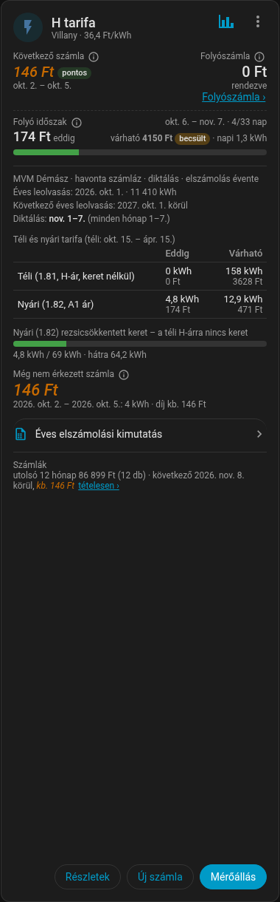

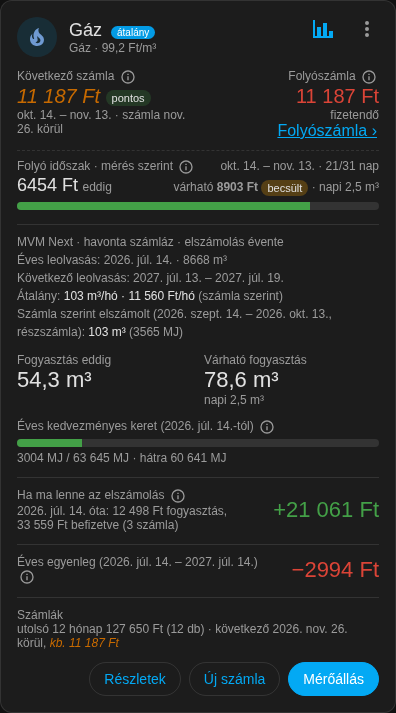

**Többhavi, utólagos számlázás (víz, szemétszállítás):**

- A **számla hónapjában** a kártya a számla által elszámolt (lezárt) időszakot mutatja: *Ebben a hónapban fizetendő* (a kiállított vagy az átalány szerint várható összeg), a számlázott időszak fogyasztása és tételes díja.
- **Számla nélküli hónapban** a folyó időszak látszik **szürkén**, felül: „Ebben a hónapban nincs számla – a következő … körül, kb. … Ft”.

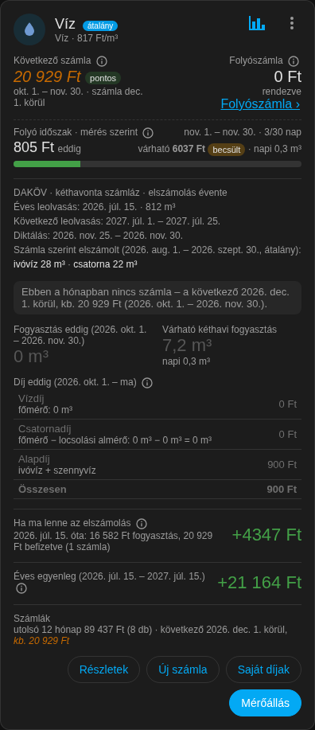

A víznél a **Díj a mért fogyasztás szerint** táblázat tételesen mutatja: vízdíj (főmérő), csatornadíj (főmérő − locsolási almérő), alapdíj, összesen.

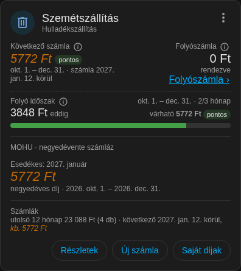

### 7.3 A kártya gombjai

| Gomb | Mire jó |
|---|---|
| **Részletek** | lezárt időszakok, mérőállások (★ = éves elszámoló leolvasás; „kezdő óraállás” = a fiókban megadott kezdőállás, az elszámolások origója; „számla alapján” = átalányszámlánként a szolgáltató által feltételezett állás: a mérő utolsó valódi állása + az azóta számlázott átalány-mennyiségek – tájékoztató, a fogyasztás számítását nem befolyásolja), számlák (jelölővel a törléshez); egy számlasorra koppintva lenyílik a számla minden tárolt adata (időszak, árszabás, elszámolt mennyiség, következő leolvasás/diktálás, forrás, fájlnév) |
| **Új számla** | számla feltöltése (PDF/XML) vagy kézi rögzítése – [9. fejezet](#9-számlák-felvitele) |
| **Mérőállás** | leolvasás rögzítése – [8. fejezet](#8-mérőállás-rögzítése-mérőcsere) |
| **Saját díjak** | víz- és fix díjas fióknál (szemétszállítás, közös költség, internet/TV/telefon), csak rendszergazdának: a saját számládon álló díjak bruttóban, „érvényes ettől” dátummal – [13.1](#131-saját-díjak-a-panelről) |
| **Ez az új havidíj** / **Egyszeri eltérés – rendben** | fix díjas fióknál, ha a legutóbbi számla eltér a havidíjtól: a figyelmeztetés alatt – [13.3](#133-ha-a-számla-eltér-a-havidíjtól) |

### 7.4 Éves összevetés

A kártya **📊** ikonjára (vagy **⋮ → Éves összevetés**) felugrik a havi grafikon: az **idei év** (kék) és az **előző év** (szürke) hónapjai egymás mellett.

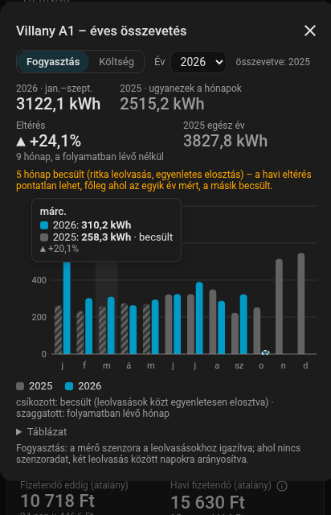

- **Fogyasztás / Költség** váltó; az **Év** választóval régebbi évpár is nézhető.
- Fent az összesítés: a **mindkét évben meglévő, lezárt hónapok** összege, az eltérés %-ban és az előző év egésze. A folyamatban lévő hónap nem számít bele.
- Koppintásra / rámutatva a hónap értékei és az eltérés.
- **Csíkozott** oszlop = becsült: ott nincs szenzoradat, a két leolvasás közti fogyasztás egyenletesen oszlik el a hónapokra. Ritka (pl. éves) leolvasásnál – tipikusan gáz – a havi bontás ezért lapos, és a figyelmeztetés jelzi, hogy az eltérés pontatlan lehet. **Szaggatott** = folyamatban lévő hónap.
- **Halványabb, teli** oszlop: a fiók *Havi elosztás szenzora* (pl. kazánbecslés) szerint elosztott hónap – a havi érték közelítő, az éves összeg pontos. Gáznál ezzel a fűtési szezon alakja is látszik évi egy leolvasás mellett.
- A **költség** a díjszámítás naptári hónapokra bontva (alapdíj és keret havonta); tájékoztató, mert a számlák időszakai nem naptári hónapok.
- A **Táblázat** alatt ugyanez számokkal. Szemétszállításnál (fix díj) nincs összevetés.
- **Napelemes fióknál** a váltó: **Vételezés** (1.8.0) / **Betáplálás** (2.8.0) / **Nettó** / **Költség**. A *Nettó* = vételezés − betáplálás; a nulla alatti oszlop az a hónap, amikor több ment a hálózatba, mint amennyit vételeztél (nyári többlet). A buborék mindkét évre mindhármat mutatja, alatta a **„Vételezés és betáplálás – tavaly és idén”** tábla hónaponként egymás mellett (pl. tavalyi és idei január vételezése, betáplálása, nettója, az eltéréssel; a folyamatban lévő hónapnál eltérés nélkül). Szaldónál az elszámolás évente, a nettó éves összegén megy – a havi mínusz a téli vételezést csökkenti.

### 7.5 Folyószámla – a számlák pénzügyi teljesítése

A fiók kártyáján ⋮ → **Folyószámla** – minden fióknak külön. Ahol a szolgáltató több fiókot **egy folyószámlán** vezet (MVM: az azonos ügyfél villanytarifái, pl. A1 és H), a fejlécben **Közös | Tarifánként** választó van: alapból **Közös** – minden tarifa egy kivonatban, ahogy a szolgáltató folyószámla-kimutatásán (lent). Alapból az **utolsó 12 hónap** látszik; választható a teljes időszak vagy egy naptári év. Két fül:

**Teljesítés** (alapnézet) – soronként egy számla, mellette a pénzügyi teljesítése:

| Oszlop | Mi áll benne |
|---|---|
| **Kelte** | a számla kiállításának napja |
| **Számla** | típus és sorszám; alatta az elszámolt időszak, a mennyiség és a számlán szereplő **induló → záró óraállás** a leolvasás módjával (diktált, leolvasott, becsült); közös folyószámlánál a fiók |
| **Határidő** | a fizetési határidő |
| **Számla összege** | a számla szerinti **fizetendő** – a szolgáltató beszámításaival együtt (korábbi túlfizetés, támogatás); mínusz = túlfizetés |
| **Fizetve** | a fizetés napja és összege (kézi jelölés, Díjnet, csoportos beszedésnél a határidő, állandó átutalásnál az átutalás napja; *egyenleg szerint*: a számlán közölt egyenlegből visszafejtve; *feltételezett*: 90 napnál régebben lejárt számla, amelyről nincs fizetési adat) |
| **Állapot** | fizetve · nyitott · **lejárt** · túlfizetés · beszámítva (a következő számla levonta – ha több számlán, részletekben, mindegyik sorszáma látszik) · nincs fizetendő · sztornó · **sztornózva** (a számlát egy stornó érvénytelenítette – befizetés nem jár rá) |

A végén narancs, dőlt sor: a **várható, még nem érkezett számla** – a túlfizetés beszámításával („túlfizetésből”, „nincs fizetendő”). Alul az összesítő: **számlázva / fizetve**, **nyitott** (ebből lejárt) és a **túlfizetés** (a várható számlából levont és a megmaradó összeggel).

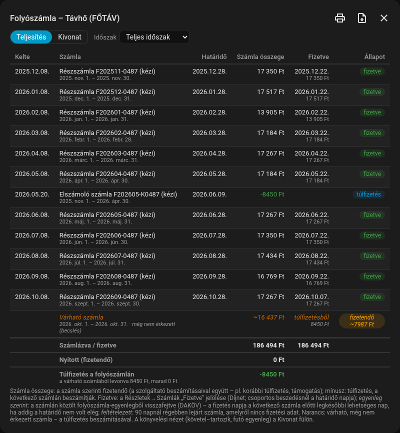

**Kivonat** – ugyanez könyvelési formában, futó egyenleggel:

| Oszlop | Mi áll benne |
|---|---|
| **Dátum** | számlánál a **kiállítás kelte**, befizetésnél a fizetés napja |
| **Megnevezés** | a számla típusa és sorszáma; alatta az elszámolt időszak, a mennyiség (kWh, m³, MJ, GJ), közös folyószámlánál a fiók, MVM-nél a számlán közölt folyószámla-egyenleg |
| **Követel** | a szolgáltató követelése: a számla értéke (elszámolónál a részszámlák levonása után), késedelmi kamat |
| **Tartozik** | ami csökkenti: befizetés, jóváíró (mínuszos) számla, stornó, kötbér |
| **Egyenleg** | futó egyenleg: pozitív = fizetendő hátralék, negatív (zöld) = túlfizetés |

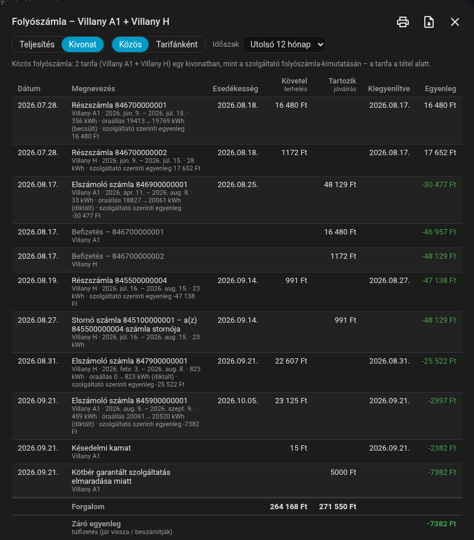

- **Nyitó egyenleg:** ha az első számla hoz át korábbi egyenleget (pl. „figyelembe vett hátralék/túlfizetés”), abból; különben 0. Kézzel is megadható (*Nyitó egyenleg megadása* – pl. az ügyfélportál szerint).
- **Áthozott sorok:** a számla „egyéb” sorai közül áthozott egyenleg (nem külön tétel, az egyenlegben már benne van) az, amelynek neve túlfizetés, hátralék vagy „Egyéb fizetendőt csökkentő/növelő tétel”, vagy amelynek összege egy korábbi számla mínuszos fizetendőjével egyezik – az MVM ezt néha „Támogatás” vagy „Kötbér…” néven hozza át. Minden más új tétel: kötbér, késedelmi kamat, egy új támogatás-jóváírás.
- **MVM gáz:** az elszámoló jóváírását az MVM a következő gáz-részszámlán „Támogatás, túlfizetés” sorban számítja be (pl. számlaérték 11 642 Ft, beszámítás −8 835 Ft, fizetendő 2 807 Ft). A kivonatban ez a részszámla a saját értékével (11 642 Ft) szerepel, a beszámítás áthozott egyenleg, így a jóváírás nem számít kétszer. Ha a beszámítás a teljes számlát fedezi, a teljesítésben „nincs fizetendő”.
- **MVM közös folyószámla – Közös nézet:** az MVM az azonos ügyfél-azonosítójú villanyfiókokat (pl. A1 és H) egy folyószámlán vezeti, ezért egy számla fizetendője a másik tarifa jóváírását vagy tartozását is tartalmazhatja. A **Közös** nézet a szolgáltató *Folyószámla kimutatás – villamosenergia* levelének felépítését követi: minden tarifa számlája, befizetése, stornója, kamata és kötbére egy kivonatban, a tarifa a tétel alatt, két további oszloppal – **Esedékesség** (a számla fizetési határideje) és **Kiegyenlítve** (az a nap, amikor a terhelést befizetés vagy jóváírás teljesen fedezte; a befizetés előbb a saját számláját, a stornó a sztornózott számlát egyenlíti ki, a többi jóváírás a legrégebbi nyitott terhelést; ami a már meglévő túlfizetésből rendeződik, az a saját napján). A Követel oszlop a kimutatás *Terhelés*, a Tartozik a *Jóváírás* oszlopa; a forgalom és a záró egyenleg így közvetlenül összevethető a kimutatás *Aktuális egyenlegével*, és a számlákon közölt (közös) folyószámla-egyenleggel soronként is. Pl. Kertes ház 2026. júl.–szept.: terhelés 64 390 Ft, jóváírás 71 772 Ft, záró −7 382 Ft (túlfizetés) – mint az MVM kimutatásán. A kimutatás a késedelmi kamatot és a kötbért a könyvelés napján, a Rezsikövető az azt tartalmazó számla keltével mutatja.
- **MVM közös folyószámla – Tarifánként:** tarifánkénti kivonatban ez **átvezetés**: az áthozott egyenlegből a saját rész a tarifa saját egyenlege, a többi a másik tarifáról jön – az egyiknél Tartozik, a másiknál Követel sorként. A teljesítésben ilyenkor a számla alatt a saját értéke is látszik, a mínuszos fizetendő pedig „beszámítva (a másik tarifa számláján)”. A két tarifa együtt a szolgáltató közös egyenlegét adja; a számlán közölt (közös) egyenleggel tarifánként nem vet össze.
- **Befizetések:** a Részletek → Számlák *Fizetve* jelöléséből (kézi, Díjnet). Ha a számlán a fizetési mód **csoportos beszedés** (a program a számláról olvassa: MVM XML/PDF, távhő), a határidő napján magától fizetettnek számít; állandó átutalásnál (a fiók beállítása) az átutalás napján. Ha egy számla határideje több mint 90 napja lejárt, és nincs róla fizetési adat, a kivonat kifizetettnek veszi a határidő napján – ezt dőlt betű és „feltételezett” jelzi.
- **Befizetés a szolgáltató egyenlegéből (DAKÖV):** a DAKÖV-számla közli, mennyi a folyószámla egyenlege a kiállításakor. Ha egy számláról nincs fizetési adat, a program két ilyen számla között visszaszámolja a befizetést (előző egyenleg + a közben kiállított számlák − az új egyenleg), és „egyenleg szerint” jelzéssel könyveli – a feltételezett befizetés helyett. A mínuszos elszámoló jóváírását a DAKÖV a következő befizetésnél számítja be (pl. 9 459 Ft-os számlára 3 855 Ft-ot fizettél, a többit a jóváírás fedezte): ilyenkor a *Fizetve* oszlopban „a többi … jóváírásból”, a jóváírás sora „beszámítva”. Így a kivonat minden számlánál egyezik a DAKÖV által közölt egyenleggel. Ha egy ilyen számlát kézzel jelölsz kifizetettnek, a fizetés napja a jelölésé, az összeg továbbra is az egyenlegből jön (a jóváírással fedezett részt nem kellett befizetni). Ha a jelölt nap eltér attól, amikor a DAKÖV könyvelte (pl. a határidő előtt fizettél, vagy a következő számla kiállítása után könyvelték), a Kivonat fülön az érintett számlánál eltérés látszik – ez csak időzítés, a záró egyenleg ugyanaz. Ha utólag, egyszerre jelölsz kifizetettnek sok számlát, a befizetés napja a jelölés napja lesz – a fizetés napja a dátummezőben átírható.
- **Összevetés a szolgáltatóval:** az MVM-számlákon (villany és gáz – a gáznál a PDF-párból: „A nyilvántartás szerinti folyószámla-egyenlege a számla kibocsátásakor”) szereplő folyószámla-egyenleget a kivonat a nap végi egyenlegével veti össze; ha eltér, a nap utolsó ilyen számláján piros „eltérés” jelzi (oka lehet hiányzó vagy rossz napra jelölt befizetés, kézi számla, sztornózás vagy a számlán nem részletezett tétel).
- **Könyvelési csúszás:** a szolgáltató a befizetést gyakran néhány nap késéssel könyveli (DAKÖV: 1–7 nap). Ha a számlán közölt egyenleg pontosan a számla előtti 10 nap befizetéseivel tér el (vagy fordítva: a nálunk rögzített befizetési nap a számla utáni 10 napban van, de a szolgáltató már lekönyvelte), az nem eltérés – a sor mellett: „a … befizetést a szolgáltató a számla kiállításakor még nem könyvelte le – nem eltérés”.
- **Stornó:** ha a szolgáltató egy számlát stornó számlával érvénytelenít (az MVM kimutatásán *Stornó számla*), a program a stornó fájljából (MVM XML vagy PDF – a PDF fejléce csak „Sztornó számla”) kiolvassa a **sztornózott számla sorszámát** is („Sztornózott számla sorszáma: …”). A stornó Tartozik-tétel (jóváírás) a sztornózott számla értékével; a sztornózott számla állapota „sztornózva”, befizetést nem vár rá a program (és nem is feltételez). A stornón a „fizetendő” (pl. 47 138 Ft) a közös egyenleg visszafordítása, nem fizetendő; az „egyéb” sorai sem új tételek, és tarifánkénti kivonatban sem hoznak átvezetést. Ha a stornó fájlja nincs meg, kézzel rögzíthető: `hu_rezsi.szamla_rogzites` *Stornó számla* típussal, a stornó sorszámával, az összeggel és a sztornózott számla sorszámával – a fájl későbbi beérkezésekor a kézi változat törölhető, és a fájlból olvasott lép a helyére. Pl. Kertes ház H: a 991 Ft-os 845500000004 részszámlát (fizetendője −47 138 Ft volt, a túlfizetésből rendeződött) aug. 27-én a 845100000001 stornó érvénytelenítette.
- **Egyeztetés, kézi tétel:** az eltérő soron az **Egyeztetés ›** gomb a különbözettel kitölti a *Kézi könyvelési tétel* űrlapot (dátum, megnevezés, összeg, Követel vagy Tartozik) – rögzítve a kivonat egyezik a szolgáltatóéval. Kézi tétel bármikor felvehető és törölhető (a sor alatti *törlés*); közös folyószámlánál a csoport minden fiókjára érvényes.
- **Túlfizetés beszámítása:** amíg a folyószámlán túlfizetés van, a várható számla fizetendője ezzel csökken: előbb a még nem érkezett számláé, aztán a következőé. A kártyán ilyenkor a **Túlfizetés beszámítása a következő számlába** táblázat mutatja a levezetést: a számla díja − a túlfizetés beszámítása = a számlán várható végösszeg (mínuszos is lehet), és a **fizetendő** (mínusz helyett 0 Ft – nincs fizetendő), alatta a megmaradó túlfizetés. Az érintett összegek (a fejléc *Következő számla* blokkja, ebben a hónapban fizetendő, még nem érkezett számla) a díjat **szürkén** mutatják, alattuk „fizetendő 0 Ft – a túlfizetés fedezi”. Pl. távhő: díj 9 921 Ft − túlfizetés 22 137 Ft = −12 216 Ft a számlán, fizetendő 0 Ft, marad 12 216 Ft. Csak a szolgáltató által igazolt túlfizetést számítja be: kell hozzá az elmúlt fél évből egy mínuszos fizetendőjű számla (pl. hődíj-korrekció, jóváíró elszámoló), és legfeljebb ennyit von le. Közös MVM-folyószámlánál a fiókok közösen fogyasztják.
- **Időszak:** teljes, utolsó 12 hónap vagy naptári év; részidőszaknál a nyitó egyenleg az előző időszak záró egyenlege. Alul a **forgalom** (Σ követel, Σ tartozik) és a **záró egyenleg**.
- 🖨 **Nyomtatás** (álló A4; telefonon PDF-fájl) és **CSV-letöltés** (Excelben megnyitható).

### 7.5.1 A részletező ablakok maguktól bezárulnak

A csak megjelenítő ablakok – a fiókkártya lenyitott **Részletek** része, a **Számlák kimutatása**, a **Folyószámla**, az **Éves összevetés**, az éves kimutatás, a várható számla **tételes** bontása, a **D tarifa elemzés**, az **Entitások** ablak és az indítókártya AI-tájékoztatója – **10 másodperc tétlenség után maguktól bezárulnak** (pl. a falra szerelt tableten nem marad nyitva). Bármilyen mozdulat, koppintás, görgetés (az ablak belsejében is) vagy billentyű újraindítja az időt; amíg a lap nem látszik (másik alkalmazás, kikapcsolt képernyő), az idő áll.

Az **űrlapok soha nem zárulnak be maguktól**: mérőállás, számla rögzítése és feltöltése, számla javítása, törlése, fiók lezárása, a beállítások és a mentés, a szenzor-hozzárendelés és az e-mail varázsló. Ha egy megjelenítő ablakból űrlap nyílik, vagy az ablakban egy mezőbe írsz (pl. a folyószámla kézi tételébe), az ablak nyitva marad.

Az idő a fejléc **Beállítások, mentés és visszaállítás** gombjával nyíló ablakban, a **Panel beállításai** részben állítható (csak rendszergazda; másodpercben, **0 = soha**). Minden felhasználóra és otthonra érvényes.

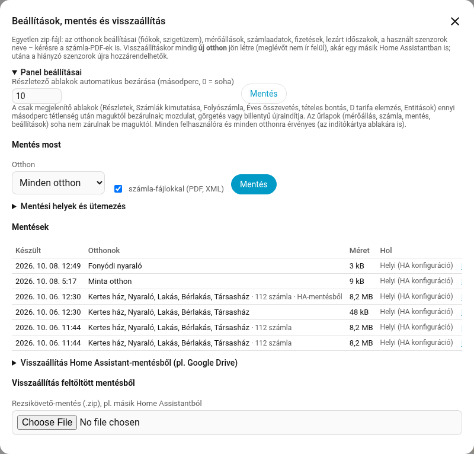

### 7.5.2 Értesítés a mobilra a fizetési határidő előtt (2.4.0)

A Rezsikövető a telefonodra szól, ha egy számlát hamarosan be kell fizetni. Alapból ki van kapcsolva.

**Bekapcsolás:** fejléc → **Beállítások, mentés és visszaállítás** → **Panel beállításai** → *Értesítés a mobilra a fizetési határidő előtt* (csak rendszergazda):

- **Hány nappal előtte:** 1–14 nap, alapból **3**.
- **Időpont:** mikor nézze meg naponta, alapból **9:00**.
- **Telefonok:** a Home Assistant mobilalkalmazásával bejelentkezett telefonok (`notify.mobile_app_…`), több is választható. Ha a lista üres, telepítsd a mobilalkalmazást, és jelentkezz be vele.
- **Otthonok** (ha több van): mely otthonok számláiról szóljon – ez a hangutasításokra (7.5.3) is vonatkozik. Ha mindegyik be van jelölve, a később felvett otthonok is beletartoznak. Ha csak egy otthon van kiválasztva, az üzenetben nem szerepel az otthon neve.
- **Mentés**, majd a **Próbaüzenet** gombbal kipróbálhatod: azt küldi el, ami ma kimenne.

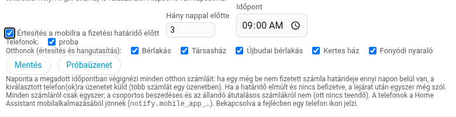

**Mit küld:** naponta a megadott időpontban végignézi minden otthon számláit. Ha egy még be nem fizetett számla határideje a megadott napon belül van, üzenetet küld; több számlát egy üzenetben sorol fel, pl. *„A1 áram: 12 345 Ft, határidő nov. 13. (3 nap múlva)”* (több otthonnál az otthon nevével). Ha a határidő elmúlt, és a számla még nincs befizetve, **a lejárat után egyszer** még szól (*„tegnap lejárt (nov. 9.), még nincs befizetve”*). Az üzenetre koppintva a Rezsikövető panel nyílik meg.

- **Minden számláról egyszer** szól előtte, és egyszer, ha lejárt – újraindítás után sem ismétel. Ha a számla később érkezik (pl. 2 nappal a határidő előtt), akkor is szól.
- **Nem szól** a csoportos beszedéses (és kompenzációs) és az állandó átutalásos számláról (ott nincs teendő), a 0 Ft-os és a stornózott számláról, és a 90 napnál régebbi határidejűről.
- Ha a küldés időpontjában a Home Assistant nem futott, az indulás után pótolja.
- Hogy mi számít befizetettnek, azt a folyószámla mutatja (7.5): Díjnet, kézzel jelölt fizetés, beszedés, állandó átutalás. Ha egy számlát máshol fizettél, jelöld befizetettnek (számla → *Javítás*), különben a lejárat után szól.

Bekapcsolva a fejlécben egy **telefon ikon** (📱) jelzi; föléhúzva mutatja, hány nappal előtte, hány órakor és hány telefonra küld, rákattintva a beállításhoz visz.

### 7.5.3 Hangutasítások: „Van befizetendő számlám?” és társai (2.4.0)

A Home Assistant hangasszisztensétől (Assist) megkérdezheted a Rezsikövető legfontosabb számait. Minden kérdés
mellé odamondhatod a közművet is (villany vagy áram, gáz, víz, távhő vagy fűtés, szemét, internet, közös költség) –
ilyenkor csak arról felel; anélkül minden fiókról.

| Kérdés (példák) | Mit mond |
|---|---|
| *„Van befizetendő számlám?”*, *„Van befizetendő gázszámlám?”*, *„Milyen számlát kell befizetnem?”*, *„Mikor kell befizetni a villanyszámlát?”* | a még be nem fizetett számlák összeggel, és hogy hány nap múlva esedékesek (a lejártaknál: hány napja járt le); a végén, ha nincs lejárt |
| *„Mikor jön a következő számla?”*, *„Mennyi lesz a következő vízszámla?”* | a várható következő számla összege és ideje (ha már meg kellett volna érkeznie: „… óta várható, még nem érkezett meg”) |
| *„Mennyi a rezsi eddig?”*, *„Mennyi a villany eddig?”*, *„Mennyibe kerül a gáz ebben az időszakban?”* | a folyó elszámolási időszak költsége eddig és az időszak végére várhatóan (fiókonként és összesen) |
| *„Hol tartok a keretben?”*, *„Hol tartok a gázkeretben?”*, *„Túllépem a keretet?”* | a kedvezményes (rezsicsökkentett) keretből hátralévő mennyiség, és ha várható, mikor lépi túl |
| *„Mennyi volt az utolsó villanyszámla?”* | a legutóbbi számla összege és kelte |

- **Melyik otthonról:** a beállításban kiválasztott otthonokról (7.5.2, *Otthonok*) – akkor is, ha maga az értesítés ki van kapcsolva. Több otthonnál a válasz az otthon nevét is mondja.
- A befizetendő számlákba ugyanazok számítanak, mint az értesítésnél (a beszedéses és állandó átutalásos kimarad).
- **Közvetlenül a Home Assistant indulása után** pár percig ezt mondja: *„A számlák adatai még töltődnek, próbáld újra pár perc múlva.”* – amíg az első számolás le nem fut (különben a Díjneten fizetett számlákat is befizetendőnek látná).
- **LLM-es ügynökkel** (Google Gemini, OpenAI, Anthropic, Ollama…) nincs teendő: ha az ügynök beállításaiban az **Assist** be van kapcsolva, a Rezsikövető ezeket eszközként adja (*Befizetendő számlák, Következő számla, Rezsi eddig és várhatóan, Kedvezményes keret, Utolsó számla*), és szabadabban is kérdezhetsz.
- **A beépített (helyi) Assisthoz** a magyar mondatokat kell bemásolni: a tároló `examples/custom_sentences/hu/hu_rezsi.yaml` fájlját a Home Assistant `config/custom_sentences/hu/` mappájába, utána a HA újraindítása (vagy Fejlesztői eszközök → YAML → *Beszélgetés* újratöltése). Frissítéskor ezt a fájlt is cseréld.
- Automatizálásból is kérhető (pl. reggeli összefoglaló a telefonra) a `conversation.process` művelettel – példa a tároló `examples/README.md` fájljában.

### 7.6 Indítókártya az irányítópultra

A panelt egy kártyáról is el lehet indítani. A kártya egy vonalas ház (egyetlen vonallal rajzolva, a padlón kis hurokkal), és benne látszik az otthon **kifizetetlen számláinak összege**. Alatta fiókonként egy ikon (⚡ villany, 🔥 gáz, 💧 víz, távhő, szemét, közös költség, internet/TV) a fiók fizetendő összegével, alatta sárga dőlt betűvel az **esedékes, de még nem számlázott** részével (mint a panelen a „még nem érkezett”: az e havi várható számla és a lezárt, még nem számlázott időszak becsült díja). Koppintásra megnyílik a Rezsikövető panel.

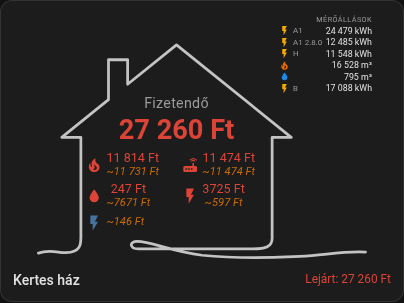

- **Felvétel:** irányítópult → *Szerkesztés* → *Kártya hozzáadása* → keresd: **Rezsikövető**. YAML-ban: `type: custom:rezsikoveto-kartya`. Erőforrást nem kell felvenni: az integráció magától betölti a kártyát, és Lovelace-erőforrásként is felveszi (*Beállítások → Irányítópultok → ⋮ → Erőforrások*: `/hu_rezsi_static/rezsikoveto-kartya.js`; új változatnál magától frissíti). A Rezsikövető frissítése után a kártya magától átvált az új változatra: amikor az alkalmazás a háttérből visszajön (vagy a lap újra látszik), az oldal egyszer újratölt. Ha mégis „Konfigurációs hiba” vagy a régi kinézet látszik, húzd le az oldalt frissítéshez, vagy az alkalmazásban: *Beállítások → Companion app → Gyorsítótár ürítése*.
- **Melyik otthon?** Alapból az, amelyiket a panelen utoljára kiválasztottad (böngészőnként/eszközönként megjegyzi). Ha a kártya mindig ugyanazt mutassa, a beállításban add meg az otthon nevét (`otthon: Kertes ház`). A *Felirat* (`cim`) a kártya alján az otthon neve helyett jelenik meg.
- **Fűtés és hőmérséklet – otthononként (nem kötelező):** az otthon saját beállítása: *Beállítások → Eszközök és szolgáltatások → Rezsikövető* → az otthon sorában **⚙ Konfigurálás**. Három mező, mind elhagyható:
  - **Fűtés:** a termosztát (`climate`) vagy egy kapcsoló/bináris érzékelő. Ha megadod, a tetőtérben (a „Fizetendő” fölött) a **benti hőmérséklet** látszik, és amíg fűt (termosztátnál `hvac_action: heating`, kapcsolónál a bekapcsolt állapot), **füst száll a kéményből**, a hőmérő ikonja pedig narancs.
  - **Benti hőmérséklet:** külön érzékelő; üresen a termosztát mért hőmérséklete.
  - **Kinti hőmérséklet:** hőmérséklet-érzékelő vagy időjárás-entitás; a házon kívül jelenik meg – jobbra fent, vagy ha ott a mérőállások vannak, a jobb fal mellett.

  A kártya mindig a megjelenített otthon beállítását használja: ha egy otthonnál nincs megadva semmi (pl. nem fűtött lakás), a kártyán nincs hőmérséklet és füst. A beállítás mentése nem tölti újra az otthont; a kártya legkésőbb 5 perc múlva (vagy oldalfrissítéskor) mutatja. A hőmérsékletre koppintva az entitás részletei nyílnak meg, a kártya többi része a panelt nyitja. Az otthon beállításai a Rezsikövető mentésébe is bekerülnek.
- **Mérőállások (jobbra fent):** a *Mérőállások* felirat alatt soronként egy színes ikon (villany sárga, gáz narancs, víz kék), villanynál a tarifa jele (A1, H, B…), majd a mérőóra **mostani állása** – csak azokról a mérőkről, amelyeknek van szenzora (a fiók mérőállás-, illetve regiszter-szenzora). H-tarifánál, ha a téli (1.81) és a nyári (1.82) regiszternek is van szenzora, a két regiszter látszik („H téli”, „H nyári”), az 1.8.0 nem; ha nincs megkülönböztetve, az egy 1.8.0-s állás („H”). Ugyanígy A2-nél a csúcs/völgy, napelemnél a betáplálás (2.8.0), víznél a locsolási almérő. Az állás a Rezsikövető által korrigált mérőóra-állás (a leolvasásokhoz igazítva, a mérő-korrekcióval), **egész számra** (lefelé, ahogy az óra egész számlálója mutatja és a számlák is számolnak), és **élőben lép** a szenzor minden új értékével. Dőlt, szürke: régi adat (a szenzor rég nem frissült). Ha egy mérőnek sincs szenzora: „Nincsenek szenzorok”. Egy sorra koppintva a szenzor részletei nyílnak meg.
- **Mi számít fizetendőnek?** A kiállított, de még nem kifizetett számlák (fizetendő > 0), a legutóbbi 90 napban esedékesek – ugyanaz, mint a panel *Fizetés* jelzése. A Díjnet szerint fizetett, a kézzel fizetettnek jelölt és a beszedéses (csoportos) számlák nem számítanak bele. Elöl a kiállított számlák, utána a csak becsült (még nem számlázott) tételek; legfeljebb hat fiók fér ki (két oszlop, három sor); ha több van, a hatodik helyén „+n fiók” áll.
- **Szenzorként is:** ugyanez az összeg az otthon **Fizetendő** szenzora (pl. `sensor.kertes_haz_fizetendo`), attribútumban a lejárt rész, a legközelebbi határidő, a még nem számlázott összeg és a fiókonkénti bontás (lásd 11. Entitások) – más kártyán, értesítésben, automatizálásban is használható.
- **Színek:** ha van **lejárt** számla, az összeg és az érintett fiók piros, alul „Lejárt: … · következő határidő …”. Különben alul a legközelebbi fizetési határidő. Ha nincs fizetendő: zöld **0 Ft**, „Minden számla rendezve” és a fiókok halvány ikonjai.
- **AI-tájékoztató (kísérleti, nem kötelező):** a kártya beállításában az *AI-tájékoztató gomb* (`ai_tajekoztato: true`) bekapcsolásával a kártya alján, jobbra egy **✨ AI** gomb jelenik meg. Koppintásra felugró ablakban rövid, szöveges tájékoztató nyílik az otthon számláiról: **összefoglaló**, **Most** (kifizetetlen és lejárt számlák, határidők, túlfizetés, késő számla), **Kilátások** (a következő számlák, a részszámlás fiókok éves elszámolásának várható visszatérítése vagy ráfizetése) és **Teendők** (befizetés, diktálás, számlahiba reklamálása). A számokat a Rezsikövető számolja (ugyanazok, mint a panelen); a szöveget egy **AI Task** entitás írja (pl. Google Gemini, OpenAI – *Beállítások → Eszközök és szolgáltatások*; az *AI Task entitás* mezőben választható, üresen az első elérhető). Az utolsó tájékoztató otthononként tárolódik, így az ablak azonnal mutatja (a készítés idejével); újat az **Új tájékoztató** gomb kér – ez egy AI-hívás, 10–60 másodperc. A *Panel megnyitása* a Rezsikövető panelt nyitja. Az AI tévedhet: a pontos adatok mindig a panelen vannak.

  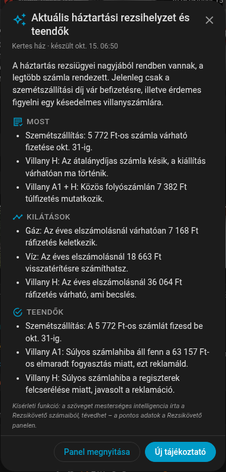

- **Frissülés:** a hőmérséklet és a füst azonnal; az összeg 5 percenként (a HA újraindulása után, amíg a Rezsikövető az első számolással és a Díjnet-fizetések beolvasásával végez, „Betöltés…”), és amikor a panelről visszatérsz (pl. fizetés rögzítése után). Széles helyen legfeljebb 340 px széles, középre igazítva.

---

## 8. Mérőállás rögzítése, mérőcsere

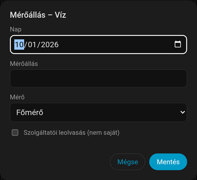

1. A fiók kártyáján **Mérőállás**.
2. **Nap** (alapból ma), **Mérőállás** (az órán látható érték). A mezőben már a **legutóbb rögzített állás** áll, alatta a dátuma („Legutóbb rögzítve: …”); elég átírni. Csatornaváltáskor (almérő, betáplálás) annak az utolsó állása jelenik meg.
3. **Mérő:** víznél *Főmérő* vagy *Locsolási almérő*; napelemnél *Betáplálás (2.8.0)*.
4. **Szolgáltatói leolvasás (nem saját):** pipáld be, ha a szolgáltató leolvasásáról van szó.
   **Éves (elszámoló) leolvasás:** pipáld be, ha a szolgáltató leolvasója az éves leolvasásra járt itt (a „Szolgáltatói” is bejelölődik). Innen indul az új elszámolási év és a kedvezményes keret, ehhez igazodik a következő éves leolvasás; az előtte lévő fogyasztást a szolgáltató ezzel az állással számolja el. Egy már rögzített állás utólag is megjelölhető: ugyanarra a napra ugyanazzal az állással, a jelölővel mentve (a Mentés ilyenkor változatlan állással is aktív). A Részletek mérőállás-listájában ★ jelzi.
   **Csak korrekciós leolvasás** (csak saját szenzoros fióknál): ha a saját szenzor szerinti állás (a mező alatt: „saját szenzor szerint most: …”) eltér az órától, írd be az órán látható állást, és pipáld be. Igazítja a szenzor szerinti állást, és a **korrekciós szorzót** (a szenzor és a mérőóra aránya) a Rezsikövető újraszámolja, ha már van hozzá elég adat (legalább 3 saját leolvasás, 45 nap alatt). **Nem** diktálás, **nem** elszámoló leolvasás, és **nem** határa az elszámolási időszaknak – a többi jelölés ilyenkor nem választható. Mentés után a panel tetején egy sáv mutatja: mennyit mért a szenzor, mennyi az eltérés, és hogyan változott a szorzó. Az aznapi rendes saját leolvasást (pl. a diktálást) nem írja felül; ha viszont aznapra **ugyanezt az állást** már saját leolvasásként rögzítetted (és nem diktálás), azt utólag megjelöli korrekciósnak – az eredeti időpont marad.
   **Diktáltam a szolgáltatónak** (csak diktálásos villanyfióknál): pipáld be, ha ezt az állást be is diktáltad – itt zárul az elszámolási időszak, másnap indul a következő.
5. **Mentés.** A gomb csak akkor aktív, ha valamelyik állás eltér az előtöltöttől (vagy bejelölted az éves leolvasást) (mérőcserénél: ha megadtad a régi mérő záró állását) – változatlan állást nem ment.

Tudnivalók:

- A leolvasás mindig **erősebb** a szenzornál: a fogyasztás ehhez igazodik.
- **Időpont:** a mai napra rögzített saját állás a rögzítés pillanatához kerül (nem a nap elejére) – így az este leolvasott állásnál a nap eleje óta mért fogyasztás nem adódik hozzá még egyszer. Régebbi napra rögzített állás a nap elejére kerül; a `hu_rezsi.leolvasas_rogzites` szolgáltatásban az `ido` mezővel pontos időpont is megadható.
- **Melyik állás a hivatalos?** A számlán szereplő állás – amíg kézzel felül nem írod. Ha ugyanarra a napra **kézzel** rögzítesz állást (mert diktáltál), az lesz a hivatalos, a számla szerinti állás félrekerül; ha a kézit törlöd, a számláé visszaáll. **Távleolvasásnál** a szolgáltató távleolvasott állása a legerősebb: azt kézzel nem lehet felülírni (hibaüzenetet kapsz). Ugyanarra a napra ugyanolyan típusú leolvasás felülírja a régit.
- A számla **becsült / kalkulált** (átalány) állását a program nem veszi valódi leolvasásnak.
- A mérő **nem mehet visszafelé**: ha egy állás kisebb, mint egy korábbi (vagy nagyobb, mint egy későbbi), hibát kapsz.
- Az **éves elszámoló leolvasást** (amelytől az új elszámolási év indul) a `hu_rezsi.leolvasas_rogzites` szolgáltatással, `elszamolasi: true`-val jelölheted; a számlákból jövőket magától jelöli.
- H-tarifánál a regisztereket a szolgáltatással, `csatorna: h_teli` / `h_nyari` értékkel rögzítheted.

**Fiók lezárása (végelszámolás):** költözés, lemondás vagy szolgáltatóváltás esetén a kártya ⋮ menüjében *Fiók lezárása (végelszámolás)* (vagy a `hu_rezsi.fiok_lezarasa` szolgáltatás): add meg a lezárás napját és a záró óraállást (a végszámla szerint). Ekkor:
- a záró állás végleolvasásként bekerül, az utolsó időszak a lezárás napjáig lezárul (lezárt időszakként, „végelszámolás” forrással);
- a fiók számolása a lezárás napján megáll: nincs előrejelzés („Várható”), nincs diktálás és következő elszámolás, a Mérőállás gomb eltűnik; a kártya tetején „Lezárva …” jelzés;
- a „Ha ma lenne az elszámolás” helyén **Végelszámolás**: az utolsó éves elszámolás (ill. a kezdő óraállás) óta mért fogyasztás díja, mínusz az azóta kapott számlák – a végső egyenleg (mínusz: még fizetendő, plusz: visszajár);
- a végszámla megérkezéséig a lezárt időszakok „Még nem érkezett számla” sorban látszanak;
- a lezárás hónapja után a fiók kimarad a háztartás havi összegeiből (az úton lévő végszámla nem).

**Fix díjas fióknál** (pl. negyedéves, utólagos hulladékdíj) nincs mérő és éves elszámolás: elég a lezárás napja. A díj a lezárás napjáig jár (az utolsó negyedévből töredék, napra arányosan); a még hátralévő számlák a szokásos ütem szerint jönnek – a lezárás előtti negyedévé teljes összeggel, majd a **végszámla** a töredék időszakról (a kártya kiírja a napját és a várható összegét). Ha a végszámla megérkezett (az időszaka eléri a lezárás negyedévét), több számla nem várható. Pl. lezárás okt. 4-én: okt. 8-án még a júl.–szept. negyedév 5 772 Ft-ja, jan. 8. körül a végszámla kb. 186 Ft (okt. 1–3.).

A lezárás visszavonható (ugyanott *Lezárás visszavonása*): a végleolvasás és a végelszámolás törlődik, a fiók újra számol.

**Mérőcsere:** a kártya **Mérőállás** ablakában a *Mérőcsere* kapcsolóval (vagy a `hu_rezsi.merocsere` szolgáltatással): a csere napja, a régi mérő záró állása, az új mérő kezdő állása (általában 0) és gyári száma; H-tarifánál a két regiszter (1.81, 1.82) záró és kezdő állása is, víznél a locsolási almérő is cserélhető. Ellenőrzi, hogy a záró állás illeszkedjen a régi mérő leolvasásaihoz. A fogyasztás a cserén át folytonos marad, az éves keret és az elszámolási év nem változik; diktálásos fióknál a csere napja időszakhatár (az addigi időszak lezárul). Egy tévesen rögzített csere visszavonható (`hu_rezsi.merocsere`, *Utolsó mérőcsere visszavonása*), amíg az új mérőn nincs leolvasás.

---

## 9. Számlák felvitele

A számlákból jönnek a **befizetések** (ezekből az egyenleg és a várható elszámolás), a **valódi mérőállások** és gáznál a **havi fűtőérték**. Négy út van, és ha a szolgáltató e-mailben küldi a számlát, ötödikként a Rezsikövető maga is kiolvashatja a postafiókból (9.8):

### 9.1 Automatikusan a Díjnetről (ajánlott)

1. Telepítsd a Díjnet-integrációt (HACS), és állítsd be a letöltést.
2. A Rezsikövető fiókjában a **Számlamappa** mezőben add meg a letöltési mappát (pl. `Dijnet /mvm_next_aram`).
3. Az új számlákat a Rezsikövető **10 percenként** keresi. Egy új, a fiókhoz tartozó számla **először jóváhagyásra vár** (értesítés jön): a panel összesítőjében „új számla jóváhagyásra vár” blokk mutatja a számla adatait, a **díját a saját mérésünkhöz képest** (ha nagyon eltér – 15%, ill. 1000 Ft felett – vagy visszafelé menő mérőállást hozna, figyelmeztet), egy **előtte / jóváhagyás után** táblázatot (eddig, várható, következő számla, esedékes, „ha ma lenne az elszámolás”, éves egyenleg, keret) és az átvett mérőállásokat. **Jóváhagyás**: a számla és a mérőállásai bekerülnek, minden újraszámolódik. **Elvetés**: nem kerül be (a fájl a mappában marad; később a `hu_rezsi.szamlak_ujraolvasasa` szolgáltatással újraolvasható) – így a szolgáltató hibás számlái nem írják át észrevétlenül a számokat. A panelről feltöltött számla (9.2) jóváhagyás nélkül, azonnal rögzül.

### 9.2 Feltöltés a panelről

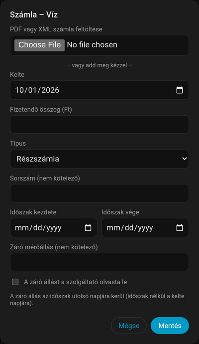

1. A fiók kártyáján **Új számla**.
2. Felül: **PDF vagy XML számla feltöltése** → válaszd ki a fájlt (telefonról is: fájlok, letöltések, e-mail melléklet).
3. Pár másodperc múlva kiírja az eredményt:
   - **✓ Beolvasva:** sorszám, kelte, összeg – kész, az ablak magától bezárul.
   - **Már szerepelt:** ez a számla már bent van, nem rögzítette újra.
   - **Felismertem, de nem ehhez a fiókhoz tartozik (más mérő):** a számlán álló mérő nem a fiók mérője (pl. H-tarifás számla az A1 fióknál), vagy a fiók **Számla-mérők** mezőjében más szám áll. Ha biztosan ehhez a fiókhoz tartozik, lásd a [15. fejezetet](#15-gyakori-kérdések-és-hibaelhárítás).
   - **Nem ismertem fel:** töltsd ki lent kézzel (9.4).

A feltöltéshez a fióknak kell **számlamappa**; ha nincs, az ablak szól, és kézzel rögzíthetsz.

### 9.3 Fájl bemásolása

A PDF/XML fájlt másold a fiók számlamappájába (Samba, File editor, Studio Code Server). Ugyanúgy feldolgozódik, mint a letöltött.

### 9.4 Kézi rögzítés

Az **Új számla** ablakban, a „vagy add meg kézzel” alatt:

| Mező | Mit írj be |
|---|---|
| **Kelte** | a számla kiállításának napja |
| **Fizetendő összeg (Ft)** | a számla **fizetendő** összege; visszatérítésnél **mínusz** |
| **Fizetési határidő** | a számlán álló határidő (nem kötelező) – ha lejár és nincs kifizetve, az összesítő figyelmeztet; utólag a Számlák listában is megadható |
| **Típus** | Részszámla / Elszámoló számla / Egyéb |
| **Sorszám** | a számla sorszáma (üresen automatikus „kezi-…”) |
| **Időszak kezdete / vége** | az elszámolt időszak (ha szerepel a számlán) |
| **Záró mérőállás** | ha szerepel; az időszak utolsó napjára (időszak nélkül a kelte napjára) kerül |
| **A záró állást a szolgáltató olvasta le** | pipa, ha nem diktált |
| **Fűtőérték (MJ/m³)** | gáznál, az időszak hónapjaira |

Ha a záró állás ellentmond a meglévőknek (a mérő nem mehet visszafelé), a számla bekerül, de az állás kimarad – erről figyelmeztetést kapsz.

> [!TIP]
> **Melyik összeg a „fizetendő”?** A számla elején álló *Fizetendő összeg*. Elszámoló számlánál ebből már le vannak vonva a részszámlák (és az MVM közös ügyfélszámláján a korábbi túlfizetés), ezért **mínusz is lehet** (visszajár). Ne a „Bruttó számlaérték összesen” sort írd be. A számla-ellenőrzés a kézi elszámoló teljes díját a fizetendő **és az időszakába eső részszámlák** összegéből veszi, így a levont részszámlák miatt nem jelez hamis eltérést.

### 9.5 Támogatott számlák

| Szolgáltató | XML | PDF | Mit vesz át |
|---|---|---|---|
| MVM Next – áram | ✅ (Díjnet `*_szamla.xml`) | ✅ (XML nélkül is, végszámla is; H-mérőnél a két regiszter összege; 15–18 jegyű mérőszám) | fizetendő, diktált/leolvasott mérőállás |
| MVM Next – gáz | ✅ | – | fizetendő, mérőállás, havi fűtőérték |
| DAKÖV – víz | – | ✅ | fizetendő, fő- és almérő állása |
| ALFÖLDVÍZ – víz | – | ✅ (a portálról letöltött másolat kivételével) | fizetendő, éves (leolvasott) mérőállás, elszámolt ivóvíz/szennyvíz, következő leolvasás és diktálás, levont részszámlák |
| HVSZ – távhő | ✅ (APEH-XML) | kiegészítésként (a PDF-pár) | fizetendő, melegvíz m³, hődíj (GJ), hődíj-korrekció, fizetési mód, határidő; a PDF-ből melegvízóra-állások, folyószámla-egyenleg, elszámolt időszak |
| MOHU – hulladék | ✅ | – | fizetendő |
| Magyar Telekom – otthoni összevont | ✅ (Díjnet AMDOCS-XML) | ✅ (XML nélkül is) | fizetendő, kelte, határidő, elszámolt hónap, fizetési mód |
| One Magyarország (volt DIGI) | – | ✅ | fizetendő, kelte, határidő, időszak, fizetési mód |
| Mezőföldvíz – víz (2.3.0, beépített saját beolvasó) | – | ✅ (részszámla, átalány) | fizetendő, kelte, határidő, időszak, díjtételek, elszámolt ivóvíz/csatorna; mérőállás nincs a számlán – a fiókot a számlamappa választja |

Ha egy számlához XML és PDF is van, az XML-t olvassa (pontosabb). Becsült állást nem vesz át.

### 9.6 Ha egy fájlt nem ismer fel

Más szolgáltató, szkennelt (képként mentett) PDF vagy nem számla: **értesítés** jön a fájl nevével, és a panel tetején is megjelenik. Teendő:

- rögzítsd a számlát kézzel (9.4), vagy
- olvastasd ki **AI-val** (9.9) – szöveges PDF-nél, ha van AI Task entitásod, és/vagy
- kérj beolvasót: GitHub → **Issues → New issue → „Új szolgáltató / számlaformátum”**, egy **kitakart** mintaszámlával. Kitakarandó: név, cím, ügyfél- és szerződésszám, mérési pont azonosító, bankszámla. Az összegek, dátumok, mérőállások és a szerkezet maradjon.

A fel nem ismert fájlt a mappából törölve a jelzés is eltűnik.

### 9.7 Számla törlése

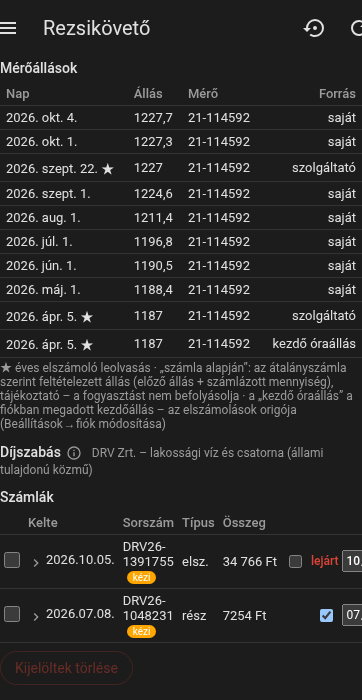

1. A kártyán **Részletek** → a **Számlák** listában pipáld be a törlendő számlá(ka)t.
2. **Kijelöltek törlése (n)** – (vagy *Kijelölés megszüntetése*).

   

3. A megerősítő ablak felsorolja a kijelölteket; **Végleges törlés**. A számlával együtt a belőle jött befizetés és mérőállás is törlődik.

   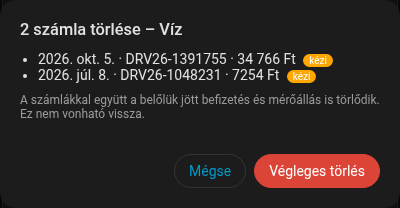

A Díjnet-mappából beolvasott számla törlés után csak a **Számlák újraolvasása** szolgáltatással jön vissza (ez a kézzel rögzített számlákat nem törli).

### 9.8 Számlák e-mailből – lépésről lépésre

Ha a szolgáltatóid (MVM, vízmű, Telekom…) e-mailben küldik a számlát, a Rezsikövető ki tudja olvasni őket a postafiókodból. Utána a számlák **maguktól bekerülnek** – nem kell letöltened és feltöltened őket. Nyomtatható változat képekkel: [Számlák e-mailből – lépésről lépésre (PDF)](Szamlak_emailbol.pdf).

**Ehhez két dolog kell:** az **e-mail címed**, ahová a számlák jönnek, és egy **jelszó**. Gmailnél ez **alkalmazásjelszó** (lásd lent – 2 perc), Freemailnél és Citromailnél a szokásos jelszavad.

**A Rezsikövető csak olvas:** semmit nem töröl, nem helyez át, és nem jelöl olvasottnak. A jelszó a saját Home Assistantodban marad (a Rezsikövető-mentésbe sem kerül bele).

#### 1. Gmail: alkalmazásjelszó készítése

A Gmail a levelezőprogramoknak **nem fogadja el a szokásos jelszavad** – ehhez külön, 16 betűs „alkalmazásjelszó” kell:

1. Nyisd meg ezt az oldalt: **https://myaccount.google.com/apppasswords** (jelentkezz be a Google-fiókodba, ha kéri).
2. Ha az oldal azt írja, hogy a beállítás nem érhető el: előbb kapcsold be a **kétlépcsős azonosítást** (Google-fiók → Biztonság → Kétlépcsős azonosítás), és nyisd meg újra a fenti oldalt.
3. Adj nevet, pl. „Rezsikövető”, és kattints a **Létrehozás** gombra.
4. A Google egy 16 betűs jelszót mutat (négy csoportban, pl. `abcd efgh ijkl mnop`). **Másold ki** – csak egyszer látszik. A szóközöket nem kell kitörölnöd.

**Freemail, Citromail:** a szokásos jelszavad kell. Ha nem enged be, a levelező honlapján, a Beállításokban nézd meg, hogy engedélyezve van-e a „levelezőprogramos (IMAP/POP3) hozzáférés”.

**Yahoo, iCloud:** ott is alkalmazásjelszó kell (Yahoo: login.yahoo.com/account/security; iCloud: account.apple.com → Alkalmazásspecifikus jelszavak). **Outlook, Hotmail, Live:** a Microsoft jelszóval már nem engedi a levelezőprogramokat – állíts be ott **továbbítást** a számlalevelekről egy Gmail- vagy Freemail-címre, és azt add meg.

#### 2. Indítás a panelről: „📧 Számlák e-mailből”

A Rezsikövető panelen, az otthonod összesítőjében kattints a **📧 Számlák e-mailből** gombra (csak rendszergazda látja).

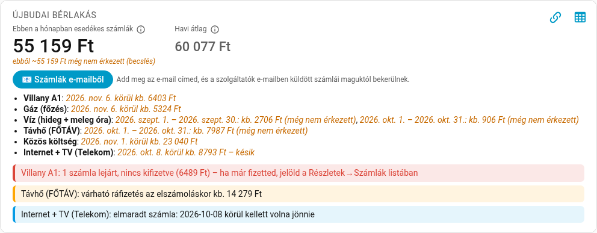

Egy rövid varázsló nyílik:

1. **Mi kell?** – elmondja, mire lesz szükséged. **Tovább**.
2. **Belépés** – írd be az e-mail címed. A varázsló felismeri a levelezőt (Gmail, Freemail…), és megmutatja, milyen jelszó kell és hol készíted el (Gmailnél gomb is van: *Alkalmazásjelszó készítése ↗*). Írd be a jelszót, és kattints a **Kapcsolódás** gombra.

   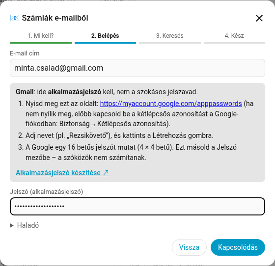

3. **Keresem a számláidat…** – a Rezsikövető belép, és átnézi az utolsó fél év leveleit (a Kukát is). Ez **több percig is tarthat**: amíg fut, a panel 5 másodpercenként frissül, időkorlát nélkül, és kiírja, mióta fut – pl. „A fél év leveleit nézem át, ez több percig is tarthat – 3 perce fut.” Nyugodtan bezárhatod, a háttérben folytatódik; ha később nyitod meg a panelt, a futó keresést ott is így látod.
4. **Kész** – megmutatja, hány számlát talált, és melyik fiókhoz kötötte be őket.

   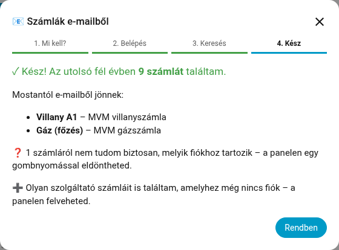

Ha a jelszó nem jó, a varázsló **érthetően megmondja, mi a teendő** (Gmailnél: „ide alkalmazásjelszó kell, nem a szokásos jelszavad”, a link is ott van):

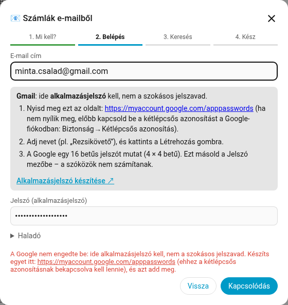

Több e-mail cím is felvehető (pl. ha a számlák egy része a párod címére jön): a panelen a **+ E-mail cím** gomb.

> A beállítás a Home Assistant felületén is elvégezhető: Beállítások → Eszközök és szolgáltatások → Rezsikövető → **E-mail fiók hozzáadása**. Itt is csak az e-mail cím és a jelszó kell; a szerver a címből jön (a **Haladó** rész alapból össze van csukva).
>
> 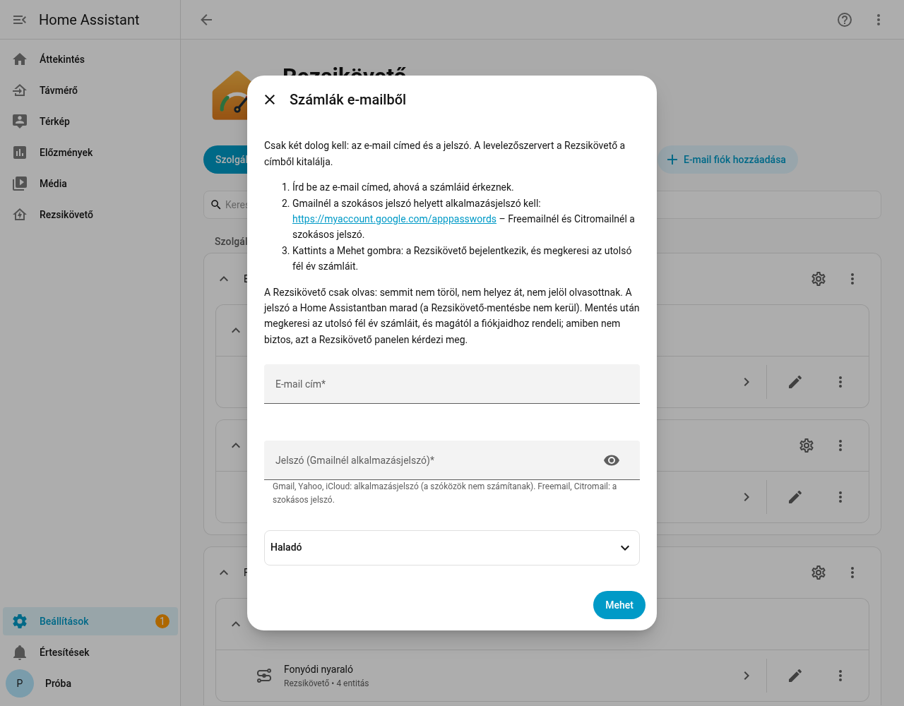

#### 3. Mi történik magától?

- A Rezsikövető **beolvassa a számlák PDF/XML mellékletét**, és a számlán lévő adatok – a **mérő gyári száma**, a mérési pont, a szolgáltató és a közmű – alapján eldönti, **melyik fiókodhoz tartozik**. Feladót, tárgyat, irányítószámot nem kell beírnod. Az MVM villany- és gázszámlája ugyanattól a feladótól jön – a tartalom alapján a villany a villanyfiókba, a gáz a gázfiókba kerül.
- Ha **biztos** a dolgában (egyetlen fiókhoz illik), bekapcsolja annál a fióknál az e-mailes számlákat, és szól: *„Az MVM villanyszámlái mostantól e-mailből jönnek a „Villany A1” fiókhoz.”*
- A talált számlák **jóváhagyásra váró számlaként** jelennek meg (9.1) – a már ismerteket nem tölti be újra.
- Ezután **óránként** magától átnézi a postafiókot; az új számla pár percen belül megjelenik. A továbbított számlát (pl. a párod küldi át) is felismeri.
- A Telekom-féle, **melléklet nélküli** számlaértesítőből a sorszámot, az összeget, a dátumokat és a határidőt veszi ki.

#### 4. Mit jelentenek a kártyák a panelen?

Az otthon összesítőjében a **Számlák e-mailből** blokk mutatja, mi van bekötve, mikor nézte utoljára, és ha valamit meg kell erősítened:

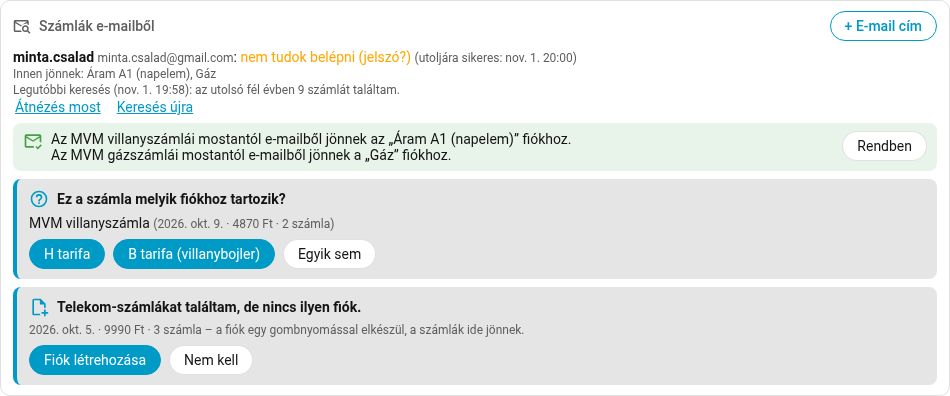

| Kártya | Mit jelent | Mit tegyél |
|---|---|---|
| ✉️ zöld üzenet | Mi kapcsolódott be (pl. „Az MVM gázszámlái mostantól e-mailből jönnek a „Gáz” fiókhoz.”) | Semmit – **Rendben** eltünteti |
| ❓ „Ez a számla melyik fiókhoz tartozik?” | Több fiókhoz is illene (pl. két villanyfiók mérőszám nélkül), vagy a mérő egyik fiókénál sem szerepel (mérőcsere? másik ingatlan?) | Koppints a jó fiók nevére – vagy **Egyik sem** (akkor többet nem kérdezi) |
| ➕ „…-számlákat találtam, de nincs ilyen fiók” | Olyan szolgáltató számlái jönnek, amelyhez még nincs fiókod | **Fiók létrehozása** (internet/TV/telefon: egy gombnyomás; villany/gáz/víz: a fiók-varázsló előtöltve nyílik, a mérő adatait ott add meg) – vagy **Nem kell** |

Gombok a blokkban: **Átnézés most** (nem kell egy órát várni), **Keresés újra** (újra átnézi az utolsó fél évet – pl. új fiók felvétele után), és ha egy fiókod még a régi, kézi szűrővel van bekötve: **Automatikus besorolás bekapcsolása** (a régi szűrő tartaléknak megmarad). Amíg keresés vagy átnézés fut, a blokk kiírja, mióta tart. (Egy korábbi bétában az Automatikus besorolás, a „Melyik fiókhoz tartozik?” és a fiókajánlat gombjai „expected str at 'id'” hibát adtak – a 2.2.0-ban működnek.)

#### 5. Hibaelhárítás

| Mit látsz | Mi a baj | Mit tegyél |
|---|---|---|
| „A Google nem engedte be: ide alkalmazásjelszó kell…” | A szokásos Google-jelszót adtad meg | Készíts alkalmazásjelszót (1. pont), és azt add meg |
| „nem tudok belépni (jelszó?)” a blokkban, és a Beállításoknál javítandó probléma | A jelszó megváltozott, vagy a Google visszavonta az alkalmazásjelszót (pl. Google-jelszócsere után) | Új alkalmazásjelszó, majd Beállítások → Eszközök és szolgáltatások → Rezsikövető → az otthon → az e-mail fiók → ⋮ → **Újrakonfigurálás** |
| „Nem találtam a levelezőszerveredet” | Saját domaines vagy ritka levelező | A levelező súgójában keresd az „IMAP-szerver” nevét, és írd be a varázsló **Haladó** részébe |
| Outlook / Hotmail-címnél „jelszóval már nem enged be” | A Microsoft letiltotta a jelszavas levelezőprogram-belépést | Továbbítás egy Gmail- vagy Freemail-címre, és azt add meg |
| „N levelet nem tudtam fiókhoz rendelni” | A számla egyik fiókodhoz sem illik egyértelműen | Ha kérdés-kártya van, válaszolj; ha nincs, nézd meg a fiók mérőszámát (a fiók beállításai → Mérő) |
| Freemail/Citromail nem enged be | Nincs engedélyezve a levelezőprogramos hozzáférés | A levelező honlapján a Beállításokban engedélyezd az IMAP-hozzáférést |
| „add meg újra a jelszót” visszaállítás után | A mentés a jelszót nem tartalmazza (biztonsági okból) | Az e-mail fióknál **Újrakonfigurálás**, és add meg a jelszót |
| Semmi nem jön, nincs hiba | A szolgáltató nem küld e-mailben számlát, vagy más címre küldi | Nézd meg a szolgáltató ügyfélportálján az „e-számla” beállítást és a címet |
| Percek óta „Keresem a számláidat…” | Nagy postafiók: a fél év levelei több percig is tarthatnak | Várj; a sor kiírja, mióta fut. Egy korábbi bétában a kijelzés 5 perc után megállt – frissíts 2.2.0-ra vagy újabbra |
| „Nem sikerült: expected str at 'id'…” egy gombnál | Hiba egy korábbi bétában (a kérés mezője ütközött a WebSocket-üzenet sorszámával) | Frissíts 2.2.0-ra vagy újabbra |


#### Haladó: kézi szűrők

A fiók beállításainál (Újrakonfigurálás → **E-mailes számlák** lépés) az **Automatikus besorolás a számla tartalma szerint** alapból be van kapcsolva. A **Haladó: kézi szűrők** részben megadható a feladó (cím vagy domain, vesszővel több is), a tárgyban szereplő szó, a mérő gyári száma és a felhasználási hely irányítószáma – automatikus besorolás nélkül ezek döntenek (így működött a 2.2.0b1), mellette tartaléknak maradnak (ha a tartalom nem dönt, a szűrő választ). A lakossági villanyszámlát az MVM Next küldi (`mvmee.hu`) akkor is, ha az elosztó MVM Démász, E.ON, OPUS TITÁSZ, ELMŰ vagy MVM Émász – ez és a Telekomé (`telekom.hu`) előtöltve.

Ha a fióknak még nincs **számlamappája**, a Rezsikövető létrehoz egyet (`Szamlak/<a fiók neve>`), és onnan olvassa be a számlákat. A **Visszatekintés** (az e-mail fiók Haladó részében, alapból 45 nap) az óránkénti átnézésre vonatkozik; a keresés („Keresés újra”, új e-mail fiók) mindig az utolsó 180 napot nézi.

---

### 9.9 Ismeretlen számla kiolvasása AI-val, saját beolvasó (2.3.0, kísérleti)

> Részletes, képes leírás: [AI-os számlaolvasó](AI_szamlaolvaso.md).

> **Beépített saját beolvasók:** a tagok által beküldött (személyes adat nélküli) beolvasók a Rezsikövetővel érkeznek, AI és fájlmásolás nélkül működnek – jelenleg: **Mezőföldvíz** (víz, részszámla). Ha ugyanilyen azonosítójú saját beolvasód is van a `hu_rezsi_sablonok` mappában, az a saját az erősebb.

Ha a Rezsikövető egy PDF-számlát nem ismer fel (más szolgáltató, pl. egy helyi vízmű), a választott **AI** kiolvassa belőle az adatokat, te ellenőrzöd és jóváhagyod – és a számla ugyanúgy bekerül, mint egy felismert.

**Kell hozzá:** egy **AI Task** entitás a Home Assistantban (Beállítások → Eszközök és szolgáltatások → pl. *Google Generative AI*, *OpenAI* vagy helyi *Ollama*). Ugyanaz lehet, amit az AI-tájékoztató használ.

**Bekapcsolás:** alapból **ki van kapcsolva**. A fejléc ⚙ (Beállítások, mentés és visszaállítás) → **Panel beállításai** → „Ismeretlen számla kiolvasása AI-val” + AI Task entitás → **Mentés**. Az első bekapcsoláskor (vagy az első kiolvasáskor) egy tájékoztató kérdezi meg, engedélyezed-e.

**Mi kerül el az AI-hoz:** a számla szövege, de elküldés előtt a Rezsikövető **igyekszik kitakarni** a személyes adatokat: a feliratos név- és címsorokat (akkor is, ha az érték a következő sorban áll), a felirat nélküli címeket (irányítószám + település + közterület), az összes otthon számláiról ismert neveket, címeket, azonosítókat és mérési pontokat, a HA személyeinek nevét, a fiók mérőszámait (MERO_1 helyőrzővel – a válaszban visszakerülnek), az e-mailt, a telefont, a bankszámlát, az adóazonosítót. A szolgáltató neve és adószáma marad. **A kitakarás nem tökéletes:** szokatlan elrendezésű számlán maradhat benne személyes adat – ha ez nem elfogadható, válassz helyi AI-t (Ollama). Helyi AI-nál (Ollama) a gépedet sem hagyja el. Az AI válaszát és a számla szövegét a Rezsikövető nem tárolja; csak a jóváhagyott adatok kerülnek be. Fizetős AI-nál egy kiolvasás néhány forint.

**Lépések:**

1. A panel tetején a figyelmeztetés („… fájlt nem ismertem fel …”) alatt: **Kiolvasás AI-val: <fájl> ›** – vagy feltöltésnél (**Új számla → fájl**), ha nem ismerte fel: „olvastasd ki AI-val ›”.
2. 10–60 másodperc múlva megnyílik a **jóváhagyó ablak**: balra a kiolvasott adatok (szolgáltató, sorszám, típus, kelte, határidő, időszak, fizetendő, mérőállások, elszámolt mennyiség, tételek) – mind javítható –, jobbra a számla szövege, a megtalált értékek kiemelve (egy mezőre kattintva a szövegben is kiemelődik).
3. Minden mező mellett jelölés:
   - **✓** – az érték szó szerint szerepel a számlán, és megfelel a szabályoknak;
   - **!** – ellenőrizd (pl. a tételek összege nem adja ki a számla értékét, szokatlanul nagy fogyasztás, nem a fiók ismert mérője);
   - **✗** – ellentmondás: az érték nincs a számla szövegében (az AI „kitalálta”), a záró állás kisebb az indulónál, a mérőállás ellentmond a fiók meglévő leolvasásainak, vagy a számla már szerepel.
4. **Átvétel jóváhagyásra:** a Rezsikövető újraellenőriz. Ellentmondásnál csak akkor veszi át, ha kijavítod, vagy bepipálod: „Tudom, hogy ellentmondás van – mégis így veszem át”.
4. Két gomb: **Csak átvétel**, vagy **Átvétel és beolvasó mentése** (ajánlott, lásd lent).
5. A számla a **jóváhagyásra várók** közé kerül („AI-val kiolvasva” címkével): ott látod, mi változna vele (fogyasztás, költség, egyenleg, átvett mérőállások), és ott **Jóváhagyás** vagy **Elvetés**.

**Saját beolvasó (2.3.0):** az „Átvétel és beolvasó mentése” a jóváhagyott adatokból helyi beolvasót (sablont) készít ehhez a szolgáltatóhoz. A **következő számláit már AI nélkül**, helyben, ingyen olvassa be – ugyanúgy jóváhagyásra várnak, mint bármely mappába érkezett számla („saját beolvasóval” címkével). A mappában már ott lévő, korábban fel nem ismert számlái is magától előkerülnek.

- A beolvasó csak akkor mentődik, ha a számlán **pontosan azt** olvassa ki, amit jóváhagytál, és nincs benne személyes adat (csak a szolgáltató neve, adószáma, a mezők feliratai és általános minták). Ellentmondásos számlából nem készül.
- Helye: `config/hu_rezsi_sablonok/<szolgáltató>.yaml` – olvasható, a HA-mentésbe bekerül, és **megosztható** (pl. GitHub-hibajegyben, hogy beépített beolvasó legyen belőle).
- Ha a szolgáltató más formájú számlát küld (pl. elszámoló a részszámla után, vagy átalakította a számláját), és a beolvasó egy kötelező adatot (sorszám, kelte, fizetendő) nem talál, a fájl fel nem ismert marad – olvastasd ki AI-val, és mentsd a beolvasót: az új forma külön beolvasót kap (`<szolgáltató>_2.yaml`), a régi is megmarad.
- A számla típusát (rész / elszámoló / sztornó) a beolvasó minden számlánál a szövegből határozza meg; a sorminták az első kiolvasott értéktől az utolsóig tartanak (a sor elején, végén álló név, cím nem kerül bele).

**Korlátok:** csak szöveges PDF (a szkennelt, képes számla egy későbbi változatban jön); a regiszterenkénti (pl. H-tarifás 1.8.1/1.8.2) sorokat még nem veszi át. Az AI-beolvasáshoz friss Home Assistant (AI Task, 2025.8+; a listás adatszerkezethez újabb) kell.

## 10. Hogyan számol?

**A következő számla – közös szabály minden fióknál** (`motor/kovetkezo_szamla.py`): a következő számla a legutóbbi számla utolsó (valódi) napja utántól a következő mérőállásig tart (a diktálási ablak közepéig; ha a számlán nincs ablak, a számlázási ütem szerinti napig). Amíg ez az állás nincs meg, a díja a saját mérésből számolódik, napi átlaggal kivetítve. Mért fióknál ez a folyó elszámolási időszak; átalányos fióknál csak akkor, ha a szolgáltató diktálás szerint számláz (az utolsó két számla elszámoló, vagy 120 napon belül diktáltál) – különben a következő számla az átalány.

> [!TIP]
> A számlafeldolgozás teljes folyamata ábrákkal – mit bont ki a számlából, hová kerül, melyik mérőállást fogadja el (diktálás, leolvasás), mit számol belőle, és hogyan veti össze a saját méréssel: [Számlafeldolgozás (PDF)](rendszer/Szamlafeldolgozas.pdf).

1. **Fogyasztás:** a mérőállás-szenzor napi statisztikájából és a leolvasásokból, a leolvasásokhoz igazítva; két leolvasás között napra arányosítva („becsült”).
2. **Szeletek:** az időszakot ott vágja, ahol a díj, a keret vagy a fűtőérték változik (pl. H-tarifa okt. 15., gáz hónapforduló).
3. **Keret:** villanynál napi arányos (egész kWh); gáznál fogyasztás szerinti (diktálásos) fióknál havonta súlyozott (egész MJ), a kedvezményes évben (aug. 1. – júl. 31.) halmozva, átalányos fióknál éves. Villany A1-nél, B-nél és a H nyári (1.82) regiszterén **összesített**: az elszámolási évben (az éves elszámoló leolvasástól a következő éves elszámoló leolvasásig) a kedvezményes rész a halmozott fogyasztás és a halmozott keret kisebbike (MVM sávkorrekció); a keret az évhatáron nem vihető át. H-nál csak az idényen kívüli napok és fogyasztás számít.
4. **Mérő-korrekció:** a szenzor változását a valódi leolvasásokból becsült aránnyal szorozza (robusztus becslés, egy-egy rossz leolvasás nem viszi el); a kézi eltolás-ugrást és a nullázódást nem veszi fogyasztásnak.
5. **Díjak:** nettó egységárak tételenként, ÁFA a nettóra; a számla kerekítési szabálya szerint (MVM: tételenként forintra, DAKÖV: a végösszeg).
6. **Előrejelzés:** az utolsó 7 nap átlagával a hónap végéig (szenzor nélkül az utolsó leolvasás óta a legutóbbi, legalább 20 napos leolvasási szakasz ütemével, becsültként); az éves egyenleghez a tavalyi fogyasztás és egy havi profil.
7. **Lezárás:** minden időszak (hónap / negyedév / egyedi nap) végén, 1 órával a határ után automatikusan lezárul; a lezárt időszakok a **Részletek** alatt és az „Utolsó lezárt időszak” entitásban látszanak.

---

## 11. Entitások

Minden fiók egy **eszköz** a saját entitásaival (az entitásnevek elején a fiók neve áll, pl. `sensor.viz_varhato_koltseg`):

| Entitás | Jelentés |
|---|---|
| Költség eddig | a folyó időszak eddigi költsége (Ft) |
| Várható költség | a folyó időszak végére várható (Ft) |
| Fogyasztás az időszakban | kWh / m³ |
| D árszabással – különbség (12 hónap) (csak A1 fióknál) | Ft, a 12 lezárt naptári hónap MVM szerint (szenzor nélküli fióknál a mérőállásokból; csak a teljesen ismert hónapok); attribútum: számítás, átlépés szerinti összeg, hónapok, tól–ig, árlista vége |
| Hátralévő kedvezményes keret (csak kerettel rendelkező díjszabásnál: villany A1, B, H nyári, gáz – víznél nincs) | kWh / MJ |
| Aktuális egységár | Ft/kWh, Ft/m³ |
| Éves fogyasztás | az elszámolási év eleje óta |
| Utolsó lezárt időszak | az utolsó lezárt időszak költsége (az első lezárásig „ismeretlen”) |
| Befizetve (részszámlák) | az elszámolási évben |
| Várható éves költség, Várható éves egyenleg | részszámlás fióknál |
| Várható elszámolás | „ha ma lenne az elszámolás” |
| Havi fizetendő (átalány) | átalányos fióknál |
| Utolsó számla, Számlák az utolsó 12 hónapban, Következő számla várható | számlamappás / számlás fióknál |
| Szolgáltató, Számlázási ütem, Elszámolási ciklus, Következő elszámolás | szöveges/dátum |
| Betáplálás, Betáplálás jóváírása, Napelemes egyenleg | napelemes fióknál |

A **háztartás** eszközén: **Rezsi eddig összesen**, **Rezsi várható összesen**, **Rezsi esedékes ebben a hónapban** és **Fizetendő**.

**Fizetendő** (pl. `sensor.kertes_haz_fizetendo`, Ft): az otthon **kifizetetlen számláinak összege** – pontosan az, amit az indítókártya nagy „Fizetendő” száma mutat (a legutóbbi 90 napban esedékes, nem fizetett, nem stornózott számlák; lásd 7.6). Ha minden rendezve: 0. A HA újraindulása után, amíg a Rezsikövető a Díjnet-fizetéseket be nem olvasta, nincs értéke („ismeretlen”), hogy egy már kifizetett számla ne látsszon tartozásnak. Attribútumai:

| Attribútum | Jelentés |
|---|---|
| `szamlak_db` | a kifizetetlen számlák száma |
| `lejart`, `lejart_db` | ebből a lejárt összeg (Ft) és darabszám |
| `kovetkezo_hatarido` | a legközelebbi fizetési határidő (dátum) |
| `meg_nem_szamlazott` | esedékes, de még nem számlázott becsült összeg (Ft) – a kártyán sárga dőlt |
| `fiokok` | fiókonkénti bontás: `{fiók neve: {fizetendo, lejart, meg_nem_szamlazott}}` (csak a nem nulla fiókok) |

Példa – értesítés, ha van lejárt számla:

```yaml
automation:
  - alias: "Lejárt rezsiszámla"
    triggers:
      - trigger: numeric_state
        entity_id: sensor.kertes_haz_fizetendo
        attribute: lejart
        above: 0
    actions:
      - action: notify.mobile_app_telefonom
        data:
          message: "Lejárt számla: {{ state_attr('sensor.kertes_haz_fizetendo', 'lejart') }} Ft."
```

Példa – értesítés, ha a villany kedvezményes kerete 20 kWh alá fogy:

```yaml
automation:
  - alias: "Villany keret fogy"
    triggers:
      - trigger: numeric_state
        entity_id: sensor.villany_a1_hatralevo_kedvezmenyes_keret
        below: 20
    actions:
      - action: notify.mobile_app_telefonom
        data:
          message: "A villany kedvezményes keretéből már csak {{ states('sensor.villany_a1_hatralevo_kedvezmenyes_keret') }} kWh maradt."
```

Irányítópultra a legegyszerűbb egy **Entitások** vagy **Csempe** kártya a fenti entitásokkal; a teljes képet a Rezsikövető panel adja.

---

## 12. Szolgáltatások (haladó)

Fejlesztői eszközök → **Műveletek**, vagy automatizálásból. Mindegyik a fiók **eszközét** kéri (`device_id`).

| Szolgáltatás | Mire jó |
|---|---|
| `hu_rezsi.leolvasas_rogzites` | leolvasás (nap, állás, típus, elszámoló-e, csatorna) |
| `hu_rezsi.leolvasas_torles` | egy nap leolvasásainak törlése |
| `hu_rezsi.merocsere` | mérőcsere (régi záró, új kezdő, új gyári szám) |
| `hu_rezsi.szamla_rogzites` | kézi számla (stornó is: a sztornózott számla sorszámával); időszak nélkül a program a kelte előtt lezárult, még nem számlázott időszakhoz rendeli, így a várható (sárga dőlt) összeg eltűnik |
| `hu_rezsi.mentes` / `visszaallitas` | mentés zipbe (minden bekapcsolt mentési helyre) / visszaállítás új otthonként (16. fejezet) |
| `hu_rezsi.sziget_leolvasas` | szigetüzem: kézi számlálóállás (kísérleti) |
| `hu_rezsi.szamla_feltoltes` | PDF/XML feltöltése a számlamappába és feldolgozás |
| `hu_rezsi.email_atnezes` | az e-mail fiókok átnézése most (különben óránként magától; 9.8); `otthon` nélkül mindé – ehhez nem kell eszköz |
| `hu_rezsi.szamla_torles` | számla törlése sorszám szerint |
| `hu_rezsi.lezartak_ujraszamolasa` | a lezárt időszakok újraszámolása a fiók mostani elszámolási módja szerint (pl. módváltás után), a díjszabás kezdetétől vagy egy megadott naptól |
| `hu_rezsi.szamlak_ujraolvasasa` | a mappából jött számlák törlése és újraolvasása (opcionálisan minden mérőállás törlésével, vagy *Csak ezek a fájlok*); a Műveletek listájában „Rezsikövető: Számlák újraolvasása” – pl. frissítés után a korábban kimaradt számlákhoz (15. fejezet) |
| `hu_rezsi.reszszamla_rogzites` / `reszszamla_torles` | befizetett részszámla kézzel (ha nincs számla) |
| `hu_rezsi.futoertek_rogzites` | gáz havi fűtőértéke (MJ/m³) |
| `hu_rezsi.feluliras` | díj vagy szabály felülírása dátumtól |
| `hu_rezsi.naplo` | lezárt időszakok, mérők, leolvasások (válaszként) |
| `hu_rezsi.csv_export` | CSV a `/config/hu_rezsi/` mappába |
| `hu_rezsi.v1_import` | átvétel a v1 YAML-csomagból |

Példa – leolvasás rögzítése:

```yaml
action: hu_rezsi.leolvasas_rogzites
data:
  device_id: 0123456789abcdef0123456789abcdef   # a fiók eszköze
  datum: "2026-10-01"
  allas: 20640
  tipus: kezi
```

---

## 13. Díjak, díjszabások, felülírás

A beépített díjszabások (szolgáltatónként a hivatalos díjakkal):

| Díjszabás | Közmű | Szolgáltatók |
|---|---|---|
| A1 – általános lakossági | villany | MVM Démász, E.ON, OPUS TITÁSZ, ELMŰ, MVM Émász |
| H – hőszivattyús | villany | ugyanők |
| B – vezérelt (éjszakai) áram | villany | ugyanők; saját 2 523 kWh/év keret, felette piaci ár |
| A2 – kétzónás (csúcs / völgy) | villany | ugyanők; közös keret a két zónára |
| B Komfort – vezérelt, napi 12 óra | villany | MVM Démász |
| B GEO – hőszivattyús vezérelt | villany | ELMŰ, MVM Émász; keret nélkül |
| D – dinamikus | villany | ugyanők mint az A1; keret felett az MVM negyedórás rugalmas ára |
| Háztartási méretű kiserőmű (napelem) – betáplálás | villany | ugyanők |
| Lakossági földgáz – 20 m³/h alatti mérő (A1) | gáz | MVM Next |
| Lakossági földgáz – 20 m³/h és afeletti mérő (B1) | gáz | MVM Next |
| Földgáz – fogyasztói közösség (A3) | gáz | MVM Next |
| Földgáz – gázmérő nélkül (átalánydíj) | gáz | MVM Next; szobaszám × tűzhely szerinti fix MJ/hó, 2,465 Ft/MJ |
| DAKÖV – lakossági víz és csatorna | víz | DAKÖV |
| Víz- és csatornadíj (egyedi) | víz | bármely vízmű (díjak felülírással) |
| Hulladékszállítás – MOHU | hulladék | MOHU |

Villany – az MVM hivatalos árlapja („Villamosenergia-díjak az egyetemes szolgáltatásban lakossági ügyfeleknek”) szerint, nettó Ft/kWh, +27% ÁFA:

| Elosztói terület | A1 kedvezményes | A2 csúcs / völgy | B kedvezményes | H téli (fűtési idény) | B Komfort | B GEO |
|---|---|---|---|---|---|---|
| MVM Démász | 5,25 | 8,95 / 1,05 | 1,90 | 1,90 | 2,19 | – |
| E.ON / OPUS TITÁSZ | 4,39 | 10,78 / 2,40 | 2,34 | 2,34 | – | – |
| ELMŰ | 5,11 | 10,03 / 1,93 | 2,05 | 2,05 | – | 2,22 |
| MVM Émász | 4,94 | 8,49 / 1,00 | 1,68 | 1,68 | – | 2,22 |

Minden területen azonos: lakossági piaci energiadíj 31,80; rendszerhasználati díj A1-nél és A2-nél 23,40, B-nél, B Komfortnál, B GEO-nál és H-nál 16,18 Ft/kWh; alapdíj A1 és A2 120,50, a többi 39,50 Ft/hó. Bruttó piaci ár a rendszerhasználati díjjal: A1/A2 70,104, B/B Komfort 60,935 Ft/kWh. A kedvezményes keret (2 523 kWh/év mérési pontonként) az A1-re, az A2-re (a két zónára közösen), a B-re, a B Komfortra és a H-tarifa nyári (1.82) regiszterére vonatkozik; a fűtési idényben igénybe vett H-árra és a B GEO-ra nem. A H nyáron az A1 díjaival számol.

**Ha a számládon más díj szerepel** (vagy díjváltozás volt): `hu_rezsi.feluliras` – a fiók, a **kulcs**, az **érték** és hogy **mikortól** érvényes:

```yaml
action: hu_rezsi.feluliras
data:
  device_id: 0123456789abcdef0123456789abcdef
  kulcs: dijak.energia_piaci
  ertek: 32.10
  ervenyes_tol: "2026-11-01"
```

Gyakori kulcsok: `dijak.energia_kedvezmenyes`, `dijak.energia_piaci`, `dijak.rendszerhasznalati`, `dijak.alapdij_ho` (villany, gáz); `dijak.energia_teli` (H); `dijak.viz_m3`, `dijak.csatorna_m3`, `dijak.alapdij_ho` (víz). Az értéket a díjszabással azonos formában add meg (a beépítetteknél **nettó** Ft, az ÁFA-t a Rezsikövető teszi rá; az *Egyedi* vízdíjnál bruttó). Érték nélkül a felülírás törlődik.

A víz- és a fix díjas fiókoknál nem kell a Fejlesztői eszközökhöz nyúlni: a díjat a panelen, a **Saját díjak** gombbal is megadhatod (13.1).

### 13.1 Saját díjak a panelről

A víz-, a szemétszállítási és a többi fix díj sokszor **településenként**, az edény méretétől vagy az ürítési gyakoriságtól függően más, mint a beépített díjszabásé. Ilyenkor a saját számládon álló díjakat add meg:

1. A fiók kártyáján **Saját díjak** (csak rendszergazdának látszik; víz- és fix díjas fióknál: szemétszállítás, társasházi közös költség, internet/TV/telefon).
2. Az ablakban a mostani díjak állnak, **bruttóban** (ÁFA-val, ahogy a számlán); a már saját díjként megadott mező mellett „saját” címke:
    - **víz:** Ivóvíz (Ft/m³), Csatorna (Ft/m³), Alapdíj (Ft/hó);
    - **fix díjas fiók:** Havidíj (Ft/hó) – negyedéves számlánál a negyedév díjának harmada.
3. **Érvényes ettől:** az a nap, amelytől a díj jár (alapból a folyó hónap 1-je). A korábbi időszakok a régi díjjal maradnak.
4. **Mentés.** A kártya újraszámol.

A háttérben ugyanaz történik, mint a `hu_rezsi.feluliras` szolgáltatással (a díj ÁFA nélkül, felülírásként tárolódik), így a két út keverhető. Díjváltozásnál add meg az új díjat új „érvényes ettől” nappal. Kézi díj után a Rezsikövető a számlákból már nem veszi át a díjat (13.2).

### 13.2 A fix díj a számlákból

Fix díjas fióknál (pl. MOHU, közös költség) a beépített díj (pl. a MOHU negyedévi 5 772 Ft-ja) csak kiindulás. Ha

- a havidíjat **kézzel még nem adtad meg** (sem Saját díjakkal, sem felülírással), és
- a **legutóbbi két teljes időszakos számla ugyanannyi**, de eltér a beépített díjtól,

akkor a Rezsikövető a számlák díját veszi át – az azonos összegű számlák sorozatának elejétől –, és értesítést küld: „A(z) … díját a számláidból vettem át: … Ft / 3 hónap = kb. … Ft/hó”. Ez egyszer történik; ha nem ez a díjad, a **Saját díjak** alatt módosíthatod. Idényes (üdülő-) díjnál nem tanul, mert ott a negyedévek eltérnek. A **mérő nélküli gáznál (gázátalány)** sem: ott a díj az országos egységár × a havi átalány-MJ (a szobaszám és a tűzhely szerint), nem havidíj – ennél a fióknál a Saját díjak gomb sem jelenik meg. (A 2.2.0 tévesen ide is tanult, ami több százezres várható díjat adott; a 2.2.1 ezt magától visszavonja.)

### 13.3 Ha a számla eltér a havidíjtól

Fix díjas fióknál a kártya a legutóbbi számlát a beállított havidíjhoz méri; ha eltér, figyelmeztet (pl. „a legutóbbi számla 18 439 Ft – 8 750 Ft-tal több, mint a díj”). A figyelmeztetés alatt – az összesítő Teendői között **és a fiók kártyáján is** – két gomb (rendszergazdának):

- **Ez az új havidíj** – a számla összege lesz a havidíj a számla időszakának hónapjától (felülírásként, mintha a Saját díjaknál adnád meg);
- **Egyszeri eltérés – rendben** – egyszeri tétel vagy kedvezmény: ennél a számlánál nem jelez tovább, a következő eltérő számlánál újra.

---

## 14. Átállás a v1 YAML-csomagról

Ha korábban a v1 csomagot (`packages/energia_elszamolas`) használtad:

1. Telepítsd a Rezsikövetőt, és hozd létre a fiókokat (A1, H, gáz).
2. `hu_rezsi.v1_import` – add meg a célfiókokat (`a_fiok`, `h_fiok`, `gaz_fiok`), előbb **próbafuttatással** (alapértelmezett): a válasz megmutatja, mit vinne át. Ha jó, futtasd `probafuttatas: false`-szal.
3. A két rendszer egymás mellett futhat; ha a Rezsikövető hónapzárásai egyeznek, a v1 csomag eltávolítható (lásd a README v1 részét).

---

## 15. Gyakori kérdések és hibaelhárítás

**Novemberben (vagy februárban) eltűnt a várható víz- és csatornadíj, csak a meleg szennyvíz maradt.**
A 2.2.0 előtt a havi átalányt napra osztva számolta, és a 30 napos hónap 1 m³-e 0,986 m³ lett, ami egész m³-re lefelé 0. Frissíts 2.2.0-ra vagy újabbra: teljes hónapban pontosan a havi átalány jár.

**„Felismertem, de nem ehhez a fiókhoz tartozik (más mérő)” – pedig ehhez a fiókhoz tartozik.**
A Rezsikövető a számlán álló mérő gyári számát a fiók **Számla-mérők** mezőjével (üresen villanynál az árszabással) veti össze. Okok:
- **A számlán nem találta a mérőt:** a 2.2.0 előtt az MVM-áramszámlán csak a 16–18 jegyű gyári számot ismerte fel, a 15 jegyűt (pl. egyes H-tarifás mérőké) nem – ilyenkor a számla mérő nélkül maradt, és a szűrő elutasította. Frissíts 2.2.0-ra, majd olvastasd be újra a kimaradt számlákat: Fejlesztői eszközök → Műveletek → **Rezsikövető: Számlák újraolvasása** (`hu_rezsi.szamlak_ujraolvasasa`), a fiók kiválasztásával (a kézzel rögzített adatok megmaradnak).
- **Más szám áll a Számla-mérők mezőben:** elírás, vagy mérőcsere után a régi szám. A fiók beállításai → Számlák lépés: írd be a számlán álló gyári számot (több mérőnél vesszővel).
- **Tényleg más mérő számlája:** közös mappában a másik fiók (pl. az A1 mellett a H) számlája – ez rendben van, annál a fióknál bekerül.

**A szemétszállítás (MOHU) díja túl kevés vagy túl sok.**
A MOHU díja településenként, edényméret és ürítési gyakoriság szerint más; a beépített (negyedévi 5 772 Ft) csak kiindulás. Add meg a saját díjad a kártya **Saját díjak** gombjával (13.1), vagy várd meg a második egyforma negyedéves számlát: ha a havidíjat kézzel nem adtad meg, a Rezsikövető a számlákból átveszi (13.2). Egy eltérő számlánál a figyelmeztetés gombjai döntenek: **Ez az új havidíj** vagy **Egyszeri eltérés – rendben** (13.3).

**A vízdíj nálam más, mert településenként eltér (pl. Mezőföldvíz).**
Ha a vízműved nincs a beépítettek között, vagy a díja településenként más, válaszd a fióknál az **Egyedi** díjszabást, és a kártya **Saját díjak** gombjával add meg a számládon álló bruttó díjakat (ivóvíz, csatorna Ft/m³, alapdíj Ft/hó) „érvényes ettől” dátummal (13.1). Díjváltozásnál új dátummal add meg újra; a korábbi időszakok a régi díjjal maradnak.

**A panelen „nincs adat” vagy „nem számolható” áll egy fióknál.**
Nincs elég mérőadat: adj meg kezdőállást, vagy egy mérőállás-szenzort, vagy rögzíts egy friss leolvasást. A szenzornak hosszú távú statisztika kell (`state_class`).

**Mínuszos a „Ha ma lenne az elszámolás”, pedig fizetek.**
Ha az utolsó elszámolás óta még nem jött számla, a mért fogyasztás még nincs kiszámlázva – ez nem tartozás, a következő számla rendezi. Nyomd meg az ⓘ-t.

**Mínuszos a félévi/éves egyenleg.**
A részszámlák nem fedik le az egész időszakot; a maradékot az elszámoló számla számlázza – ennek a várható összege. Valódi ráfizetés akkor van, ha a sorban az „átalányhoz képest +… Ft” **narancs**.

**A számlát nem dolgozta fel.**
Nézd meg: (1) jó-e a fiók **számlamappája**, (2) jött-e „fel nem ismert fájl” értesítés, (3) közös mappánál a **Számla-mérők** mezőben a jó gyári szám áll-e. A feldolgozás 10 percenként fut; azonnal a panel feltöltésével megy.

**„… mérőállás a mérő kezdőnapja előtti, ezért kimaradt” értesítés.**
A fiók kezdőnapja későbbi, mint a számlák állásai. Fiók szerkesztése → 3. lépés: állítsd a kezdőnapot a legrégebbi számla induló állásának napjára, és add meg az akkori óraállást – a mappát magától újraolvassa.

**Az egyik fiókban a másik számlája is megjelent.**
Közös mappánál add meg a **Számla-mérők** mezőben a fiók mérőjének gyári számát (villanynál üresen az árszabás dönt). Mentés után a mappát magától újraolvassa.

**Rossz összeget olvasott ki egy számlából.**
Töröld (Részletek → jelölés → Kijelöltek törlése), és rögzítsd kézzel a helyes **fizetendő** összeggel; küldj kitakart mintát, hogy a beolvasót javíthassuk.

**Egy mérőállás kimaradt („ellentmond a meglévőknek”).**
Egy későbbi leolvasás kisebb, vagy egy korábbi nagyobb értékű. Nézd meg a Részletek → Mérőállások listát; a hibás leolvasást a `hu_rezsi.leolvasas_torles` törli.

**Dupla bejegyzés a mérőállásoknál.**
A számlahatáron az előző számla záró és a következő induló állása ugyanaz – ezt a Rezsikövető egyszer veszi fel. Régebbi, kézzel rögzített állások mellett előfordulhat; a `hu_rezsi.szamlak_ujraolvasasa` rendet tesz.

**A HA lassan indul a Rezsikövető miatt.**
A számlamappák feldolgozása az indulás **után** fut, nem tartja fel. Az első feldolgozás sok PDF-nél pár percig tarthat.

**Eltűnt a Rezsikövető menüpont.**
Az integráció nem töltődött be: Beállítások → Rendszer → Naplók, keresés: `hu_rezsi`. Gyakran egy újraindítás megoldja.

**Hol jelentsek hibát?**
GitHub → Issues. Írd le, mit láttál és mit vártál, és csatold a diagnosztikát: Beállítások → Eszközök és szolgáltatások → Rezsikövető → ⋮ → **Diagnosztika letöltése**.

---

## 16. Adatok, mentés, frissítés, eltávolítás

- **Hol vannak az adatok?** A beállítások (otthonok, fiókok, szigetüzem) a HA konfigurációjában (`config/.storage/core.config_entries`), a mérőállások, számlaadatok, fizetések és lezárt időszakok otthononként a `config/.storage/hu_rezsi.<azonosító>` fájlban; a számla-PDF-ek a fiókok számlamappáiban. Mindez benne van a **HA mentésében** (Beállítások → Rendszer → Mentések).
- **Saját mentés (a HA-tól függetlenül):** a panel fejlécében a **Mentés és visszaállítás** gomb (csak adminnak), vagy a `hu_rezsi.mentes` szolgáltatás. Egyetlen zip: az otthonok beállításai (fiókok, szigetüzem, az otthon Konfigurálás-beállításai), minden tárolt adat, a használt szenzorok neve, kérésre a számla-fájlok (PDF, XML) is. Egy otthon vagy mind; a panelről **letölthető**.
- **Mentési helyek:** a *Mentési helyek és ütemezés* részben több hely is megadható egyszerre – a helyi mappa (`config/rezsikoveto_mentes`) mellett **hálózati tárhely (NAS)**: előbb a HA-ban Beállítások → Rendszer → Tárhely → *Hálózati tárhely hozzáadása* (Média vagy Megosztás használattal), utána a listában kiválasztható (`/media/<név>` vagy `/share/<név>`, almappával). Helyenként külön **megtartás** (ennyi legutóbbi mentés marad), ki-be kapcsolható. A mentés minden bekapcsolt helyre kerül; ha egy hely nem írható (pl. a NAS ki van kapcsolva), a többire attól még elkészül.
- **Ütemezés:** naponta vagy hetente (nap, időpont), számla-fájlokkal vagy nélkülük; az utolsó ütemezett mentés eredménye látszik, hibánál HA-értesítés jön. A számlák nélküli mentés néhány tíz kB, a számlás akár több tíz MB – a helyi mappa a HA saját mentéseibe is belekerül, ezért a számlásat inkább csak a NAS-ra, vagy kézzel érdemes.
- **Google Drive:** a helyi mentés a `config` mappában van, így a HA mentéseivel (pl. a Google Drive Backup kiegészítővel) automatikusan felkerül. Sőt: a **HA mentései eleve tartalmazzák a Rezsikövető minden adatát** – akkor is, ha Rezsikövető-mentés még nem készült.
- **E-mail fiók jelszava:** a Rezsikövető-mentés a postafiókok jelszavát **nem** tartalmazza (a cím, a szerver és a fiókok e-mailes szűrői benne vannak). Visszaállítás után a panel és a javítandó problémák (Beállítások → Javítások) is szólnak: az e-mail fióknál **Újrakonfigurálás**, és add meg újra a jelszót (Gmailnél az alkalmazásjelszót – akár újat is készíthetsz).
- **Visszaállítás:** a *Mentések* listában **Visszaállítás**, egy zip **feltöltése** (akár másik Home Assistantból), illetve `hu_rezsi.visszaallitas` (`fajl` + `hely`, vagy `file_id`; opcionálisan csak egy `otthon`). Mindig **új otthon** jön létre a mentés fiókjaival és adataival – meglévőt nem ír felül; névütközésnél „(visszaállítva)”. A számla-fájlok csak oda kerülnek vissza, ahol még nincsenek.
- **Visszaállítás Home Assistant-mentésből** (pl. a Google Drive-on lévőből): a *Visszaállítás Home Assistant-mentésből* rész listázza a HA mentéseit (helyi, Nabu Casa felhő); a **Kiolvasás** a kiválasztott mentésből – titkosítottnál a HA saját mentéskulcsával – Rezsikövető-mentést készít, ami a *Mentések* listából visszaállítható (egy 2,5 GB-os titkosított mentés kb. 1–2 perc). Új rendszeren a Drive-on lévő mentést előbb töltsd vissza a HA-ba (a Google Drive Backup kiegészítőben a mentésnél *Upload*, vagy Beállítások → Rendszer → Mentések → *Feltöltés*).
- **Szenzorok hozzárendelése:** visszaállítás után – új rendszerben más nevűek lehetnek a szenzorok – az otthon összesítője jelzi, ha egy használt szenzor nem található, és a **Szenzorok hozzárendelése** táblázatban fiókonként látszik: mire való (mérőállás, H téli/nyári regiszter, betáplálás, almérő, profil, szigetüzem…), a mentéskori szenzor neve és entitása, és egy kereshető mezőben választható az új szenzor (csak mérő jellegű szenzorok, a növekvő számlálók elöl; a Rezsikövető saját szenzorai nem). Mentés után az otthon újraszámol. A táblázat bármikor elérhető az összesítő láncszem-ikonjával (pl. Shelly-csere után).
- **Export:** `hu_rezsi.csv_export` (lezárt időszakok, leolvasások CSV-ben), `hu_rezsi.naplo` (minden adat válaszként).
- **Frissítés:** HACS → Rezsikövető → **Frissítés**, majd újraindítás. Az adatok megmaradnak.
- **Eltávolítás:** Beállítások → Eszközök és szolgáltatások → Rezsikövető → ⋮ → **Törlés** (a tárolt adatok is törlődnek), majd HACS → Rezsikövető → **Eltávolítás**, és újraindítás.

---

*Rezsikövető – © 2026 Gyuszko55, Krissz55555 · MIT licenc · Tájékoztató jellegű számítás, nem helyettesíti a szolgáltatói számlát.*
